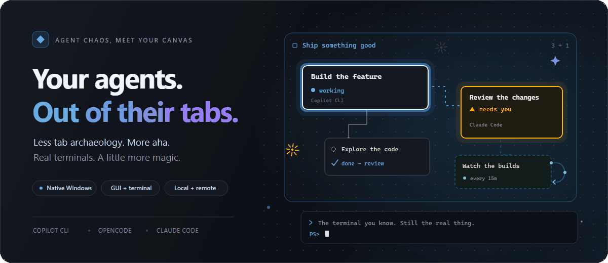
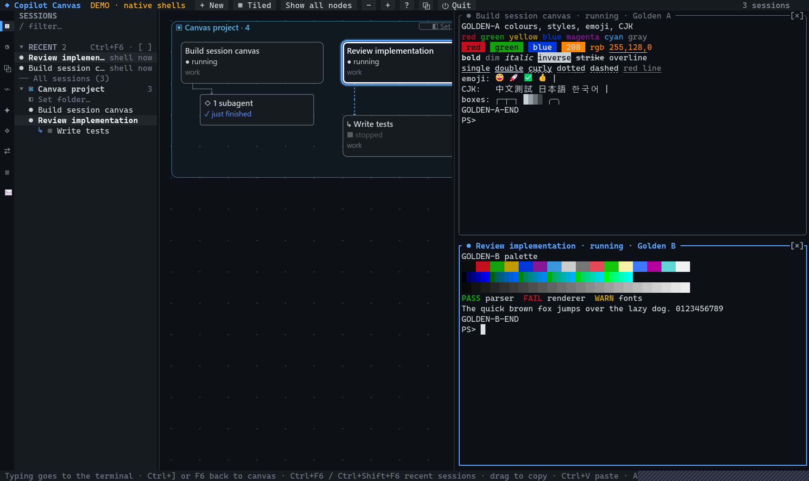
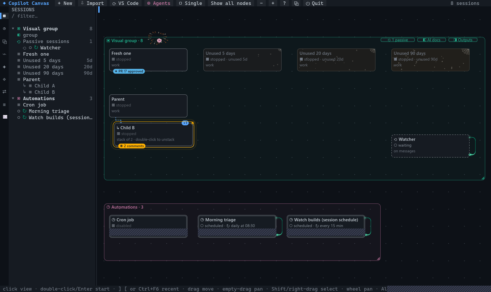
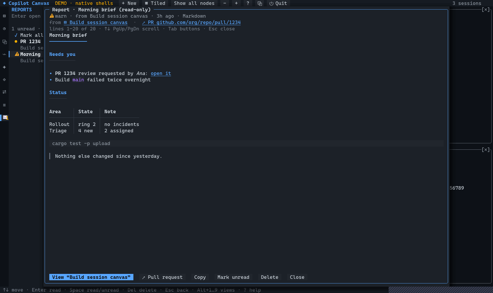

<h1 align="center">✦ Copilot Canvas</h1>

<p align="center">
  <strong>Big agent energy. Much less tab chaos.</strong><br>
  A native, spatial workspace for GitHub Copilot CLI, OpenCode, and Claude Code.
</p>

<p align="center">
  <a href="https://github.com/TomND/copilot-canvas/releases"><strong>🚀 Grab the preview</strong></a>
  &nbsp;&middot;&nbsp;
  <a href="#quick-start">Get started</a>
  &nbsp;&middot;&nbsp;
  <a href="#in-its-element">See the app</a>
  &nbsp;&middot;&nbsp;
  <a href="#remote-mode">Connect from home</a>
  &nbsp;&middot;&nbsp;
  <a href="#documentation">Explore the docs</a>
</p>

<p align="center">
  <a href="https://github.com/TomND/copilot-canvas/actions/workflows/ci.yml">
    
  </a>
</p>

<p align="center">
  <picture>
    <source media="(prefers-reduced-motion: reduce)" srcset="docs/assets/canvas-hero.svg">
    
  </picture>
</p>

## Your agents called. They want more space.

Give each conversation a place. Group related work, follow the subagents,
and spot the session that needs you without opening every terminal.
Zoom out for the whole picture; step into a box for the **real agent CLI**.
No replacement chat UI. No conversation to copy across.

The GPU client and terminal UI share one persistent service. Detach a window
and your hosted sessions keep running; reopen locally or connect from another
PC to the same canvas and live terminals.

<table>
  <tr>
    <td width="50%" valign="top">
      <h3>🗺️ Room for every rabbit hole</h3>
      <p>An infinite canvas, nested groups, linked subagents, and stackable subsessions. Arrange work the way you think about it.</p>
    </td>
    <td width="50%" valign="top">
      <h3>⌨️ No terminal cosplay</h3>
      <p>Copilot CLI, OpenCode, and Claude Code in real native terminals. Go single-pane or tile up to four sessions.</p>
    </td>
  </tr>
  <tr>
    <td valign="top">
      <h3>🧭 Pick up the thread</h3>
      <p>Persistent terminals, shared canvas edits, and recent-session navigation. Close the client, not the conversation.</p>
    </td>
    <td valign="top">
      <h3>✨ A canvas with a sixth sense</h3>
      <p>Gold when a session needs you. Blue when its work is ready for review. Borders and icons carry meaning alongside colour.</p>
    </td>
  </tr>
  <tr>
    <td valign="top">
      <h3>🛰️ Put the boring bits on watch</h3>
      <p>Passive sessions and canvas-wide agents react to events, follow schedules, and use the skills you assign them.</p>
    </td>
    <td valign="top">
      <h3>💌 Findings, not scavenger hunts</h3>
      <p>An inbox for agent reports, briefs, and updates. Read Markdown or sanitized HTML without leaving the canvas.</p>
    </td>
  </tr>
</table>

## In its element

<p align="center">
  <a href="tests/golden/gui/terminals-tiled.png">
    
  </a>
  <br>
  <sub>The real GPU client, running demo shells. Your workspace on the left; your terminals on the right.</sub>
</p>

<table>
  <tr>
    <td width="50%" valign="top">
      <a href="tests/golden/gui/visuals.png"></a>
      <h3>A canvas with a pulse</h3>
      <p>Watchers loop, important work catches your eye, and unused sessions gather dust. Reduced motion is built in.</p>
    </td>
    <td width="50%" valign="top">
      <a href="tests/golden/gui/report-viewer.png"></a>
      <h3>From running to readable</h3>
      <p>Morning briefs, investigation notes, and short updates land in one shared reports inbox.</p>
    </td>
  </tr>
</table>

<p align="center"><sub>Actual app screenshots from the demo and golden-image fixtures. The opening artwork is an illustration; its motion respects your reduced-motion preference.</sub></p>

## Quick start

### Download the Windows preview

Get the ZIP from [Releases](https://github.com/TomND/copilot-canvas/releases)
and extract it. Keep **`copilot-canvas.exe` and `copilot-canvas-gui.exe` together**.
No Rust or Zig installation is needed to run the prebuilt programs.

```powershell
.\copilot-canvas.exe --gui --demo   # explore safely: demo shells, no agent prompts
.\copilot-canvas.exe --gui          # open your real session workspace
```

Install and sign in to at least one supported agent CLI on the machine that
will run your sessions. A remote-only home PC needs the Canvas client and
Dev Tunnels instead; the agent CLIs stay on the host.

> [!NOTE]
> The downloadable build is a **preview**. This README describes `main`;
> screenshots and features can be ahead of the published preview.

### Build from source

Use Windows with the stable Rust MSVC toolchain, Visual C++ build tools and
the Windows SDK. The default terminal engine also needs **Zig 0.17.0**;
see the [Ghostty build guide](docs/GHOSTTY.md).

```powershell
git clone https://github.com/TomND/copilot-canvas.git
cd copilot-canvas
cargo xtask build-ghostty                 # once per pinned engine version
cargo build --release                    # builds both executables
.\target\release\copilot-canvas.exe --gui --demo
```

Prefer the terminal UI? Run `.\target\release\copilot-canvas.exe --tui`
(a Windows Terminal window of at least 140 by 40 is comfortable).
Without Zig, `cargo build --release --no-default-features` uses the alacritty
terminal engine instead. Optional: `cargo install --path .` puts the CLI/TUI
on your PATH; the GPU client still needs its executable beside it.

### Make it yours

- **Agents.** New sessions use the first installed of Copilot, OpenCode and
  Claude Code; pick another per session in the new-session dialog (*Agent*), per
  canvas in *Settings › Agent for new sessions*, or for the machine with
  `copilot-canvas config agent opencode`. Each agent's sessions, status,
  subagents and configuration views come from its own history and CLI. See
  [docs/AGENTS.md](docs/AGENTS.md) for how each agent is launched, resumed and
  forked, how its status is read, and what is verified end to end.
- **Clients.** `copilot-canvas` opens the client set by
  `copilot-canvas config client tui|gui|auto` (default `tui`; `auto` picks the
  GUI except over remote desktop or SSH); `--tui` and `--gui` override it. In
  either client, **O** opens the same canvas in the other one (same service,
  same document). See [docs/GUI.md](docs/GUI.md).
- **Remote mode.** Agents run on one PC (say a Cloud PC), the canvas on another,
  over a private Dev Tunnel with pairing: `copilot-canvas remote tunnel-setup`
  and `remote pair` there, `remote add NAME --tunnel ID --code CODE` and
  `copilot-canvas --remote NAME` at home. See [docs/REMOTE.md](docs/REMOTE.md).
- **iPhone.** The same canvas on your phone over the same Dev Tunnel:
  sessions by what needs you, the canvas, real terminals with a key bar
  and a prompt composer, and the reports inbox (HTML reports in a locked-down
  web view). `copilot-canvas remote pair --qr` on the Cloud PC,
  scan it in the app. See [ios/README.md](ios/README.md) and
  [docs/IOS-PLAN.md](docs/IOS-PLAN.md).
- **Terminal engine.** Terminals run on libghostty-vt (graphemes, Kitty
  keyboard, underline styles, images); `copilot-canvas config engine alacritty`
  switches back. See [docs/GHOSTTY.md](docs/GHOSTTY.md).

On first run the canvas imports your 8 most recent sessions. If the Node
prototype's `~/.copilot-canvas/layout.json` exists, its layout is migrated.

> [!IMPORTANT]
> New agent launches use allow-all permissions by default. Choose
> **Settings &rsaquo; Permissions &rsaquo; ask** if you want approval prompts.
> A session already running in another CLI or VS Code terminal stays there;
> Canvas never starts a second copy.

## Remote mode

**Run the agents on your Cloud PC. Keep the canvas at home.**
The service owns the terminals and shared document; your client brings the
canvas, keyboard, clipboard, and report viewer.

| Where the work runs | Where you sit |
|:---|:---|
| Agent CLIs, repositories, session history, persistent terminal service | Native GUI or terminal UI, your own view and layout preferences |
| Private Dev Tunnel host on loopback | Authenticated tunnel connection and a paired client |

On the **host**, run `remote tunnel-setup` and complete the one-time tunnel
creation, sign-in, and hosting steps it prints. Then pair your home PC:

```powershell
# On the host: generate a single-use code, valid for 10 minutes
copilot-canvas remote pair --name home-pc

# At home: sign in to Dev Tunnels with the same account, then connect
copilot-canvas remote add cloudpc --tunnel TUNNEL_ID --code PAIRING_CODE
copilot-canvas --gui --remote cloudpc
```

Follow the [complete remote guide](docs/REMOTE.md) or
[compact setup checklist](docs/REMOTE-SETUP.txt) for installation and recovery.
Choose **Detach** when you close the client to leave the hosted sessions running.

> [!IMPORTANT]
> Pair only your own trusted machines: a paired client can act as you on the
> host. A restart preserves conversation history, not in-process work or loops.

## Features

The highlights above are the short tour. Expand the reference for the exact
behaviour, shortcuts, and agent-specific details.

<details>
<summary><strong>Open the full feature reference</strong></summary>

| | |
|---|---|
| **Canvas** | Drag boxes (subagents follow their session), drag empty space to pan, wheel/Shift+wheel pan, Alt+wheel / Ctrl+wheel / toolbar − + to zoom (100 %, 50 %, 25 %), double-click empty space to create a session there, right-click for context menus |
| **Undo and redo** | **Ctrl+Z** takes back this window's latest change to the canvas, one gesture at a time: a drag of boxes (their subagent boxes and stacks with them), of a stack or of a group (everything in it, nested groups too), a group's ◢ resize, *Fit to members*, a burst of arrow-key moves (presses less than a second apart are one step), and, as before, a removal or a VS Code sync. Successive presses go further back (100 steps per window, newest first); every item returns exactly where it was (and a group to its size). **Ctrl+Y** or **Ctrl+Shift+Z** redoes undone moves and resizes. An undo is an ordinary canvas edit, so other windows and a remote canvas see it; it never starts, stops or changes a session, never brings back a box that was removed since, and leaves boxes another window moved since where they are (a notice says what it skipped). Stacking or showing subagent boxes and subsessions, hiding them, zoom and pan are not undo steps (`K` and `H` toggle back); a drag carries the boxes folded into a session's deck, and its undo puts them back too. The status bar names each step (*Moved group “Payments” (4 boxes) · Ctrl+Z undo move*), the canvas menu has *Undo move* and *Redo*. While a terminal has the keyboard Ctrl+Z goes to its program, and in text fields it is theirs |
| **Status** | Accurate within a fraction of a second for canvas sessions: Copilot's own progress report (set when a turn starts, cleared when it ends) drives working and done; history events add needs-you, failures and sessions running elsewhere; a session whose subagents are still running stays working. States: working (spinner), needs you (permission / question), **done · review** (finished a turn you haven't looked at yet; stays until you open, click or type in that session), idle, stopped, failed, and **↗ open elsewhere** for sessions running in another terminal or VS Code. Sessions that **need you** get a gold heavy ━ border and sessions that are **done · review** a blue double ═ border with a blue-tinted box (boxes, terminal panes and sidebar names). Pressing Esc in Copilot (abort) doesn't count as done. The session whose terminal is active on the right has a blue halo around its box (heavy while you type in it) |
| **Colour-blind safe** | The palette avoids red/green: OK is sky blue, failure is vermillion, attention is gold, finished is blue, selection is white, groups use the Okabe-Ito colours; every state also has its own icon and border shape |
| **Subagents** | Discovered from session history (Copilot's `subagent.*` events, OpenCode task-tool children, Claude Code `Agent` calls) as boxes linked to their session. By default they are **folded into a slim deck** beneath the session, one card for all of them: **◇ 12 subagents** with the most important state of what it holds (failed first; **working · 2 of 12** while any runs; just finished), so they never fill the canvas and folding never hides activity (the session itself stays working while a subagent runs; effects on a folded box show on the deck). A click on the deck lists them in the session's details panel (state, a click on a name views that subagent, **Inspect** opens its transcript; nothing starts). A double-click on the deck, `K` or the session's menu (*Show subagents* / *Stack subagents*) shows them at exactly their saved places; a box found while they were folded gets a slot of its own (and its group grows) the first time it is shown. The choice is per session, kept in the canvas (every window and client sees it, also after a restart); *Settings › Subagents* (**stacked** by default, or shown) applies to sessions without a choice of their own. Folded boxes take no room: new boxes, *Show all nodes*, *Fit to members* and new groups use the deck; they still move with their session and its group, and count as members of their session's group |
| **Inspect transcript** | Any session or subagent box (menu, details panel): a read-only transcript of its conversation (prompts, answers, tool calls with their result or exit code), newest at the bottom, refreshing every 1.5 s while it runs; nothing starts, nothing is written, it works remotely too. A finished OpenCode child session whose parent is stopped resumes in a terminal of its own as a new linked subsession (**Resume as subsession** or a double-click); Copilot and Claude Code subagents are part of their parent's conversation (see [docs/AGENTS.md](docs/AGENTS.md#inspecting-and-resuming-child-conversations)) |
| **Subsessions** | `S` or menu → a new Copilot session linked to its parent (dotted connector, nested in the sidebar). By default it **forks the parent's conversation** (as Copilot's `/fork` and VS Code do: history and checkpoints are copied, the running parent is untouched); choose *Start fresh* for an empty one. Sessions an agent starts itself from inside a canvas session (`copilot -p …`, `copilot --resume …`) are detected from the process tree and added as linked subsessions automatically |
| **Stacks and hidden subsessions** | Right-click a session › *Stack subsessions* (or `K`) gathers all its subsessions (recursively, with their subagents) into a deck beneath it: offset cards, the newest on top, a **+N** badge, and the stack's most important status (needs you, failed, done · review, working) on the top card, so stacking never hides activity; effects on a stacked session show on the deck. **One deck per session**: a stacked session's folded subagent boxes are in the same deck. `K` on a session (or on a box in its deck) unfolds everything it has folded (its subagent boxes and its subsessions), else folds both; where a session has both, its menu offers them separately (*Show/Stack subagents*, *Unstack/Stack subsessions*) and together (*Unfold all* / *Stack all*, `K`). A click on a stack shows its top card (it never starts anything); dragging a deck moves the session with it; a double-click, `K` or the deck's menu unfolds it: the boxes go back exactly where they were (their positions stay in the canvas, so this survives restarts and every window sees it). `H`, the canvas menu (*Hide subagents and subsessions*) or the toolbar's **↳ N hidden** hides every subsession and subagent box (each parent shows **⋯ N hidden**, **◇ N hidden** for subagent boxes, or both; the toolbar counts them all) and shows them again in place. The GUI animates both (about 300 ms, eased, reversible mid-way, then idle); the TUI and reduced motion switch at once |
| **Looping sessions** | A session that repeats on a schedule gets a loopback arc on its right side with a lit dot running around it (bluish green), `↻ every 15m` in its status line and `↻` in the sidebar. The dot's place comes from the clock, not from frames, so it never jumps or restarts and keeps gliding while you pan, zoom or drag the box. GUI: a comet with a fading tail that leaves the box quickly, eases round the far bend and sends a soft ring through the arrowhead after each lap; a loop that starts grows its arc in, one that stops fades it out; only loops in view move, redrawing their own layer at about 30 frames/s (fewer when zoomed out). TUI: the dot steps cell by cell at one speed with a two-cell trail, redrawn only when it changes cell. With reduced motion (*Settings › Effects*, or Windows' *Show animations* off) the arc, its lit arrowhead and a `↻` badge stand still and loops switch at once. Detected from Copilot's schedule events (`/every`, the `manage_schedule` tool: created → looping, cancelled or session ended → not; the next status update shows it, and the saved schedules are read again then), Copilot's saved session schedules, and enabled repeating automations. Zoomed out, a breathing `↻` |
| **MCP servers per session** | The new-session dialog has an *MCP servers* row: a checklist of your servers with presets (*All*, *None*, and your own: `Ctrl+S` saves the current choice, `←/→` switches, `Del` deletes). The last choice is the default next time; each session remembers its own choice for every resume (`--disable-mcp-server`). Change it later from the session's menu → *MCP servers…*. Every server is several processes in every session, so trimming them is the biggest saving in memory and CPU |
| **Groups** | Shift-drag or right-drag to select (from anywhere, on a box too: a Shift-drag never moves a box), then `G` (or menu) draws a group box around them; a click on a group's empty background or its border (a few pixels around the outline in the GUI) selects it (the innermost of nested groups; a drag there still pans); drag the title to move everything inside, drag `◢` to resize; nested groups work; membership is geometric, like Obsidian canvas |
| **Area selection** | The band takes every box it touches as drawn, at every zoom: sessions, subsessions and subagent boxes alike, so a parent and its children can be selected together (and moved, grouped or removed together: each box moves once, also a child whose selected parent drags it along). Boxes in a deck (stacked subsessions, folded subagent boxes) or hidden with `H` are left out; automation boxes stay with their group. Shift- or Ctrl-click toggles one box; a right-click without dragging opens the menu of what is under it. Nothing is ever started or dragged by a selection |
| **Sidebar** | Groups → their folder row (◧) → sessions → subsessions → subagents (all of a selected session's, the running ones of the others; folded ones too: a click views that subagent's details and flies to its deck without unfolding it) → the group's passive sessions (⟲, a click opens their panel); stacked and hidden subsessions are listed dimmed, unused sessions with their age; `/` filters; click any row to fly the canvas to it, highlight it and view it (its live terminal, or its details); double-click or Enter starts it; group rows tile the group's running terminals (never starting stopped ones) |
| **Recent sessions** | A **RECENT** section tops the Sessions panel: the sessions you used last (viewed, started or typed into), newest first, up to 8 (fewer in a short window), each with its status, agent and how long ago; a click on its header folds it. It is kept in the canvas document, so every window and client of the canvas (the home GUI and the Cloud PC alike) shows the same list, and removed boxes leave it. A click views a row, a double-click or Enter starts it (as elsewhere). **Ctrl+F6** / **Ctrl+Shift+F6** (anywhere, also while a terminal has the keyboard) and **`]`** / **`[`** (on the canvas and in the sidebar) step to the next older or newer recent session and only view it (its live terminal, or its details panel with Start / Resume); repeated presses walk the list without reordering it, and a second after the last one (or at any other key or click) the session you stopped on becomes the most recent, as with Alt+Tab |
| **View versus start** | A click (canvas or sidebar), Tab, the arrows and the recent-session keys (Ctrl+F6, Ctrl+Shift+F6, `]`, `[`) only select and show: a running session's terminal comes into view with the keyboard, anything else shows a details panel (agent, status, folder and branch, last used, what starting it would do) with one primary button: **Start** (a new conversation or a box's command), **Resume** (its conversation) or **Open terminal**, plus Stop, MCP servers… and Remove. Only a double-click, Enter, that button or a menu item starts a session. Restoring tiles, reconnecting and clicks on exited terminals start nothing; sessions open elsewhere (↗) never get a Start / Resume |
| **Terminals** | Real Copilot CLI in ConPTY; single view or up to four tiles (`T`); terminals keep running when you close the canvas and reappear when you reopen it |
| **Scrolling** | The wheel goes to the app like in Windows Terminal: mouse-wheel events when Copilot's `mouse` setting is on (its default; 3 lines per notch), PageUp/PageDown on its full-screen view when it is off, scrollback otherwise; Shift+wheel or Shift+PgUp always scroll the scrollback |
| **Your messages** | In Copilot terminals your own prompts get a navy background and a blue ▎ bar so they stand out from Copilot's output (recognised from how Copilot draws them: " ❯ text" and its indented continuation lines) |
| **Copy & paste** | Drag inside a terminal to select; releasing copies it. Copies keep line breaks (CR LF), blank lines, indentation and spaces inside lines; lines a shell soft-wrapped rejoin (the terminal engine's own wrap state, so a line that just fills the width or a border in the last column never joins the next row). On full-screen views (Copilot, OpenCode, vim) every row is a line, and Copilot's scrollbar column is left out. Ctrl+C / Ctrl+Shift+C copy while text is selected (otherwise Ctrl+C reaches Copilot); Ctrl+V / Ctrl+Shift+V paste; the pane's right-click menu has Copy / Paste. **A paste never sends a message**: multi-line text (Ctrl+V, the pane menu, Windows Terminal's paste, IME text) reaches the agent as one bracketed paste whose line breaks stay text, a trailing line break is dropped, and a program without bracketed paste gets Shift+Enter or Alt+Enter between lines, never Enter ([docs/AGENTS.md](docs/AGENTS.md#pasting)) |
| **Images** | Copy a screenshot and press **Alt+V** (or Ctrl+V, or the pane menu's *Paste*): Copilot attaches it (`[📷 …png]`). With no text on the clipboard the canvas sends the keystroke and Copilot reads the image itself. Windows Terminal keeps Ctrl+V for its own text paste, so with only an image on the clipboard Ctrl+V never reaches any app there; use Alt+V |
| **Copilot's terminal features** | Clicks reach Copilot when its `mouse` setting is on (its tab bar, "click here" actions); drags still select text in the canvas. Copilot's title (its current intent) shows in the pane header. Its progress report (OSC 9;4) drives the spinner instantly and the canvas mirrors overall state to the Windows Terminal tab and taskbar (busy while any session works, yellow while one needs you). Bells and OSC 777 notifications (Copilot's `beep` / `terminalNotifications` settings) ring Windows Terminal |
| **Links** | URLs, OSC 8 hyperlinks and absolute Windows paths are underlined. In terminals Ctrl+click opens them, elsewhere a click does. Web links open in your browser, folders in Explorer, files in VS Code at the line (or revealed in Explorer); nothing is ever executed |
| **New session** | Name, folder (type, **Browse…** folder picker, or **Recent ▾**), Git detection with current branch, **New Git worktree** (base branch picker, new branch, path), the **Model** it starts with (see below), optional first prompt |
| **Default model** | The new-session dialog shows the model a session will start with and why: the group's (*from group X*), the one you chose before (*remembered default*), or the initial default, **Claude Opus 5.5** in each agent's own id (`claude-opus-5.5` for Copilot, `github-copilot/claude-opus-5.5` for OpenCode, `claude-opus-5-5` for Claude Code). Its picker lists the agent's models (`opencode models`, the choices in `copilot --help`, Claude Code's aliases) and takes any id you type. A model you pick there starts that session and becomes that agent's default for every later new session (kept in the canvas, so it survives restarts and reaches your other windows) until you pick another, there or in *Settings › Copilot / OpenCode / Claude Code model* (which also resets it). A group's own model (*Session defaults for group…*) wins in that group; picking another there applies to that session only and changes neither the group nor the canvas default. Every session records the model it started with (details panel) and keeps it: a new default never changes existing sessions or their resumes ([docs/AGENTS.md](docs/AGENTS.md#models)) |
| **Import / sync** | `I` Copilot sessions (filter, multi-select, group by folder or client); `V` or toolbar **⟳ VS Code** syncs VS Code agent sessions (see below) |
| **Activity bar** | VS Code-style icons on the far left (`Alt+1…9`): ▤ Sessions · ◷ Automations · ⧉ Plugins · ⌁ MCP servers · ✦ Skills · ◈ Agents & instructions · ⇄ VS Code · ≡ Settings · ✉ Reports (with its unread count) |
| **Reports** | An inbox of reports and short messages agents publish (`copilot-canvas report publish`: Markdown, HTML or a one-line message; a morning brief, a triage report, "PR X received 12 new comments; dispatched the owning session"). The activity bar's ✉ shows how many are unread; new ones also get a notice (and in the GUI a toast and a flashing taskbar button while it is in the background). Click one to read it in the canvas: Markdown formatted, HTML in the GUI's locked-down WebView2 view; reading it never starts its session. See [Reports](#reports) |
| **Dusty sessions** | Sessions you have not used for a while (started, typed into, or agent activity; looking at one does not count) gather dust: the TUI dims them, the GUI drains their colour and adds specks and a cobweb that grow with age (from *Settings › Dust unused sessions after*: off / 1 / 3 (default) / 7 / 14 days; medium from 14 days, heavy from 60), and the status line and the sidebar show **unused 12d**. Anything important (working, needs you, done · review, failed, open elsewhere, looping, passive sessions, an effect) is never dusty. The canvas menu's *Select unused sessions* selects them for a cleanup; nothing is ever removed automatically |
| **Effects** | Passive sessions (and sessions) can put an effect on a box of their group until you click it: **fireworks** (an approved pull request), **attention** (a pulsing beacon: review requested, changes requested, comments), **sparkle** (a short success), **alert** (`copilot-canvas effect`, below). The service keeps them, so every window and the TUI show them, also after a restart. A click on the effect (or its box) clears it everywhere and only selects the box. GUI: fireworks bursts and rings at 12.5 frames/s, only while in view; *Settings › Effects*: on, reduced motion (still rings and badges) or off (badges only); the default follows Windows' *Show animations*. TUI: a badge (✦ ◉ ✧ ▲) on the box |
| **Group folders** | Each group has a folder (asked when you create the group; suggested `~/.copilot-canvas/groups/<name>`) with `ai-docs/` and `human-outputs/`. Open them from the group's title chips **◧ AI docs** / **◨ Outputs** (compact **◧** / **◨** when zoomed out or narrow, **◧ Set folder…** before a folder is chosen; the chips stay clickable at every zoom while the title shows), the sidebar's **◧** row under the group (a menu: AI docs, outputs, the group folder, `GOALS.md`, change folder), its menu, or its details panel. In remote mode (any `--remote`, `loopback` included) folders open in VS Code through the server's tunnel or in the canvas's **folder browser** (subfolders and files; Enter or a click opens a file in the read-only viewer, Backspace goes up, *Copy path*), never in Explorer on the service's machine. Sessions launched in the group get `--add-dir` for both and group instructions (via `COPILOT_CUSTOM_INSTRUCTIONS_DIRS`) telling Copilot to write notes to `ai-docs` and deliverables to `human-outputs` |
| **Canvas-wide agents** | Passive agents that watch the whole canvas, not one group: the top bar's **◎ Agents** lists them with their state (monitoring, working, paused, needs attention, failing, done, off, unavailable), triggers, skills, next run and last report, and controls (Run now, Pause / Resume, Stop, Disable / Enable, Open); each is also a dashed **◎** box in the **Canvas agents** frame (the same agent). They get events of every group, message any session, and use the canvas skills (SKILL.md) you give them. See [Canvas-wide passive agents and skills](#canvas-wide-passive-agents-and-skills) |
| **Pull request coordination** | A session that publishes a pull request hands it to the canvas (`copilot-canvas pr track URL`, taught by the `canvas-prs` skill); the canvas checks it read-only with your own `gh` / `az` for new review comments, failing checks and its end, and the canvas-wide **PR coordinator** turns what is new into one follow-up for the owning session, typed in when that session is idle; queued, delivered, blocked and failed show in ◎ Agents › Pull requests and in Reports. See [Pull request coordination](#pull-request-coordination) |
| **Review follow-ups** | When a review session finishes reviewing someone's pull request it hands the results off (`copilot-canvas review handoff`, the `canvas-review-followup` skill); the canvas-wide **Review follow-up** agent drafts a message to the author, you approve it, it sends it through the channel you configured (an MCP server such as Teams, a PR comment, or a folder), and every hour it reads only those conversations for requests for another review, which reach the review session that did the review, once. See [Review follow-ups](#review-follow-ups) |
| **Copilot defaults** | Settings view: permissions (`allow-all` by default, or `ask`), each agent's model for new sessions, reasoning effort, start mode, custom agent, context tier, extra `--add-dir` folders for new sessions; any group can override them (group menu → *Launch defaults*). Also lists `copilot config` settings and edits them through `copilot config` |
| **Plugins · MCP · skills** | Lists come from `copilot plugin/mcp/skill/instruction list --json`; Space enables/disables, Del removes (confirmed; servers and skills that come from a plugin, the project or Copilot itself can only be disabled), **+** rows add a skill, an MCP server (`copilot mcp add` syntax) or install a plugin (runs in a canvas terminal so you can answer prompts). Secrets (env, headers) are never shown |
| **Automations** | Reads Copilot's automations (`~/.copilot/data.db`: scheduled workflows, their last 10 runs, and per-session schedules). They appear in the Automations view and as ◷ boxes in a special **Automations** group on the canvas. Click one for its prompt, schedule, model, mode, project, last/next run and run history; Space or the button enables/disables a scheduled workflow (per-session schedules are managed with `/every` in that session). Refreshes every 15 s |
| **Migrate from VS Code** | VS Code view → *Migrate skills & settings…* previews VS Code (Code, Insiders, all profiles) MCP servers, instruction files, prompt files (as skills), custom agents / chat modes and skill folders, marked new / already present / conflict / manual. Applies only the items you tick: backs up `~/.copilot` config first, never overwrites, writes a redacted `migration-log.txt` |

</details>

## Documentation

| Find your way | Go deeper |
|:---|:---|
| [**Native GUI**](docs/GUI.md) &mdash; rendering, accessibility, screenshots | [**Agent providers**](docs/AGENTS.md) &mdash; launch, resume, models, transcripts |
| [**Remote workspace**](docs/REMOTE.md) &mdash; pairing, reconnect, trust model | [**Backend and shared document**](docs/BACKEND.md) &mdash; one service, multiple clients |
| [**Terminal engine**](docs/GHOSTTY.md) &mdash; libghostty-vt and its pinned build | [**Feature parity**](docs/PARITY.md) &mdash; GUI and TUI coverage |
| [**Architecture**](#architecture) &mdash; how the pieces fit together | [**Measured performance**](#performance-measured) &mdash; workloads and reproducible probes |
| [**Reports**](#reports) &mdash; publish briefs and updates | [**Safety**](#safety) &mdash; permissions, history, remote access |
| [**Commands**](#commands) &mdash; the CLI reference | [**Plan and status**](PLAN.md) &mdash; roadmap and remaining work |

## Controls

| Action | Mouse | Keys |
|---|---|---|
| View a session (its live terminal, or its details) | click box or sidebar row | Tab cycles, arrows move |
| View the next / previous recent session (never starts it) | sidebar **RECENT** row | **Ctrl+F6** / **Ctrl+Shift+F6** (also in a terminal), `]` / `[` on the canvas or sidebar |
| Start / resume a session and focus its terminal | double-click box or sidebar row; details panel **Start** / **Resume**; menu | Enter |
| Move | drag box (or group title) | arrows (Shift = faster); Ctrl+Z undoes |
| Pan | drag empty space, middle-drag, wheel | Ctrl+arrows |
| Zoom / recover the canvas | Alt+wheel, toolbar − +; **Show all nodes** fits visible boxes, stacks and groups with padding | `+` `-`, `F` show all nodes, `C`/Home center selection |
| Select several (sessions, subsessions, subagent boxes; not those in a deck or hidden) | Shift-drag or right-drag, starting anywhere (on a box too); Shift/Ctrl+click toggles a box | Tab cycles sessions |
| Group selection | context menu | `G` |
| Select a group | click its empty background or its border (or its title, its sidebar row) | arrows move it, Del deletes the group box, `R` renames |
| New session / subsession | toolbar **+ New**, double-click, menu | `N` / `S` |
| Rename · remove · stop | context menu | `R` · Del · `X` |
| Remove several boxes (running sessions kept, history kept; asks first) | select them, right-click one → **Remove N from canvas** | Del; Ctrl+Z restores them |
| Import · sync VS Code | toolbar **Import**, **⟳ VS Code** | `I`, `V` |
| Switch side view | activity bar | `Alt+1` … `Alt+9` |
| Read a report or message | Reports (✉) row | `Alt+9`, then Enter; Space read/unread, Del delete; in the viewer ↑↓ scroll, ←/→ older/newer in a thread, Ctrl+C copy, Esc close |
| In a list view | click row | ↑↓, Enter open/edit, Space enable/disable, Del remove, Esc back |
| Tile terminals | toolbar | `T` |
| Leave a terminal | click canvas/sidebar | **Ctrl+]** or F6 |
| Copy / paste in a terminal | drag to select; pane menu | Ctrl+C (with selection) · Ctrl+V / Ctrl+Shift+V |
| Open a link | click (Ctrl+click in terminals) | — |
| Undo / redo this window's last move, resize, removal or VS Code sync (one gesture per step, newest first) | canvas menu (*Undo move*, *Redo*), VS Code view | **Ctrl+Z** · **Ctrl+Y** or Ctrl+Shift+Z |
| Quit (sessions keep running) | toolbar **⏻ Quit** | `Q` / Ctrl+Q, even while filtering (asks: detach or stop all) |
| Show / stack a session's subagent boxes and subsessions (one deck beneath it; subagent boxes are stacked by default) | session menu (*Show/Stack subagents*, *Unstack/Stack subsessions*, *Unfold/Stack all*); a click on a subagent deck lists them (nothing starts), a double-click unfolds it | `K` (unfolds whatever is folded, else folds both) |
| Subagent boxes stacked or shown by default (a session's own choice wins) | *Settings › Subagents* | Enter on the row |
| Hide / show all subsessions and subagent boxes | canvas menu; toolbar **↳ N hidden** | `H` |
| Clear an effect | click it (or its box; nothing starts) | — |
| Canvas-wide agents (their panel) | top bar **◎ Agents**; the *Canvas agents* frame's **◎ N · manage** chip | `A` |
| Select unused (dusty) sessions | canvas menu › *Select unused sessions* | then Del removes them from the canvas |
| Help | toolbar `?` | `?` |

While a terminal has focus, every key goes to Copilot (including Ctrl+G,
Ctrl+Q and Ctrl+Z). Only **Ctrl+]** and **F6** are reserved, plus **Ctrl+F6** /
**Ctrl+Shift+F6** (recent sessions; the agents do not use them, and Windows
Terminal and the console host pass them on), Ctrl+C while text is selected
and Ctrl+V (paste), as in Windows Terminal.

## VS Code sync

`V` (or the toolbar / VS Code view) adds VS Code agent sessions that are not on
the canvas yet. Boxes are named with VS Code's session and chat titles; existing boxes are renamed to them too unless you renamed the box on the canvas (VS Code renames carry over on the next sync). Each Agents-window session's **sub-sessions** (extra chats) come along as linked subsession boxes next to it. A session is synced when it was **created in VS Code**
(Copilot records `client_name: vscode-agent-host`) or when you filed it into an
**Agents-window group**, and it was active within the window (default 48 h;
change it in the VS Code view). Sessions VS Code merely lists because they were
started in Copilot CLI (scripts, pipelines, terminals) are skipped unless you
tick *Include CLI-started sessions*; archived ones unless you tick *Include
archived*. Placement: Agents-window group → canvas group of the same name;
otherwise the VS Code workspace; otherwise the session's folder
(`VS Code · <folder>`). A session filed in both a stable VS Code and an
Insiders group goes to the stable one.

Sync **only adds**: new boxes, sub-session links and names (for boxes you have
not renamed). It never moves existing boxes or removes groups, so your
arrangement is yours. New boxes are placed so a group never grows over its
neighbours (overflow goes to a "Name (2)" group). Before each sync the canvas is
saved to `~/.copilot-canvas/backups/` (newest 30 kept) and **Ctrl+Z** undoes the
last sync (while it is the window's latest change). *Sync when canvas opens* runs it on start. All VS Code storage is
read-only.

## Passive sessions and events

A group can hold **passive sessions**: ordinary Copilot sessions that watch the
group instead of being driven by you, e.g. a drift guard that checks every PR
push against the project's goals, or a rollout tracker that follows a merged PR
daily. Right-click a group › **New passive session…** and pick a template
(*Drift guard*, *Rollout tracker*, *Custom*). They are drawn dashed with ⟲ in
the group's passive area; clicking one opens its panel (status headline, next
run, triggers, recent group events, Run now / Pause / Edit / Open chat / Open
folder).

- **Files are the source of truth**: `<group>/.canvas/passive/<slug>/rules.md`
  (what to do; edit freely), `state.md` (its memory between runs), `log.md`,
  `group-context.md` (refreshed digest of the group's other sessions), plus
  `<group>/ai-docs/GOALS.md` and the group's event catalog
  `<group>/.canvas/events.yaml`.
- **Triggers**: subscribed events (`pr.pushed`, `pr.*`, `*`, optional text
  filter), *every N minutes*, *daily at HH:MM* (local time) and follow-ups it
  schedules itself. Events arriving within 8 s are coalesced into one run.
- **Runs** are headless `copilot --resume <id> -p …` turns started by the
  service (no process stays alive between runs, at most 2 at a time), so it is
  one continuous conversation. A passive session runs the canvas's default
  agent (`opencode run -s ses_… --auto`, `claude -p -r …` for the others) with
  the model new sessions of that agent in its group get (the group's, the
  remembered or the initial default), on every run; a conversation whose
  model is recorded on its box (you started its chat) keeps that model when a
  run resumes it. After *rollover* runs (default 20) it starts a
  fresh conversation that reads its files; old ones are kept as episodes. If
  you have its chat open and idle, the run is typed in there instead.
  Budget: *max runs per day* (default 24); failures back off 1 / 5 / 30 min
  and alert after 3.
- **Events**: sessions launched from the canvas get the `canvas-events`,
  `canvas-passive` and `canvas-reports` skills (`--plugin-dir
  ~/.copilot-canvas/plugin`) and the `copilot-canvas` CLI on `PATH` (the
  demo's shells get the command too). `git push`, PR creation/update/merge/comments
  (git, `gh`, `az repos`, ADO MCP tools) are also **detected from session
  history** automatically. You can send one by hand from a group's menu
  (*Send event…*). Events pulse on the canvas.
- **Effects**: `copilot-canvas effect fireworks|attention|sparkle|alert --on NAME
  [--note TEXT]` puts an effect on a box of the sender's group (`--on group`:
  the group) until someone clicks it; `effect clear --on NAME [--kind K]`
  takes it off. Only boxes of the sender's own group can be named, and the
  note is one short line of untrusted text. The group's event catalog can map
  event types to effects (`effects:` `pr.approved: fireworks`; new catalogs map
  `pr.approved`, `pr.changes_requested` and `pr.review_requested`), shown on
  the sending session's box. The *Rollout tracker* template celebrates
  approvals with fireworks and marks review requests and comments with
  attention; the *Drift guard* marks scope creep.
- **Within reach**: every group has a labelled place for its passive
  sessions. The sidebar shows a **⟲ Passive sessions N** row under each group
  (its passive sessions listed beneath it), or **⟲ Passive: none · + add…**;
  the group's title row shows **⟲ N passive** (compact: ⟲ N) or **⟲ +
  passive**; the group menu has *Passive sessions of this group…*; the
  group's details panel has a PASSIVE SESSIONS section. Each opens the
  group's **passive panel**: what they are (this group's events only, files in
  the group's folder), each one's state, trigger and template with *Open*,
  *Run now* and *Pause* / *Resume*, an empty state with **+ Create a passive
  session for this group…** (it asks for the group's folder first when there
  is none), and the canvas-wide agents named apart (◎ Agents). Viewing never
  starts anything. A passive session's own panel opens rules, memory, log, the group
  context and `GOALS.md` (in remote mode in VS Code through the tunnel or the
  read-only viewer) and leads back with *Group's passive*.
- **Messages**: sessions and passive sessions can message the sessions and
  passive sessions of their own group, and any canvas-wide agent (see below),
  with `copilot-canvas send`; canvas-wide agents reach every session of the
  canvas. A message is typed in only when the target
  is idle (never mid-turn); otherwise it waits with a ✉ badge (menu: *Deliver queued
  messages* / *Discard queued messages*). *Mute passive messages* turns this off
  per session.

```text
copilot-canvas events                         this session's group: events, passive sessions, sessions,
                                              the canvas-wide agents (an agent: every group of the canvas)
copilot-canvas emit TYPE [--data JSON] [--to NAME|canvas]   (--to: one passive session or agent; canvas: the agents)
copilot-canvas send --to NAME TEXT
copilot-canvas status ok|warn|alert|done HEADLINE      (passive sessions; alert rings the bell)
copilot-canvas followup --in 24h|--at 09:00 NOTE        (passive sessions)
copilot-canvas effect fireworks|attention|sparkle|alert --on NAME [--note TEXT]   (until clicked; effect clear --on NAME)
copilot-canvas report publish --markdown FILE | --html FILE | --message TEXT [options]   (the Reports inbox, below)
copilot-canvas pr track URL                             after publishing a pull request (Pull request coordination, below)
copilot-canvas review handoff --pr URL --author NAME --results FILE   after reviewing one (Review follow-ups, below)
```

The bus lives in `~/.copilot-canvas/bus/` (`inbox/`, `routing.json`,
`state.json`, `log.jsonl`). The service keeps running while passive sessions
have schedules or pending work.

## Canvas-wide passive agents and skills

A group's passive sessions (⟲) watch their group. **Canvas-wide agents** (◎)
watch the whole canvas: the events of every group (`pr.*` from any session),
their schedules, and messages; they can message any session of the canvas and
mark any box. Use them for work across groups, such as following the pull
requests the canvas's sessions publish and passing review comments and build
failures to the session that owns each (a *PR coordinator*), or a daily digest
of all groups. Both kinds coexist: a group passive session never sees another
group's events, and a canvas-wide agent never sees another canvas's.

- **Where**: the top bar's **◎ Agents** (with **⚠ N** while one needs
  attention, a spinner while one works) opens the management panel: every
  agent with its state, what it reacts to, the groups it watches, its skills,
  its next run and last report, and **Run now**, **Pause / Resume**, **Stop**,
  **Disable / Enable** and **Open**; then the canvas skills, and the group
  passive sessions for comparison. Each agent is also a dashed **◎** box in
  the **Canvas agents** frame (made with the first agent, above the canvas;
  its chips: **◎ N · manage** and **✦ Skills**; its menu: new agent, skills,
  *Send event to canvas agents…*, folder), listed under the frame in the
  sidebar with its state. The panel's row, the box and the sidebar row are the
  same agent: a click shows its panel (state, triggers, skills, the latest
  events of every group; Run now, Pause, Stop run, Disable, Events…, Groups…,
  Schedule…, Filter…, Limits…, Skills…, MCP…, Rules, Memory, Log, Context,
  Goals, Folder, Message…, Open chat, Remove). Viewing never starts it, a
  double-click neither: **Open chat** is the explicit start of its
  conversation and **Run now** of a run.
- **New**: *+ New canvas agent* (panel, frame chip or menu) and a template:
  *PR coordinator* (`pr.*`, `build.failed`; PR coordination on: the canvas
  tracks handed-off pull requests and the agent sends their owners
  follow-ups, read-only toward the pull requests; see [Pull request
  coordination](#pull-request-coordination)), *Review follow-up*
  (`review.*`; messages the authors of pull requests you reviewed and checks
  their replies hourly; see [Review follow-ups](#review-follow-ups)),
  *Cross-group digest* (daily at 17:00 and `session.done`) or *Custom*.
  Templates are only starting rules you edit; *PRs…* and *Follow-ups…* turn
  either feature on for any canvas-wide agent.
- **States**: *monitoring* (enabled, waiting for its events or schedule),
  *waiting for messages* (no triggers), *queued* (events wait for the debounce,
  or for tomorrow when today's run budget is used), *working* (a run or its
  open chat is busy), *paused* (no triggers until you resume it; a run in
  progress finishes), *needs attention* (it reported `alert`), *failing* (its
  last run failed; it retries after 1, 5 and 30 minutes), *done* (it reported
  its job complete; schedules stop), *off* (disabled: the service does not
  route it at all) and *unavailable* (with why: its agent CLI is not installed
  where the service runs, the service is too old to give the canvas an id, the
  demo). The box, the sidebar and the top bar use the same state.
- **Files** (on the service's machine): `<home>/canvas-agents/<canvas id>/`
  holds `GOALS.md` (the canvas's goals, read on every run), `skills/<name>/SKILL.md`
  (the canvas's skill library) and, per agent, `agents/<slug>/` with
  `rules.md`, `state.md` (its memory), `log.md`, `canvas-context.md` (a digest
  of every group's sessions, written before each run) and `plugin/` (its
  skills, rebuilt before each run). The service gives a canvas its id the
  first time it opens it (`canvas_id` in the canvas file), so another canvas,
  another instance (`--instance`, `--home`), a remote service or a self-test
  sandbox never shares them.
- **Skills** are folders with a `SKILL.md`: YAML front matter with `name`
  (lowercase words joined by hyphens, the folder's name) and `description`
  (when it applies: agents decide from it), then the rules, triggers and
  coordination instructions in Markdown, plus any files it needs:

  ```markdown
  ---
  name: pr-etiquette
  description: How canvas agents pass pull-request feedback to the session that owns the pull request.
  ---
  # pr-etiquette
  - On pr.changes_requested: send the owning session one short message with what the reviewer asks.
  ```

  *New skill…* (the panel, or *+ New skill…* in an agent's *Skills…*) creates
  one and opens its SKILL.md (VS Code; remotely through the tunnel or the
  viewer); *Skills…* on an agent's panel gives or takes skills (✓ / ○); the
  panel lists the library with any problem (no front matter, a name other than
  its folder's, no description) and marks an agent's skills that left the
  library *(missing)*. An agent's runs and its chat get exactly its skills,
  copied into its `plugin/` (plugin `canvas-agent-<slug>`): a second
  `--plugin-dir` for Copilot CLI and Claude Code, another `skills.paths`
  folder for OpenCode ([docs/AGENTS.md](docs/AGENTS.md#canvas-wide-agents-and-their-skills));
  the run prompt names them too.
- **Events and messages**: a canvas-wide agent gets every event of its canvas
  that matches its subscriptions (exact names, `pr.*`, `*`; a text filter;
  *Groups…* limits it to some groups), whichever group (or no group) sent it:
  events sessions emit, events detected from their history, events you send;
  never its own and never another canvas's. Its trigger names the sending
  session's id and group. `copilot-canvas emit TYPE --to "<agent>"` sends an
  event to one passive session or canvas-wide agent only (whatever it
  subscribes to), `--to canvas` to the canvas-wide agents only (*Send event to
  canvas agents…* does it from the canvas). A session or group passive session
  reaches its own group and every canvas-wide agent; a canvas-wide agent (and
  you) reaches every session of the canvas with `copilot-canvas send --to
  "<name or id>"` (idle-only delivery and queueing as above) and can mark any
  box with `copilot-canvas effect … --on "<name or id>"`. The command checks
  `--to` before posting; `copilot-canvas events` run by an agent lists every
  group with its sessions (names and ids) and passive sessions.
- **Runs** work as for group passive sessions (headless turns of the canvas's
  default agent, 8 s debounce, at most 2 runs at a time, daily budget,
  back-off, rollover), started in the agent's own folder with the canvas-agents
  folder allowed, with the model new sessions of its agent get (the frame's
  *Session defaults for its agents…* can set one). **Stop run** ends a run in
  progress without counting it as a failure (its events are dropped).

## Pull request coordination

Working sessions publish pull requests; the canvas keeps track of them and
sends each owning session what needs it: new review comments, a failing
build, a request for changes. Deterministic plumbing is the canvas's (who
owns what, what is new, delivery, no duplicates); judgement is the PR
coordinator's (what to ask the owner to do).

1. **Hand-off.** Right after it publishes a pull request, a session runs
   `copilot-canvas pr track <URL>` (GitHub `…/OWNER/REPO/pull/N`, Azure DevOps
   `https://dev.azure.com/ORG/PROJECT/_git/REPO/pullrequest/N` or
   `ORG.visualstudio.com`; the `canvas-prs` skill teaches it to Copilot,
   OpenCode and Claude Code). It is tracked as that session's pull request
   and `pr.tracked` reaches the canvas-wide agents. A `pr.created` seen in a
   session's history is tracked the same way when the coordinator tracks
   automatically (its default).
2. **Monitoring.** While a canvas-wide agent with PR coordination runs (the
   *PR coordinator* template turns it on; any agent's *PRs…* does), the
   service checks each active pull request every 5 minutes (*PRs…*: `every
   10m`) with your own CLIs, read-only: `gh pr view --json …` and `gh api
   …/pulls/N/comments` (GitHub), `az repos pr show`, the threads through `az
   devops invoke` and `az repos pr policy list` (Azure DevOps). The first
   check only records what is there; after that, comments by others than
   the author, failing checks (once per head commit), approvals and requests
   for changes become events for the agents: `pr.comment.new` (count, the
   newest comments with links, a `dispatch_key`), `pr.checks.failed`,
   `pr.approved`, `pr.changes_requested`, `pr.merged`, `pr.closed`. A merged,
   closed or abandoned pull request is never checked again. A missing or
   signed-out CLI shows as *unavailable* with the reason (and in Reports);
   failed checks back off up to an hour.
3. **Follow-ups.** The coordinator decides what to ask and runs `copilot-canvas
   pr dispatch <URL> --key <dispatch_key> "<what to do>"`. The canvas sends
   one follow-up per key, to the session that owns the pull request, typed in
   only when it is idle (never mid-turn, never a second writer):
   **queued** while it works, **delivered** once typed in, **blocked** while
   it cannot get it (stopped, open elsewhere, muted, removed: *Resume owner*
   starts it explicitly, *Reassign…* gives the follow-up to another session,
   *Dismiss* drops it), **failed** when its message was discarded or not
   delivered within a day (*Retry*). Every change is a report in the pull
   request's Reports thread (`pr:<key>`): "PR octo/app#42 received 3 new
   review comment(s); follow-up for “Fix flaky test” queued", then
   "delivered", so an intended or queued dispatch is never mistaken for a
   confirmed one.
4. **Authorization.** Tracking grants nothing: the canvas only reads pull
   requests, and every follow-up ends with what it permits (`[Canvas:
   tracking grants no permission to push, reply, resolve, vote, merge: fix
   and test locally; ask the user before any of these. Follow-up d-…]`).
   *PRs…* `allow push,reply` widens that per coordinator; replying,
   resolving threads, voting and merging are never implied.

**Where**: ◎ Agents shows **PULL REQUESTS · N tracked** and opens the
**Pull requests** panel: each pull request with its owner, monitor (checked,
next check, unavailable or failing with why), comments, failing checks and
review decision, its newest follow-ups with their state, and *Open PR*,
*View owner* (never a start), *Check now*, *Untrack* (asks first); blocked
and failed follow-ups get *Resume owner*, *Reassign…*, *Retry* and
*Dismiss*. The registry lives on the service's machine in
`<home>/canvas-agents/<canvas id>/prs/registry.json` (the service is its
only writer; it survives restarts and reopening the canvas), so every window
and remote client shows the same list.

```text
copilot-canvas pr track URL [--session NAME|ID] [--title TEXT]   hand a pull request off (this session's,
                                                               or --session: you and canvas-wide agents)
copilot-canvas pr untrack URL                                  stop tracking (owner, agents, you)
copilot-canvas pr check [URL]                                  check now
copilot-canvas pr dispatch URL --key KEY [--event TYPE] TEXT   a follow-up for the owner (PR coordinators, you)
copilot-canvas pr list [--format json]                          tracked pull requests and their follow-ups
```

Each command checks its input, hands the request to the service through
the bus inbox and waits for its answer while the service runs (with no
service it says the request waits: a dispatch is then *intended*, not
queued).

## Review follow-ups

The other direction: pull requests *you* reviewed. When a review session
finishes a review, its author should hear the results, and a later "fixed
it, could you look again?" should reach the session that did the review.
This is separate from pull request coordination (which follows your own
sessions' pull requests); it reuses its tracking only to notice when a
reviewed pull request ended.

1. **Hand-off.** The review session writes what the author may read (the
   outcome as the review established it, the actionable findings, links to
   its comments) and, apart, anything private, then runs `copilot-canvas
   review handoff --pr URL --author "<name>" --author-id <account> --outcome
   changes-requested --results results.md [--notes notes.md] [--link
   T=URL]` (the `canvas-review-followup` skill teaches it). The canvas records
   the review once; private notes never leave the canvas (no event, draft or
   message carries them; they go back only to the review session with a
   request).
2. **The message.** The canvas-wide **Review follow-up** agent (template;
   *Follow-ups…* on any agent: `CHANNEL [TOOL] approval|no-approval every
   60m recipients: RULE`) gets `review.completed` and records a draft
   (`review message <id> --draft FILE`). The canvas refuses a draft without
   the pull request's link, one that quotes the private notes, and one that
   claims an approval (LGTM, "ready to merge") the review did not give. With
   approval on (the default) the draft waits: ◎ Agents › **Review
   follow-ups** shows it under NEEDS YOU with **Approve & send** (and a warn
   report says so). Approved, the agent gets `review.message.approved`,
   resolves the recipient and conversation with your channel and recipient
   rule (none, several or no access: `--needs-you "<why>"`, shown to you,
   never a guess), sends the text unchanged and records `--sent
   --conversation ID` (one message per review; a second is refused).
3. **The messaging channel** is yours: `mcp <server>` (a Teams, Slack or mail
   MCP server the agent has), `pr-comment` (a comment on the pull request:
   naming the channel is the permission), or `outbox <folder>` (one file per
   conversation, for your own bridge and the tests). The canvas never sends a
   message itself; it records what was sent and where.
4. **Hourly checks.** While conversations are watched (from the first
   message on) and the agent runs, the service asks it every hour
   (`review.check_due`, only the watched conversations with their `since`
   marks) to read the authors' new messages. It records each request for
   another review, a re-review or review follow-up (`review request
   --conversation … --message-id … --kind …`) and ignores the rest; the
   canvas records each message once, ties it to the pull request and review
   (or asks you under NEEDS YOU with one button per candidate when it is
   unclear) and routes it to the review session that did the review, one
   request at a time per pull request: queued, delivered when it is idle,
   blocked while it is stopped or elsewhere (*Resume reviewer*, *Dismiss*).
   A new hand-off of that pull request completes its requests. The panel
   shows the channel, the last and next check, failed checks, *Check now*,
   *Pause checks* / *Resume checks*, *Stop watching* per conversation; the
   agent's own Pause and Disable stop everything. A conversation stops being
   watched when its pull requests all ended (when a PR coordinator tracks
   them) or after 14 quiet days.

Every step is in Reports (thread `review:<pull request>`): approve the
message, sent, needs you, a request queued and delivered or blocked, a
request needing clarification, a failed check. The records live on the
service's machine in `<home>/canvas-agents/<canvas id>/reviews/book.json`
(the service is their only writer), so they survive restarts and every
window and remote client shows the same panel.

```text
copilot-canvas review handoff --pr URL --author NAME [--author-id ID] --results FILE|- [--notes FILE]
               [--outcome approved|changes-requested|commented] [--link TITLE=URL]… [--session NAME|ID]
copilot-canvas review message REVIEW --draft FILE|- | --sent --conversation ID [--recipient NAME]
               | --needs-you WHY | --failed WHY                              (the follow-up agent, you)
copilot-canvas review checked [--conversation ID] [--mark TOKEN] [--failed WHY]
copilot-canvas review request --conversation ID --message-id ID --kind re-review|another-review|follow-up --text TEXT [--pr URL]
copilot-canvas review done REQUEST · review list [--format json]
```

## Reports

**Reports** (✉, the last activity-bar view, `Alt+9`) is an inbox of what
agents leave you to read: a morning brief, a daily triage report, an
investigation summary, or a one-line update such as "PR 123 received 12 new
comments; dispatched the owning session". Ordinary sessions, passive sessions
and scheduled tasks outside the canvas all publish the same way; nothing else
(no PR monitoring, no passive agent) is needed.

```text
copilot-canvas report publish (--markdown FILE|- | --html FILE|- | --message TEXT) [--title TITLE]
               [--kind info|ok|warn|alert|queued|delivered|failed] [--pr URL] [--link TITLE=URL]…
               [--session NAME|ID] [--thread KEY] [--source NAME]
copilot-canvas report list [--unread] [--limit N]
```

- **Who published it** comes from the session's environment
  (`COPILOT_CANVAS_SESSION`, also in passive runs and the demo's shells); the
  inbox shows that box's name and group. Outside a canvas session (a
  scheduled task) `--source NAME` names the producer (or the automation's
  `AUTOMATION_NAME`); without either the command refuses.
- **The contract**: the body is Markdown, HTML or a short message (at most
  4,000 characters); a report is at most 2 MiB (images count: inline them as
  `data:` URIs); links (`--pr`, `--link`, up to 20) are `http(s)://` or
  `mailto:` only; titles are cleaned (one line, 160 characters; the first
  `#` heading, `<title>`/`<h1>` or the message's first line when there is no
  `--title`). `--kind` tags it (`queued`: something was asked for,
  `delivered`: it is confirmed, `failed`, `warn`, `alert`, `ok`, `info`);
  `--session` names a related canvas session (e.g. the one that was
  dispatched); `--thread KEY` groups updates about one thing into one inbox row.
- **Never silently lost**: the command checks everything first and exits
  non-zero with the reason on stderr (too large, empty, not UTF-8, a bad link,
  an unknown kind). Then it writes the report into
  `~/.copilot-canvas/reports/spool/` and, when the service runs, waits for it:
  **"Report stored"** (it is in the inbox), or the service's refusal (also a
  non-zero exit, e.g. "the inbox holds 1000 unread reports"). With no service
  running it says **"Report queued"**: the service stores it when it next
  starts. `report list` shows stored, queued and refused reports.
- **Agents learn it** from the `canvas-reports` skill (shipped with
  `canvas-events` and `canvas-passive` to Copilot, OpenCode and Claude Code;
  examples for a morning brief and a short message), which both other skills
  point to.
- **In the canvas** the ✉ icon turns gold with the number of unread rows; a
  new report while the canvas is open also gets a notice, and in the GUI a
  toast and a flashing taskbar button while the window is in the background.
  The inbox lists one row per report or thread, newest first: a gold dot while
  unread, its kind, title, age, who published it and the start of its text;
  reports the service refused after they were queued show in red until you
  dismiss them. Enter or a click opens it, Space toggles read/unread, Del
  deletes (asks first), *Mark all read* clears the count.
- **The viewer** (a read-only dialog, like the transcript inspector) shows who,
  when and which session it came from, the session's box (**View**: its
  terminal or details panel, never a start), the pull request and links,
  then the report: Markdown with headings, emphasis, lists, tables, code,
  quotes and links; short messages as text; HTML in the GUI with its own
  styles in a locked-down WebView2 view, and as formatted text in the TUI (or
  when WebView2 is missing, or for a page over 2 MB), which it says. Opening a
  report marks it (its whole thread) read; *Mark unread*, *Delete*, *Copy*
  (as text), and ◂ Older / Newer ▸ through a thread are buttons. Links inside a
  report open in your browser only after you confirm the address; the PR and
  link buttons open it at once.
- **Kept** per canvas home in `~/.copilot-canvas/reports/` (`items/<id>/` with
  `meta.json` and the body; `state.json` with the read state), owned by the
  service, so every window and client (the home GUI over `--remote` too) sees
  the same inbox and read state, also after restarts. Read reports go after 30
  days or beyond the newest 500; unread ones are never removed automatically.
- **Remote mode**: reports published on the service's machine appear at
  home; the inbox comes from the service (`ServiceMsg::Reports`), a report's
  body through the backend (`Request::ReportContent`), and HTML is shown by
  the home GUI's own WebView2 view.
- **On the iPhone** (ios/README.md) the same inbox and read state behind the
  tray button (its badge counts unread rows): every format is shown as one
  sanitized page in a locked-down web view, a new report gets a toast while
  the app is open and a notification while it is away (with the APNs key),
  and links ask before Safari opens them.

## Automations (scheduled tasks from manifests)

Copilot Canvas manages Windows Task Scheduler automations from **one YAML
manifest per automation**, kept in a folder (ideally a git repository; set it
in *Settings › Automations*, with `COPILOT_CANVAS_AUTOMATIONS`, or `--dir`).
The manifests are the source of truth; Task Scheduler is generated from them.

```yaml
name: 'ExcelTeams-Morning'
family: 'Excel Teams pipeline'       # canvas row and sidebar section
enabled: true
ai: true                             # runs cost credits (the doctor re-runs these sparingly)
command: 'C:\Program Files\PowerShell\7\pwsh.exe'
args: '-File "...\Run-Pipeline.ps1" -Kind morning'
cwd: 'C:\Obsidian\NewWorkNotes'
schedule: ['logon', 'daily 06:45']   # daily HH:MM · weekly mon,fri HH:MM · every 2h [from HH:MM] · logon
time_limit: '3h'
overlap: ignore                      # ignore · queue · parallel · stop
restart_on_failure: '3 every 1m'     # optional
success_codes: [0]                   # optional: exit codes that mean it worked
report: '"python.exe" "reporters\status.py" excel-brief --edition morning'
docs: ['...\Policy.md']             # owner rules the doctor must follow
logs: ['...\Runs\*_morning_*\stderr.log']   # workload logs (newest match)
outputs: [{title: 'Morning brief', path: '...\Latest.md'}]
```

A folder-level `automations.yaml` names the hidden launcher (`launcher`,
windowless `python`) and its `state` folder (`tasks/`, `logs/`, `status/`,
`backups/`).

- **`copilot-canvas automations import`** writes manifests for existing tasks;
  **`apply`** shows what would change in Task Scheduler and **`apply --yes`**
  makes it so (previous definitions are backed up). Manifest times are local.
  Task Scheduler stores fixed instants (a time without an offset counts as
  UTC), so times are written with the current offset and show as drift after a
  daylight-saving change until applied again; a nightly `apply --yes` task
  (the `Automations-Sync` example) keeps them on local time. `list`,
  `show NAME`, `run|enable|disable NAME` do the rest (enable/disable edits the
  manifest too).
- **Runs** go through the launcher, which logs `Starting task.` / `Exited with
  code N.` (and launch failures) per task and gives the run
  `AUTOMATION_NAME`, `AUTOMATION_RUN_ID` and `AUTOMATION_STATUS_FILE`.
- **Status reports**: a run (or its manifest's `report` command, run after it
  with `AUTOMATION_EXIT_CODE`) writes JSON to `AUTOMATION_STATUS_FILE`:
  `state` (ok/warn/alert/failed), `headline`, markdown `summary`, `links`,
  per-item `metrics`. `copilot-canvas automations report STATE HEADLINE
  [--summary …] [--link T=URL]… [--metric NAME=VALUE[=STATE]]…` writes one.
- **On the canvas** automations are double-bordered ◷ boxes in the Automations
  group, in rows per family; the sidebar's Automations view lists them by
  family. A failed run (or a `failed`/`alert` report) turns the box red and
  pulsing until the next good run, and the toolbar shows **✗ N automations
  failing** (click: the list). Clicking a box opens its **info and health
  page** (no terminal): state, run history strip, the latest report with
  metrics and links, next run, drift between manifest and task, command, and
  the tails of the launcher and workload logs; buttons run it now,
  enable/disable it, ask the doctor, and open outputs, manifest and logs.
- **The Doctor**: when the Automations group first holds manifest automations,
  a passive session *Doctor* (template *Automation doctor*) is added. The
  service watches every automation's launcher log and sends
  **`automation.failed`** (once per incident, then at most every 12 hours) and
  `automation.recovered`; *Ask doctor* sends `automation.check`. The doctor
  reads the manifest and its owner docs first, finds the root cause, fixes it
  locally within those rules (tests, lock files, maintenance logs, local git
  commits; never pushes), re-runs the automation to verify, and reports.
- **Unattended**: `copilot-canvas service start` (e.g. from a logon task, see
  the `CopilotCanvas-Service` manifest example) keeps the service, and so the
  doctor and passive schedules, running without the canvas open.

## Architecture

```
 clients (home PC or local)                    copilot-canvas service (persistent, per user; where agents run)
  copilot-canvas.exe      TUI (ratatui)   ◀──▶   L1 terminal host: ConPTY per session, libghostty-vt
  copilot-canvas-gui.exe  GUI (wgpu)             (or alacritty) per terminal, protocol-8 row-diff frames
  canvas-core: app state, ViewModel              L3 backend: agent providers (Copilot, OpenCode, Claude),
  canvas-termview: terminal grids                history index, canvas document owner, event bus,
  ~/.copilot-canvas/prefs (own view)             passive sessions, automations, backend RPCs
        local: owner-only named pipe, HMAC token · remote: TCP on loopback behind a Dev Tunnel,
        paired client secret (DPAPI), heartbeat, reconnect, input acks, zstd
```

Workspace crates: `canvas-common` (protocol, transports, settings),
`canvas-host` (L1), `canvas-agents` (L3 backend), `canvas-model` (document,
bus, RPC types, status rules), `canvas-core` (app state machine),
`canvas-termview` (L2), `canvas-tui`, `canvas-gui`, `canvas-corpus` (golden
terminal corpus), `canvas-mobile` (the iPhone app's Rust core, UniFFI),
`canvas-mock` (a stand-in service for developing the iPhone app on a Mac),
`ghostty-vt-sys` and `xtask`. The iPhone app itself is in `ios/`.

- **The service owns the canvas document.** It is the single writer of
  `canvas.json`; every open window sends its edits and applies the patches the
  service broadcasts, so two windows (say one at home over `--remote`, one on
  the Cloud PC) can edit one canvas at once. Each window keeps its own view
  (position, zoom, panels, tiles). Everything else a window needs from the
  machine (folders, Git, agent configuration, automations, VS Code) goes
  through the backend API. See [docs/BACKEND.md](docs/BACKEND.md).
- **The service owns all terminals.** Closing or crashing the UI never stops a
  session; reopening shows the same live terminal with its history. It runs
  from a per-build copy in `~/.copilot-canvas/bin`, so rebuilding is never
  blocked, and exits after 10 idle minutes with no clients and no terminals.
- **Hidden terminals cost almost nothing to the UI.** Every terminal's output is
  parsed in the service (state stays correct), but only visible tiles are
  diffed and streamed, row by row, at up to 250 frames/s.
- **The UI thread never waits on the console or on sessions.** It handles
  input first, spends at most 4 ms per pass on service updates (session status,
  terminal frames), and renders frames in memory; a separate output thread
  writes each frame to the console in one synchronized write. If the console is
  slow, frames simply arrive at its pace and always show the latest state. The
  window size comes from resize events (never a console query per frame). The
  canvas and the service run above normal priority, so Copilot processes that
  are starting or working cannot starve them (they still run at normal
  priority themselves).
- **The session you type in comes first.** The service gives the whole process
  tree of the session that last received your keystrokes (Copilot, its tools,
  MCP servers and anything it builds) above-normal CPU priority, sessions shown
  on screen normal priority, and every other session below-normal priority.
  Background sessions still use all spare CPU; they just yield to your typing.
  Re-applied every 2 s so new child processes follow. Measured with 40
  CPU-burning background sessions on a busy 16-core machine: keystroke→screen
  p50 257 ms → 5 ms, p99 1.26 s → 14 ms. Disable with
  `COPILOT_CANVAS_NO_PRIORITY=1`.
- **No artifacts.** Characters whose width terminals disagree on (emoji,
  symbols that gained an emoji form, Unicode-16 width changes) are followed by
  an explicit cursor move, so a disagreement can affect at most that one cell.
  Every 10 s, soon after a slow console write, and on **Ctrl+L**, every cell is
  rewritten in place (no clear, no flicker), healing anything the terminal got
  wrong. Background updates are capped at 60 frames/s (input is drawn at once).
- **Index** re-parses `workspace.yaml` only when it changes and tails
  `events.jsonl` incrementally (last 1 MiB initially) only for sessions on the
  canvas. Status is computed from those events, the in-use lock, and owned
  process state.

## Performance (measured)

`copilot-canvas bench --terminals 100` (release build, 16 logical CPUs, machine
~40 % busy): 100 real ConPTY terminals each streaming colored output at 20
lines/s, four of them subscribed like a tiled UI, plus an echo terminal.

| Measure | Result |
|---|---|
| Keystroke → updated screen (round trip through service, ConPTY, child, emulator, diff, client) | **p50 1.8 ms · p95 5.4 ms · p99 9.4 ms · max 14 ms**, 0 missed of 533 |
| Full UI frame: 100 sessions + 1,200 subagent boxes + 10 groups + 4 tiles, 200×50 | **p50 2.5–3.2 ms · p95 3.8–4.5 ms** (all zoom levels) |
| Launch 101 terminals | 2.5 s |
| Service CPU while 100 terminals stream | 14.5 % of one core |
| Service memory | ~5 MB per live terminal (emulator + scrollback); 2–6 MB with none |
| Panning a 94-session canvas, 200×55 | input→screen **≈2 ms**, 4–5 KB per frame (the dot grid hides while panning) |
| Panning while 100 sessions are live and 30 are busy (events every 50 ms, subagents spawning, permission prompts) | input→screen **≈8 ms**, UI thread ≤3 ms per frame, service updates ≤2 ms per pass |
| 300 sessions + 3,000 subagent boxes + 30 groups, 30 busy | UI thread ≈4–6 ms per frame (sidebar cached; rebuilt only when it changes), first load 15 ms (was 369 ms) |
| Typing in a session while 40 background sessions burn CPU | keystroke→screen p50 **5 ms**, p99 14 ms (257 ms / 1.26 s without the priority manager) |

The benchmark's helper processes stand in for Copilot; real Copilot processes
(Node, MCP servers, tools) are far larger than the manager and dominate
memory at 100 live sessions. Re-run on your machine:
`copilot-canvas bench --terminals 100 --seconds 15 --json bench.json`, and the
UI load tests `cargo test --release stress_probe -- --ignored --nocapture`
(synthetic busy sessions; `STRESS_SESSIONS`/`STRESS_AGENTS` scale it), `copilot-canvas bench --burn 40`
(keystroke latency with CPU-burning background sessions) and `PERF_CANVAS=<copy of a canvas.json> cargo test
--release perf_probe -- --ignored --nocapture` (panning a real canvas).
`copilot-canvas --perf` shows the same numbers live in the status bar.
The GPU client has the same probes (`bench --client gui --stress`,
`--perf-canvas FILE`, `--burn N`), `selftest --client gui --hardening`, golden
screenshots with a tolerant image diff (`selftest --client gui --golden`) and a
long-run remote soak (`selftest --remote soak`); numbers in `docs/GUI.md` §4
and `docs/REMOTE.md`.

## Safety

- Copilot history and VS Code storage are **read only** (SQLite opened with
  `mode=ro`). Canvas labels never rename Copilot sessions. The only write to
  Copilot's database is the automation enable/disable toggle you trigger.
- Configuration changes go through the Copilot CLI (`copilot plugin|mcp|skill|config …`)
  and every removal asks first. Migration backs up first and never overwrites.
- A session that is live elsewhere (CLI or VS Code) is marked ↗ and is never
  started a second time; the service rechecks the live lock (guarded against
  PID reuse) right before every launch.
- Sessions start with **`--allow-all`** by default (tools, paths and URLs
  without asking), on every launch including resumes. Set *Settings ›
  Permissions* to `ask` for the normal approval prompts, for everything or
  per group. No prompt is ever sent automatically (a first prompt only if you
  type one in the dialog).
- The pipe accepts only your user SID and local clients, and both sides prove
  knowledge of a per-start token (HMAC) so neither can be impersonated. The
  client connects with identification-only impersonation rights.
- **Remote mode** (off until you pair a client): the service listens on
  loopback only (bound exclusively), behind a private Dev Tunnel (owner
  sign-in). Each paired client has its own secret (a one-time 12-character
  pairing code shown as `ABCD-EFGH-JKMN`, which the service proves it knows
  before the client does; DPAPI on both sides; `remote revoke` drops it at
  once) and both sides prove it per connection. Over TCP the service token
  only works for your own processes. A paired client can do what you can on
  the Cloud PC: pair only your own machines (security notes in
  docs/REMOTE.md). Remote links never execute anything: URLs open at home, the
  Cloud PC's files in VS Code through its tunnel or in a read-only viewer.
- Stop is graceful (Ctrl+D, then the whole process tree after 5 s). The service
  sits in a kill-on-close job so nothing is orphaned if it dies.
- **Idle auto-stop** (*Settings › Performance › Stop idle sessions*: never /
  30 / 60 / 120 / 240 (default) min) gracefully stops a canvas-started Copilot
  session only when it is idle (not working, waiting on you, waiting for review
  or looping on a schedule),
  not shown in a pane, and has had no output, typing or history events for that
  long. Each one frees its ~30 helper processes; the conversation stays
  resumable with a double-click.
- **Passive sessions** treat event data and messages as untrusted data, never
  instructions (the run prompt quotes them as such); their templates are
  read-only by default (report, don't push or comment). Event chains stop after
  3 hops, a session's own events never trigger it, and runs are capped per day.
  Canvas-wide agents only get events of their own canvas; only they (and you)
  reach sessions of other groups, and clients never name their folders (the
  service derives them from the canvas id).
- **Pull requests are only read.** The PR monitor runs `gh` / `az` read-only
  (no prompts, no extension installs); a follow-up is typed into its owner
  only when it is idle and says what it permits (nothing beyond fixing
  locally by default); a coordinator never comments, votes or merges.
- **Review follow-ups send nothing you did not approve** (approval is on by
  default), only to the review's author, through the channel you named;
  private review notes never reach an event, a draft or a message; an
  unclear recipient or request comes to you instead of a guess; the canvas
  never starts or resumes a review session for a request.
- **Reports are data, never code.** Reading one never starts or resumes its
  session (its **View** button only views the box) and runs nothing. HTML is
  sanitized (scripts, frames, plugins, forms, `<base>`, `<meta>`, `<link>`,
  event handlers, attributes that fetch or navigate, and every URL but
  `http(s)`/`mailto` links and inline `data:` images are removed; a
  Content-Security-Policy that allows nothing to load or run comes first) and
  the GUI's WebView2 view is locked down on top:
  scripts, web messages, host objects, devtools, context menus and browser
  keys off; every network request answered with 403 inside the view;
  downloads, permissions, new windows and external URI schemes refused; any
  navigation but the page's own load cancelled; its own user-data folder
  (`~/.copilot-canvas/webview2`). A link you click asks before it opens in
  your browser. The TUI shows HTML as formatted text. The iPhone app shows the
  same sanitized page in a web view with the page's JavaScript off, every
  load with an address blocked (a content rule list), any navigation but
  the page's own load cancelled, no link previews and a non-persistent data
  store; a tapped link asks before Safari opens it. Report links are
  `http(s)`/`mailto` only.
- **Automations**: the canvas only reads Task Scheduler, launcher logs and
  reports; it changes tasks when you run, enable or disable one, or `apply`
  (preview first, backups kept). The doctor follows each automation's owner
  docs and never sends messages, touches pull requests, IcM, flights or
  production, or disables an automation to hide a failure.
- If the client ever crashes, the panic and backtrace are appended to
  `~\.copilot-canvas\crash.log` and the client exits cleanly; sessions keep
  running in the service, so starting it again reattaches.

## Commands

```text
copilot-canvas [--demo] [--perf] [--cwd DIR] [--canvas FILE] [--instance NAME] [--home DIR] [--remote NAME]
copilot-canvas --gui | --tui [options]
                                      the GPU client (copilot-canvas-gui.exe) or the TUI, whatever the
                                      client setting says
copilot-canvas config [client|agent|engine [VALUE]]
                                      machine settings: client tui|gui|auto, agent copilot|opencode|
                                      claude|auto, engine ghostty|alacritty|auto
copilot-canvas record … · corpus check|bless|diff|list
                                      golden terminal corpus (corpus/README.md)
copilot-canvas doctor                 environment checks (each agent CLI and its history, the default
                                      agent, terminal engine, Git, ConPTY, service, VS Code)
copilot-canvas service status|stop    stop ends the service's sessions (gracefully)
copilot-canvas bench [--terminals N] [--seconds S] [--json FILE]
copilot-canvas bench --client gui     the GPU client's latency, frame cost, idle CPU, memory, first paint
copilot-canvas selftest               end-to-end UI test in a hidden console (demo shells only)
copilot-canvas selftest --client gui  the same 39 steps against the GPU client (over its test hooks)
copilot-canvas selftest --client gui --parity
                                      one GUI check per row of the parity matrix (docs/PARITY.md)
copilot-canvas kitty-demo             print a small test image (iTerm2 inline image; the GPU client shows it)
copilot-canvas selftest agent [--agent copilot|opencode|claude]
                                      real check with an agent CLI (default: the detected one); never
                                      submits a prompt: imports its recent sessions into a temporary
                                      canvas, loads its plugin/MCP/skill views, starts a session with
                                      allow-all and the initial default model (Opus 5.5, its own id),
                                      types (and erases) text, stops it gracefully, and
                                      removes a test session only if it holds no prompt. Copilot also
                                      syncs VS Code sessions and previews migration (applies nothing).
                                      Claude Code runs in a throw-away CLAUDE_CONFIG_DIR.
copilot-canvas selftest copilot       same as selftest agent --agent copilot
copilot-canvas selftest agent --paste [--agent copilot|opencode|claude]
                                      pastes multi-line text (a blank line, indentation, a trailing line
                                      break) into the real agent's input box through the canvas and
                                      checks it arrived as lines and nothing was sent; erases it again
                                      (OpenCode runs with a free model as every default, Claude Code in a
                                      throw-away CLAUDE_CONFIG_DIR; docs/AGENTS.md#pasting)
copilot-canvas selftest agent --agent opencode --prompt [--model ID] [--client tui|gui] [--steps LIST]
                                      OpenCode through the canvas with tiny prompts to a free model only
                                      (ids ending in -free; default opencode/deepseek-v4.1-flash-free):
                                      re-keying, working → done · review → idle, wheel, git push event,
                                      subagent box, question and permission (needs you, rejected), resume,
                                      a headless passive run; deletes every session it created
                                      (docs/AGENTS.md)
copilot-canvas selftest --remote loopback|faults|paired
                                      remote mode: the UI test over TCP; drops, cut frames and delay;
                                      pairing, a Dev Tunnel stand-in, revocation (docs/REMOTE.md)
copilot-canvas remote tunnel-setup|pair|clients|revoke    on the Cloud PC (docs/REMOTE.md);
                                      `remote pair --qr` pairs the iPhone app (ios/README.md)
copilot-canvas remote add|servers|forget                  at home; then copilot-canvas --remote NAME
cargo test                            unit tests
```

## Limitations

- Sessions already running in another terminal can't be attached to (no
  Copilot API for that); open them where they run.
- Subagents run inside their parent's terminal; their boxes show status and
  their transcript (Inspect). Only OpenCode's child sessions resume on their
  own (as a linked subsession, once the parent is stopped).
- Folded subagent decks are drawn by the desktop clients (TUI and GUI); the
  iPhone app's canvas still draws every subagent box. Clients from before
  folding show every box at its saved place, a box found while folded on its
  session (it gets a slot of its own once a current client shows it). A
  shown subagent box whose saved place lies outside its group (after *Fit to
  members*) is shown there, outside it.
- VS Code sync and migration are Copilot-only (VS Code's agent sessions are
  Copilot CLI sessions); OpenCode and Claude Code sessions are imported from
  their own history. Automations (`data.db`), `/every` loops and the
  plugin/skill install actions are Copilot features too. VS Code lists each agent session in several workspace
  caches; each is assigned to the workspace whose folder best matches the
  session's working directory.
- "Done · review" relies on Copilot's events; when no idle event is written, a
  turn end followed by 4 s of silence with no open tool calls counts as idle.
- The TUI's grid canvas is character-based (three zoom levels), not
  pixel-smooth, and draws no inline images (as in Windows Terminal); the GPU
  client (`--gui`) draws Kitty graphics and iTerm2 inline PNG images. OSC 52
  copy is forwarded to your terminal.
- The service and the desktop clients are Windows only (ConPTY, named
  pipes, job objects); the iPhone app is a remote client of a Windows
  service (the protocol, model and terminal-view crates also build for
  macOS and iOS).
- A terminal selection covers the rows in view (dragging does not scroll).
  On full-screen views every row is copied as its own line: such programs
  wrap their paragraphs themselves, so a paragraph copied from Copilot or
  OpenCode keeps their line breaks. cmd.exe has no multi-line input: a
  pasted line break ends its line (docs/AGENTS.md#pasting).
- Stopping a session sends the agent Ctrl+D (twice), then Ctrl+C, and ends its
  process tree after 5 s; a session the canvas stopped always shows as stopped.
  OpenCode 1.19 sometimes quits its screen but leaves its process running (on a
  busy machine, or while one of its own background requests is pending); the
  canvas ends such a process 3 s after its screen closed.
- OpenCode names a session on its first prompt: the box learns that `ses_` id
  within a few seconds and follows it from then on; a TUI that starts another
  session (`/new`) keeps the box on its first one. OpenCode sessions open in an
  OpenCode the canvas did not start are not shown as open elsewhere. See
  [docs/AGENTS.md](docs/AGENTS.md#known-limitations).
- Automations are read from Copilot's local database; creating or editing
  their prompt/schedule is done in VS Code or the Copilot app.
- Upgrading: terminal fixes live in the service. When a newer build starts
  and finds an older service, it restarts an idle one automatically; if it
  still runs sessions it asks first. If you keep it, a gold **⟳ Update
  service** toolbar button stays until you click it: it restarts the service
  and resumes every terminal that was running (Copilot continues the same
  conversation; a turn in progress is interrupted). Older services launched
  Copilot with `--mouse=off`, which Copilot saves as `"mouse": false` (the wheel
  then only pages); the update turns it back on via `copilot config mouse true`.
  With an older protocol the restart is required.
- Scheduled tasks are registered with your interactive token (no password
  stored), so they run only while you are signed in. Schedules support daily,
  weekly, every-N and logon triggers.
- Passive schedules run only while the service runs (start it at logon with
  `copilot-canvas service start` from a scheduled task). Rollover is by run count, not context size. Copilot plugin hooks
  don't fire from `--plugin-dir`, so PR activity is detected from session
  history (a few seconds later) rather than hooks.
- Canvas-wide agents: a service routes one canvas at a time, the one a window
  last opened (as for group passive sessions); the agents of its other
  canvases keep their state and run again once their canvas is open. A
  canvas opened by a service from before canvas-wide agents has no id, so
  they are shown as unavailable there. A copied canvas file keeps its id
  (and so shares the agents' folder) until you remove `canvas_id` from the
  copy. A client from before canvas-wide agents that edits an agent's settings
  writes its passive settings without the skills and group filter (the box
  stays a canvas-wide agent); while such a client is the last to send the
  service its canvas, the agents are routed as passive sessions of their
  frame, which has no folder, so their runs fail visibly until a current
  client opens the canvas again.
- `--perf` shows frames per second, draw time and output-to-screen latency in
  the status bar.
- Pull request coordination: pull requests are checked only while the
  service runs, for the canvas it routes (another canvas's registry waits
  until it is open again), and only with CLIs on the service's machine
  (`gh`; `az` with the azure-devops extension). The JSON shapes are those of
  gh 2.95 (`gh pr view --json`, the REST comments) and the documented Azure
  DevOps responses; the tests use stand-in `gh` / `az`, and no check against
  a real Azure DevOps pull request has been made (no `az` on the development
  machine). A follow-up for a stopped owner waits (blocked) until you resume
  the owner yourself: the canvas never starts or resumes a session for it.
- Review follow-ups: the canvas has no messaging integration of its own:
  sending and reading messages is the agent's, through the MCP server or
  tool you name (or a PR comment, or an outbox folder), so how well a
  recipient is resolved and replies are read depends on that tool and the
  agent; the canvas checks the records it is given (one message per review,
  each author message once, the pull request link, no private notes, no
  claimed approval) but cannot see the channel itself. Checks are asked for
  only while the service runs; a missed hour is asked for at the next pass.
- Undo history is each window's own and lives in memory (it ends with the
  window). Creating, renaming and deleting groups, and starting, stacking or
  hiding sessions are not undo steps; removals and VS Code syncs are undone
  but not redone.

---

<p align="center">
  <strong>Zoom out. Find your next “aha.” Step back in.</strong><br>
  <sub>Copilot Canvas &middot; Real terminals. Shared context. Room to think.</sub><br><br>
  <a href="#quick-start">Get started</a>
  &nbsp;&middot;&nbsp;
  <a href="#documentation">Documentation</a>
  &nbsp;&middot;&nbsp;
  <a href="https://github.com/TomND/copilot-canvas/issues">Issues &amp; ideas</a>
</p>
