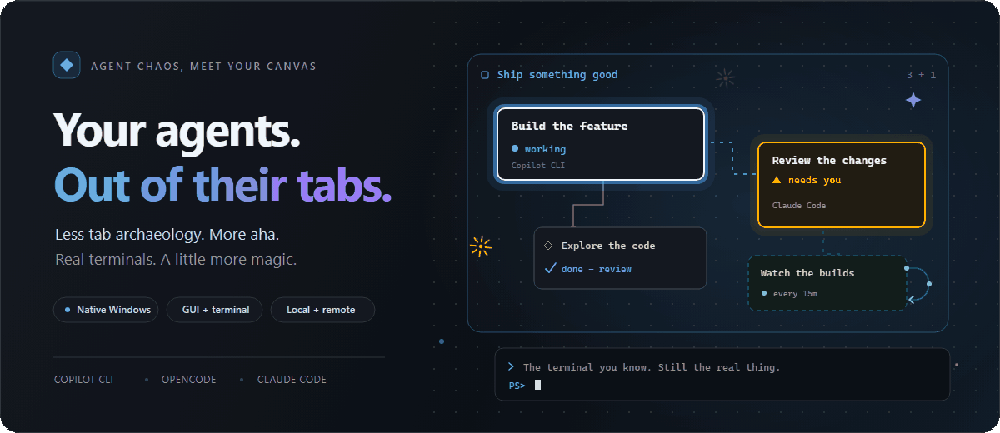
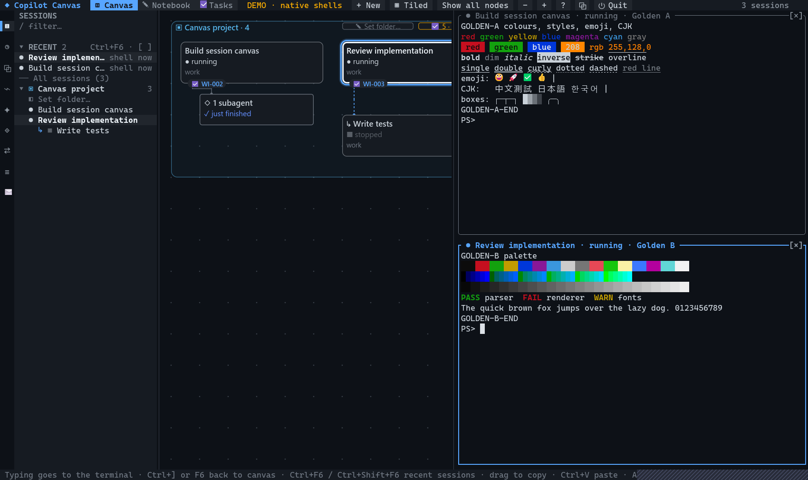
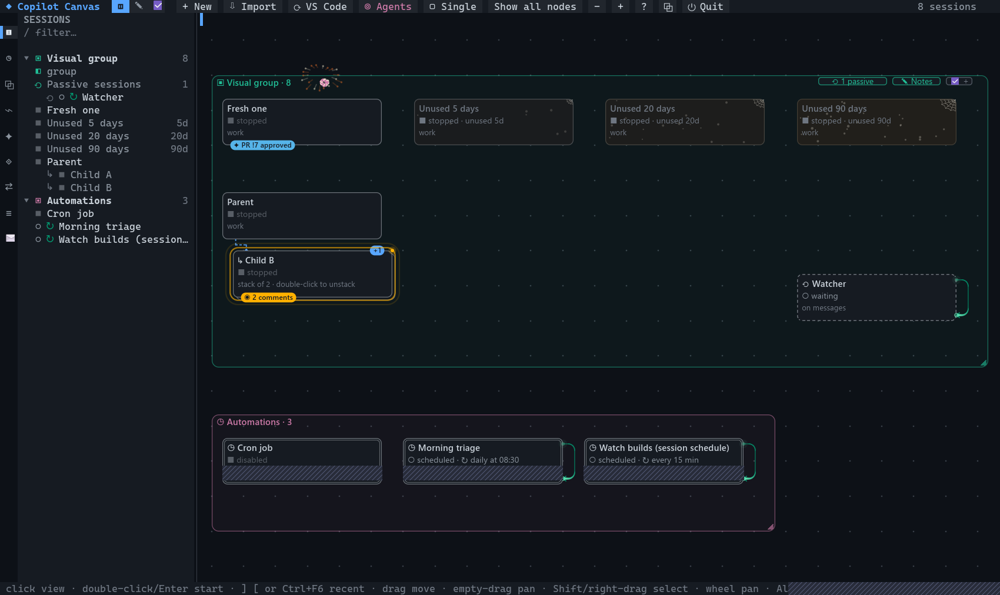
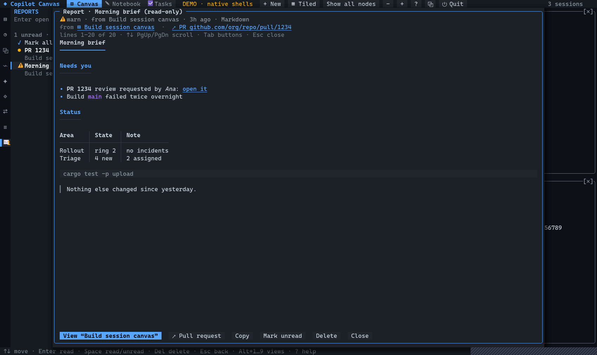

<h1 align="center">✦ Atelier</h1>

<p align="center">
  <strong>Big agent energy. Much less tab chaos.</strong><br>
  A native, spatial workspace for GitHub Copilot CLI, OpenCode, and Claude Code.
</p>

<!-- rename:keep-begin -->
<p align="center"><sub>Formerly <em>Copilot Canvas</em>: the same app, renamed because it works with every agent. Installs from before the rename move over by themselves (<a href="#upgrading-from-copilot-canvas">Upgrading from Copilot Canvas</a>).</sub></p>
<!-- rename:keep-end -->

<p align="center">
  <a href="https://github.com/TomND/copilot-canvas/releases"><strong>🚀 Grab the preview</strong></a>
  &nbsp;&middot;&nbsp;
  <a href="#quick-start">Get started</a>
  &nbsp;&middot;&nbsp;
  <a href="#in-its-element">See the app</a>
  &nbsp;&middot;&nbsp;
  <a href="#remote-mode">Connect from home</a>
  &nbsp;&middot;&nbsp;
  <a href="#documentation">Explore the docs</a>
</p>

<p align="center">
  <a href="https://github.com/TomND/copilot-canvas/actions/workflows/ci.yml">
    
  </a>
</p>

<p align="center">
  <picture>
    <source media="(prefers-reduced-motion: reduce)" srcset="docs/assets/canvas-hero.svg">
    
  </picture>
</p>

## Your agents called. They want more space.

Give each conversation a place. Group related work, follow the subagents,
and spot the session that needs you without opening every terminal.
Zoom out for the whole picture; step into a box for the **real agent CLI**.
No replacement chat UI. No conversation to copy across.

The GPU client and terminal UI share one persistent service. Detach a window
and your hosted sessions keep running; reopen locally or connect from another
PC to the same canvas and live terminals.

<table>
  <tr>
    <td width="50%" valign="top">
      <h3>🗺️ Room for every rabbit hole</h3>
      <p>An infinite canvas, nested groups, linked subagents, and stackable subsessions. Arrange work the way you think about it.</p>
    </td>
    <td width="50%" valign="top">
      <h3>⌨️ No terminal cosplay</h3>
      <p>Copilot CLI, OpenCode, and Claude Code in real native terminals. Go single-pane or tile up to four sessions.</p>
    </td>
  </tr>
  <tr>
    <td valign="top">
      <h3>🧭 Pick up the thread</h3>
      <p>Persistent terminals, shared canvas edits, and recent-session navigation. Close the client, not the conversation.</p>
    </td>
    <td valign="top">
      <h3>✨ A canvas with a sixth sense</h3>
      <p>Gold when a session needs you. Blue when its work is ready for review. Borders and icons carry meaning alongside colour.</p>
    </td>
  </tr>
  <tr>
    <td valign="top">
      <h3>🛰️ Put the boring bits on watch</h3>
      <p>Passive sessions and canvas-wide agents react to events, follow schedules, and use the skills you assign them.</p>
    </td>
    <td valign="top">
      <h3>💌 Findings, not scavenger hunts</h3>
      <p>An inbox for agent reports, briefs, and updates. Read Markdown or sanitized HTML without leaving the canvas.</p>
    </td>
  </tr>
  <tr>
    <td valign="top">
      <h3>✎ Notes with a return address</h3>
      <p>A Notebook space for Markdown and HTML notes: yours up front, the agents' dimmed, every note saying who it is for and who wrote it.</p>
    </td>
    <td valign="top">
      <h3>☑ Todos your agents can pick up</h3>
      <p>A Tasks space of todo boards: agents claim, note and submit work; their own ideas wait as proposals until you say yes.</p>
    </td>
  </tr>
</table>

## In its element

<p align="center">
  <a href="tests/golden/gui/terminals-tiled.png">
    
  </a>
  <br>
  <sub>The real GPU client, running demo shells. Your workspace on the left; your terminals on the right.</sub>
</p>

<table>
  <tr>
    <td width="50%" valign="top">
      <a href="tests/golden/gui/visuals.png"></a>
      <h3>A canvas with a pulse</h3>
      <p>Watchers loop, important work catches your eye, and unused sessions gather dust. Reduced motion is built in.</p>
    </td>
    <td width="50%" valign="top">
      <a href="tests/golden/gui/report-viewer.png"></a>
      <h3>From running to readable</h3>
      <p>Morning briefs, investigation notes, and short updates land in one shared reports inbox.</p>
    </td>
  </tr>
</table>

<p align="center"><sub>Actual app screenshots from the demo and golden-image fixtures. The opening artwork is an illustration; its motion respects your reduced-motion preference.</sub></p>

## Quick start

### Download the Windows preview

Get the ZIP from [Releases](https://github.com/TomND/copilot-canvas/releases)
and extract it. Keep **`atelier.exe` and `atelier-gui.exe` together**.
No Rust or Zig installation is needed to run the prebuilt programs.

```powershell
.\atelier.exe --gui --demo   # explore safely: demo shells, no agent prompts
.\atelier.exe --gui          # open your real session workspace
```

Install and sign in to at least one supported agent CLI on the machine that
will run your sessions. A remote-only home PC needs the Canvas client and
Dev Tunnels instead; the agent CLIs stay on the host.

> [!NOTE]
> The downloadable build is a **preview**. This README describes `main`;
> screenshots and features can be ahead of the published preview.

### Build from source

Use Windows with the stable Rust MSVC toolchain, Visual C++ build tools and
the Windows SDK. The default terminal engine also needs **Zig 0.17.0**;
see the [Ghostty build guide](docs/GHOSTTY.md).

```powershell
git clone https://github.com/TomND/copilot-canvas.git atelier
cd atelier
cargo xtask build-ghostty                 # once per pinned engine version
cargo build --release                    # builds both executables
.\target\release\atelier.exe --gui --demo
```

Prefer the terminal UI? Run `.\target\release\atelier.exe --tui`
(a Windows Terminal window of at least 140 by 40 is comfortable).
Without Zig, `cargo build --release --no-default-features` uses the alacritty
terminal engine instead. Optional: `cargo install --path .` puts the CLI/TUI
on your PATH; the GPU client still needs its executable beside it.

### Linux

Atelier runs on Linux x86_64 and aarch64 with glibc 2.35 or newer
(Ubuntu 22.04, Debian 12, Fedora 36 and later), under X11 or Wayland. CI
builds four packages per architecture (the `linux-packages-x86_64` and
`linux-packages-aarch64` artifacts of a CI run); install one:

```sh
sudo apt install ./atelier_<version>_amd64.deb     # Debian, Ubuntu (arm64 alike)
sudo dnf install ./atelier-<version>.x86_64.rpm     # Fedora and relatives
chmod +x Atelier-<version>-x86_64.AppImage          # any distribution, nothing installed:
./Atelier-<version>-x86_64.AppImage --demo          #   the GUI; `… cli ARGS` runs the CLI
tar -xzf atelier-<version>-linux-x86_64.tar.gz      # or the tarball, into ~/.local
./atelier-<version>/install.sh                      #   (PREFIX=… elsewhere; --uninstall)
atelier --gui --demo                                # or Atelier in the app menu
```

The programs link only glibc; the rest is loaded when used, and the .deb and
.rpm recommend it: a Vulkan or OpenGL driver (Mesa's software renderer works,
more slowly), WebKitGTK 4.1 for HTML reports (else they show as formatted
text), a Secret Service (GNOME Keyring, KWallet, KeePassXC) for pairing
secrets (else a key file in the canvas home), and wl-clipboard or xclip.
Automations and `atelier service install` use systemd's user manager
(cron without one). To build from source (Ubuntu's package names):

```sh
sudo apt install build-essential pkg-config libssl-dev libfontconfig1-dev libvulkan-dev \
  libxkbcommon-dev libwayland-dev libx11-dev libxcursor-dev libxi-dev libxrandr-dev
git clone https://github.com/TomND/copilot-canvas.git atelier && cd atelier
cargo xtask build-ghostty --target x86_64-unknown-linux-gnu   # Zig 0.17.0: ZIG=…, ~/.local/zig-0.17.0 or PATH
cargo build --release
./target/release/atelier --gui --demo
packaging/linux/build.sh --arch x86_64 --bin target/release --out dist   # optional: the packages
```

### macOS

Atelier runs on macOS 13 Ventura or newer, on Apple silicon and Intel
(one universal app). CI builds `Atelier-<version>-macos-universal.dmg`
(the `macos-package` artifact of a CI run): open it and drag **Copilot
Canvas** to Applications. The app carries the command line too:

```sh
"/Applications/Atelier.app/Contents/MacOS/atelier" --gui --demo
sudo ln -s "/Applications/Atelier.app/Contents/MacOS/atelier" /usr/local/bin/   # CLI and TUI on PATH
```

A Homebrew cask (`packaging/homebrew-tap/Casks/atelier.rb`, for a
tap) installs both. Until the project's Developer ID signing is set up the
app is signed ad hoc and not notarized: open it the first time with
right-click › Open.

What differs from Windows: **⌘ is the app's modifier** (⌘C / ⌘V copy and
paste, ⌘Z undo, ⌘1 / ⌘2 / ⌘3 the Canvas, Notebook and Tasks, ⌘P Go to,
⌘[ / ⌘] back and forward, ⇧⌘[ / ⇧⌘] the note tabs, ⌘N a new note in the
Notebook and a new window elsewhere, ⇧⌘N a new window, ⌘-click links);
Windows' Alt shortcuts are ⌃⌘ ones (⌃⌘1…9 views, ⌃⌘N a quick note, ⌃⌘H
the filter). Control always goes to the terminal's program (Ctrl+C
included); the left Option key is Alt (Meta) for terminals and composes
characters elsewhere (⌥E E types é in a note); the note editor moves by
word with ⌥←/→ and by line with ⌘←/→. ⌘Q and the Dock's Quit ask, as
closing the last window does on Windows: detach and keep the sessions
running, or stop them all. A **trackpad** pans pixel for pixel with the
system's momentum, pinches to zoom around the pointer (over a terminal:
its text size; ⌘+ ⌘− ⌘0 too), double-taps to fit a box and force-clicks a
box for its details; in the Notebook and Tasks it scrolls notes and lists
row by row and pans the todo canvas (pinch or ⌘-scroll steps its zoom, a
double tap fits the boards). The Dock icon shows how many sessions need
you and a dot while sessions work; notifications come from the app (the
first one asks for permission). HTML reports and notes open in locked-down
WKWebViews; a note's *Print / PDF* saves the page as a PDF in Downloads.
Automations and `atelier service install` use launchd (LaunchAgents
in `~/Library/LaunchAgents`). To build from source (Xcode's command line
tools, Rust, Zig 0.17.0):

```sh
git clone https://github.com/TomND/copilot-canvas.git atelier && cd atelier
cargo xtask build-ghostty --target aarch64-apple-darwin   # Zig 0.17.0: ZIG=…, ~/.local/zig-0.17.0 or PATH
cargo build --release
./target/release/atelier --gui --demo
packaging/macos/build.sh --arch arm64    # optional: Atelier.app and its DMG (universal: both Ghostty targets)
```

### Make it yours

- **Agents.** New sessions use the first installed of Copilot, OpenCode and
  Claude Code; pick another per session in the new-session dialog (*Agent*), per
  canvas in *Settings › Agent for new sessions*, or for the machine with
  `atelier config agent opencode`. Each agent's sessions, status,
  subagents and configuration views come from its own history and CLI. See
  [docs/AGENT-PROVIDERS.md](docs/AGENT-PROVIDERS.md) for how each agent is launched, resumed and
  forked, how its status is read, and what is verified end to end.
- **Clients.** `atelier` opens the client set by
  `atelier config client tui|gui|auto` (default `tui`; `auto` picks the
  GUI except over remote desktop or SSH); `--tui` and `--gui` override it. In
  either client, **O** opens the same canvas in the other one (same service,
  same document). See [docs/GUI.md](docs/GUI.md).
- **Remote mode.** Agents run on one PC (say a Cloud PC), the canvas on another,
  over a private Dev Tunnel with pairing: `atelier remote tunnel-setup`
  and `remote pair` there, `remote add NAME --tunnel ID --code CODE` and
  `atelier --remote NAME` at home. See [docs/REMOTE.md](docs/REMOTE.md).
- **iPhone.** The same canvas on your phone over the same Dev Tunnel:
  sessions by what needs you, the canvas, real terminals with a key bar
  and a prompt composer, the reports inbox (HTML reports in a locked-down
  web view), and the Notebook and Tasks to read and edit notes and todos.
  `atelier remote pair --qr` on the Cloud PC,
  scan it in the app. See [ios/README.md](ios/README.md) and
  [docs/IOS-PLAN.md](docs/IOS-PLAN.md).
- **Terminal engine.** Terminals run on libghostty-vt (graphemes, Kitty
  keyboard, underline styles, images); `atelier config engine alacritty`
  switches back. See [docs/GHOSTTY.md](docs/GHOSTTY.md).

On first run the canvas imports your 8 most recent sessions. If the Node
prototype's `~/.atelier/layout.json` exists, its layout is migrated.

> [!IMPORTANT]
> New agent launches use allow-all permissions by default. Choose
> **Settings &rsaquo; Permissions &rsaquo; ask** if you want approval prompts.
> A session already running in another CLI or VS Code terminal stays there;
> Canvas never starts a second copy.

## Remote mode

**Run the agents on your Cloud PC. Keep the canvas at home.**
The service owns the terminals and shared document; your client brings the
canvas, keyboard, clipboard, and report viewer.

| Where the work runs | Where you sit |
|:---|:---|
| Agent CLIs, repositories, session history, persistent terminal service | Native GUI or terminal UI, your own view and layout preferences |
| Private Dev Tunnel host on loopback | Authenticated tunnel connection and a paired client |

On the **host**, run `remote tunnel-setup` and complete the one-time tunnel
creation, sign-in, and hosting steps it prints. Then pair your home PC:

```powershell
# On the host: generate a single-use code, valid for 10 minutes
atelier remote pair --name home-pc

# At home: sign in to Dev Tunnels with the same account, then connect
atelier remote add cloudpc --tunnel TUNNEL_ID --code PAIRING_CODE
atelier --gui --remote cloudpc
```

Follow the [complete remote guide](docs/REMOTE.md) or
[compact setup checklist](docs/REMOTE-SETUP.txt) for installation and recovery.
Choose **Detach** when you close the client to leave the hosted sessions running.
Keep the host and every client on the same build: a client that connects to a
service of another build says so once and shows **⚠ Mixed builds** in its
toolbar (mixed builds are unsupported; update the client, or update the host
and run `atelier service restart` there).

> [!IMPORTANT]
> Pair only your own trusted machines: a paired client can act as you on the
> host. A restart preserves conversation history, not in-process work or loops.

## Features

The highlights above are the short tour. Expand the reference for the exact
behaviour, shortcuts, and agent-specific details.

<details>
<summary><strong>Open the full feature reference</strong></summary>

| | |
|---|---|
| **Canvas** | Drag boxes (subagents follow their session), drag empty space to pan (released while moving, it glides on briefly and gently slows to a stop, at most a few cells; any key, click or wheel stops it, reduced motion turns it off, box, group and area drags never glide), wheel/Shift+wheel pan, Alt+wheel / Ctrl+wheel / toolbar − + to zoom (100 %, 50 %, 25 %), double-click empty space to create a session there, right-click for context menus |
| **Undo and redo** | **Ctrl+Z** takes back this window's latest change to the canvas, one gesture at a time: a drag of boxes (their subagent boxes and stacks with them), of a stack or of a group (everything in it when the drag began, nested groups too), a group's ◢ resize, *Fit to members*, a burst of arrow-key moves (presses less than a second apart are one step), and, as before, a removal or a VS Code sync. Successive presses go further back (100 steps per window, newest first); every item returns exactly where it was (and a group to its size). **Ctrl+Y** or **Ctrl+Shift+Z** redoes undone moves and resizes. An undo is an ordinary canvas edit, so other windows and a remote canvas see it; it never starts, stops or changes a session, never brings back a box that was removed since, and leaves boxes another window moved since where they are (a notice says what it skipped). Stacking or showing subagent boxes and subsessions, hiding them, zoom and pan are not undo steps (`K`, `H` and `J` toggle back); a drag carries the boxes folded into a session's deck, and its undo puts them back too. The status bar names each step (*Moved group “Payments” (4 boxes) · Ctrl+Z undo move*), the canvas menu has *Undo move* and *Redo*. While a terminal has the keyboard Ctrl+Z goes to its program, and in text fields it is theirs |
| **Status** | Accurate within a fraction of a second for canvas sessions: Copilot's own progress report (set when a turn starts, cleared when it ends) drives working and done; history events add needs-you, failures and sessions running elsewhere; a session whose subagents are still running stays working. States: working (spinner), needs you (permission / question), **done · review** (finished a turn you haven't looked at yet; stays until you open, click or type in that session), idle, stopped, failed, and **↗ open elsewhere** for sessions running in another terminal or VS Code. Sessions that **need you** get a gold heavy ━ border and sessions that are **done · review** a blue double ═ border with a blue-tinted box (boxes, terminal panes and sidebar names). Pressing Esc in Copilot (abort) doesn't count as done. The session whose terminal is active on the right has a blue halo around its box (heavy while you type in it) |
| **Colour-blind safe** | The palette avoids red/green: OK is sky blue, failure is vermillion, attention is gold, finished is blue, selection is white, groups use the Okabe-Ito colours; every state also has its own icon and border shape |
| **Subagents** | Discovered from session history (Copilot's `subagent.*` events, OpenCode task-tool children, Claude Code `Agent` calls) as boxes linked to their session. By default they are **folded into a slim deck** beneath the session, one card for all of them: **◇ 12 subagents** with the most important state of what it holds (failed first; **working · 2 of 12** while any runs; just finished), so they never fill the canvas and folding never hides activity (the session itself stays working while a subagent runs; effects on a folded box show on the deck). A click on the deck lists them in the session's details panel (state, a click on a name views that subagent, **Inspect** opens its transcript; nothing starts). A double-click on the deck, `K` or the session's menu (*Show subagents* / *Stack subagents*) shows them at exactly their saved places; a box found while they were folded gets a slot of its own (and its group grows) the first time it is shown. The choice is per session, kept in the canvas (every window and client sees it, also after a restart); *Settings › Subagents* (**stacked** by default, or shown) applies to sessions without a choice of their own. Folded boxes take no room: new boxes, *Show all nodes*, *Fit to members* and new groups use the deck; they still move with their session and its group, and count as members of their session's group |
| **Inspect transcript** | Any session or subagent box (menu, details panel): a read-only transcript of its conversation (prompts, answers, tool calls with their result or exit code), newest at the bottom, refreshing every 1.5 s while it runs; nothing starts, nothing is written, it works remotely too. A finished OpenCode child session whose parent is stopped resumes in a terminal of its own as a new linked subsession (**Resume as subsession** or a double-click); Copilot and Claude Code subagents are part of their parent's conversation (see [docs/AGENT-PROVIDERS.md](docs/AGENT-PROVIDERS.md#inspecting-and-resuming-child-conversations)) |
| **Subsessions** | `S` or menu → a new Copilot session linked to its parent (dotted connector, nested in the sidebar). By default it **forks the parent's conversation** (as Copilot's `/fork` and VS Code do: history and checkpoints are copied, the running parent is untouched); choose *Start fresh* for an empty one. Sessions an agent starts itself from inside a canvas session (`copilot -p …`, `copilot --resume …`) are detected from the process tree and added as linked subsessions automatically |
| **Stacks and hidden subsessions** | Right-click a session › *Stack subsessions* (or `K`) gathers all its subsessions (recursively, with their subagents) into a deck beneath it: offset cards, the newest on top, a **+N** badge, and the stack's most important status (needs you, failed, done · review, working) on the top card, so stacking never hides activity; effects on a stacked session show on the deck. **One deck per session**: a stacked session's folded subagent boxes are in the same deck. `K` on a session (or on a box in its deck) unfolds everything it has folded (its subagent boxes and its subsessions), else folds both; where a session has both, its menu offers them separately (*Show/Stack subagents*, *Unstack/Stack subsessions*) and together (*Unfold all* / *Stack all*, `K`). A click on a stack shows its top card (it never starts anything); dragging a deck moves the session with it; a double-click, `K` or the deck's menu unfolds it: the boxes go back exactly where they were (their positions stay in the canvas, so this survives restarts and every window sees it). `H` (the canvas menu's *Hide/Show subsessions*) hides every subsession box with what is under it (its subagent boxes and subsessions); `J` (*Hide/Show subagents*) hides every subagent box, folded ones too. They are two switches of this window, kept with its view (other windows keep theirs), on their own or together. Each parent shows what is hidden under it by kind (**⋯ N hidden** for subsessions, **◇ N hidden** for subagent boxes, or **⋯ N · ◇ M hidden**), in the colour of the most important hidden state (a hidden box that needs you or fails shows there, so hiding never hides attention), and the toolbar counts each kind (**↳ N hidden**, **◇ N hidden**; a click opens the list of hidden boxes, below). A deck shows what is not hidden: with `H` a deck holding a stack and folded subagent boxes becomes the slim card of those subagent boxes, with `J` a session's deck of folded subagent boxes goes (a stack stays). Hiding moves nothing: boxes come back exactly in place. The GUI animates both (about 300 ms, eased, reversible mid-way, then idle); the TUI and reduced motion switch at once |
| **Hidden area** | Right-click a subsession or a subagent box › **Hide** (on a box of a multi-selection: **Hide N**, its subsessions and subagent boxes) puts it into the canvas's hidden area: it is kept in the canvas (`Node::hidden`), so every window and remote client sees it, also after a restart; it is no longer drawn, clicked or taken by an area selection, everything under a hidden subsession hides with it, and it moves with the box it is counted on (dragging the parent, or its group, carries it). Its parent's marker counts it by kind (**⋯ N hidden**, **◇ N hidden**) in the colour of the most important hidden state, so a hidden box that needs you or fails still shows. A subagent box folded into a deck hides from the deck's menu (**Hide ◇ name**) or from its session's SUBAGENTS list in the details panel (**Hide** per row). **Showing them again**: a click on a parent's marker (or its menu's **Show hidden (N)…**) lists the boxes hidden into it, with **Show** per box and **Show all**; the toolbar's **↳ N hidden** and **◇ N hidden** list the whole canvas's, grouped by parent, with the `H` / `J` switches at the top. The sidebar still lists hidden boxes (dimmed, marked *hidden*): a click views one (its details, with **Show on canvas**; nothing starts) and its menu offers **Show**. Showing puts a box back exactly where it was. A hidden box keeps running (its terminal and its tile stay); hiding and showing are toggles, not undo steps, and never start or stop anything. Hidden boxes take no room: new boxes, *Show all nodes*, *Fit to members* and new groups leave their places out. An older service keeps the field out of the canvas (the box shows again) |
| **Looping sessions** | A session that repeats on a schedule gets a loopback arc on its right side with a lit dot running around it (bluish green), `↻ every 15m` in its status line and `↻` in the sidebar. The dot's place comes from the clock, not from frames, so it never jumps or restarts and keeps gliding while you pan, zoom or drag the box. GUI: a comet with a fading tail that leaves the box quickly, eases round the far bend and sends a soft ring through the arrowhead after each lap; a loop that starts grows its arc in, one that stops fades it out; only loops in view move, redrawing their own layer at about 30 frames/s (fewer when zoomed out). TUI: the dot steps cell by cell at one speed with a two-cell trail, redrawn only when it changes cell. With reduced motion (*Settings › Effects*, or Windows' *Show animations* off) the arc, its lit arrowhead and a `↻` badge stand still and loops switch at once. Detected from Copilot's schedule events (`/every`, the `manage_schedule` tool: created → looping, cancelled or session ended → not; the next status update shows it, and the saved schedules are read again then), Copilot's saved session schedules, and enabled repeating automations. Zoomed out, a breathing `↻` |
| **MCP servers per session** | The new-session dialog has an *MCP servers* row: a checklist of your servers with presets (*All*, *None*, and your own: `Ctrl+S` saves the current choice, `←/→` switches, `Del` deletes). The last choice is the default next time; each session remembers its own choice for every resume (`--disable-mcp-server`). Change it later from the session's menu → *MCP servers…*. Every server is several processes in every session, so trimming them is the biggest saving in memory and CPU |
| **Groups** | Shift-drag or right-drag to select (from anywhere, on a box too: a Shift-drag never moves a box), then `G` (or menu) draws a group box around them; a click on a group's empty background or its border (a few pixels around the outline in the GUI) selects it (the innermost of nested groups; a drag there still pans); drag the title to move everything inside (what is inside when the drag starts, with the stacks, folded and hidden boxes of its sessions, and its nested groups; boxes and groups it passes over stay where they are; arrow keys on a selected group move what it held when the burst began), drag `◢` to resize; nested groups work; membership is geometric, like Obsidian canvas: after a drop, a box whose centre ends up inside a group belongs to it (as when you drop a box into a group) |
| **Area selection** | The band takes every box it touches as drawn, at every zoom: sessions, subsessions and subagent boxes alike, so a parent and its children can be selected together (and moved, grouped or removed together: each box moves once, also a child whose selected parent drags it along). Boxes in a deck (stacked subsessions, folded subagent boxes) or hidden (`H`, `J`, or one by one) are left out; automation boxes stay with their group. Shift- or Ctrl-click toggles one box; a right-click without dragging opens the menu of what is under it. Nothing is ever started or dragged by a selection |
| **Sidebar** | On the canvas: groups → their folder row (◧) → sessions → subsessions → subagents (all of a selected session's, the running ones of the others; folded ones too: a click views that subagent's details and flies to its deck without unfolding it) → the group's passive sessions (⟲, a click opens their panel); stacked and hidden boxes are listed dimmed (hidden ones marked *hidden*), unused sessions with their age; `/` filters; click any row to fly the canvas to it, highlight it and view it (its live terminal, or its details); double-click or Enter starts it; group rows tile the group's running terminals (never starting stopped ones) |
| **Recent sessions** | A **RECENT** section tops the Sessions panel: the sessions you used last (viewed, started or typed into), newest first, up to 8 (fewer in a short window), each with its status, agent and how long ago; a click on its header folds it. It is kept in the canvas document, so every window and client of the canvas (the home GUI and the Cloud PC alike) shows the same list, and removed boxes leave it. A click views a row, a double-click or Enter starts it (as elsewhere). **Ctrl+F6** / **Ctrl+Shift+F6** (anywhere, also while a terminal has the keyboard) and **`]`** / **`[`** (on the canvas and in the sidebar) step to the next older or newer recent session and only view it (its live terminal, or its details panel with Start / Resume); repeated presses walk the list without reordering it, and a second after the last one (or at any other key or click) the session you stopped on becomes the most recent, as with Alt+Tab |
| **View versus start** | A click (canvas or sidebar), Tab, the arrows and the recent-session keys (Ctrl+F6, Ctrl+Shift+F6, `]`, `[`) only select and show: a running session's terminal comes into view with the keyboard, anything else shows a details panel (agent, status, folder and branch, last used, what starting it would do) with one primary button: **Start** (a new conversation or a box's command), **Resume** (its conversation) or **Open terminal**, plus Stop, MCP servers… and Remove. Only a double-click, Enter, that button or a menu item starts a session. Restoring tiles, reconnecting and clicks on exited terminals start nothing; sessions open elsewhere (↗) never get a Start / Resume |
| **Terminals** | Real Copilot CLI in ConPTY; single view or up to four tiles (`T`); terminals keep running when you close the canvas and reappear when you reopen it |
| **Scrolling** | The wheel goes to the app like in Windows Terminal: mouse-wheel events when Copilot's `mouse` setting is on (its default; 3 lines per notch), PageUp/PageDown on its full-screen view when it is off, scrollback otherwise; Shift+wheel or Shift+PgUp always scroll the scrollback |
| **Your messages** | In Copilot terminals your own prompts get a navy background and a blue ▎ bar so they stand out from Copilot's output (recognised from how Copilot draws them: " ❯ text" and its indented continuation lines) |
| **Copy & paste** | Drag inside a terminal to select; releasing copies it. Copies keep line breaks (CR LF), blank lines, indentation and spaces inside lines; lines a shell soft-wrapped rejoin (the terminal engine's own wrap state, so a line that just fills the width or a border in the last column never joins the next row). On full-screen views (Copilot, OpenCode, vim) every row is a line, and Copilot's scrollbar column is left out. Ctrl+C / Ctrl+Shift+C copy while text is selected (otherwise Ctrl+C reaches Copilot); Ctrl+V / Ctrl+Shift+V paste; the pane's right-click menu has Copy / Paste. **A paste never sends a message**: multi-line text (Ctrl+V, the pane menu, Windows Terminal's paste, IME text) reaches the agent as one bracketed paste whose line breaks stay text, a trailing line break is dropped, and a program without bracketed paste gets Shift+Enter or Alt+Enter between lines, never Enter ([docs/AGENT-PROVIDERS.md](docs/AGENT-PROVIDERS.md#pasting)) |
| **Images** | Copy a screenshot and press **Alt+V** (or Ctrl+V, or the pane menu's *Paste*): Copilot attaches it (`[📷 …png]`). With no text on the clipboard the canvas sends the keystroke and Copilot reads the image itself. Windows Terminal keeps Ctrl+V for its own text paste, so with only an image on the clipboard Ctrl+V never reaches any app there; use Alt+V |
| **Copilot's terminal features** | Clicks reach Copilot when its `mouse` setting is on (its tab bar, "click here" actions); drags still select text in the canvas. Copilot's title (its current intent) shows in the pane header. Its progress report (OSC 9;4) drives the spinner instantly and the canvas mirrors overall state to the Windows Terminal tab and taskbar (busy while any session works, yellow while one needs you). Bells and OSC 777 notifications (Copilot's `beep` / `terminalNotifications` settings) ring Windows Terminal |
| **Links** | URLs, OSC 8 hyperlinks and absolute Windows paths are underlined. In terminals Ctrl+click opens them, elsewhere a click does. Web links open in your browser, folders in Explorer, files in VS Code at the line (or revealed in Explorer); nothing is ever executed |
| **New session** | Name, folder (type, **Browse…** folder picker, or **Recent ▾**), Git detection with current branch, **New Git worktree** (base branch picker, new branch, path), the **Model** it starts with (see below), optional first prompt |
| **Default model** | The new-session dialog shows the model a session will start with and why: the group's (*from group X*), the one you chose before (*remembered default*), or the initial default, **Claude Opus 5.5** in each agent's own id (`claude-opus-5.5` for Copilot, `github-copilot/claude-opus-5.5` for OpenCode, `claude-opus-5-5` for Claude Code). Its picker lists the agent's models (`opencode models`, the choices in `copilot --help`, Claude Code's aliases) and takes any id you type. A model you pick there starts that session and becomes that agent's default for every later new session (kept in the canvas, so it survives restarts and reaches your other windows) until you pick another, there or in *Settings › Copilot / OpenCode / Claude Code model* (which also resets it). A group's own model (*Session defaults for group…*) wins in that group; picking another there applies to that session only and changes neither the group nor the canvas default. Every session records the model it started with (details panel) and keeps it: a new default never changes existing sessions or their resumes ([docs/AGENT-PROVIDERS.md](docs/AGENT-PROVIDERS.md#models)) |
| **Import / sync** | `I` Copilot sessions (filter, multi-select, group by folder or client); `V` or toolbar **⟳ VS Code** syncs VS Code agent sessions (see below) |
| **Activity bar** | VS Code-style icons on the far left (`Alt+1…9`): the space's own sidebar (▤ Sessions on the canvas, ✎ Explorer in the Notebook, ☑ Tasks in Tasks) · ◷ Automations · ⧉ Plugins · ⌁ MCP servers · ✦ Skills · ◈ Agents & instructions · ⇄ VS Code · ≡ Settings · ✉ Reports (with its unread count) |
| **Reports** | An inbox of reports and short messages agents publish (`atelier report publish`: Markdown, HTML or a one-line message; a morning brief, a triage report, "PR X received 12 new comments; dispatched the owning session"). The activity bar's ✉ shows how many are unread; new ones also get a notice (and in the GUI a toast and a flashing taskbar button while it is in the background). Click one to read it in the canvas: Markdown formatted, HTML in the GUI's locked-down WebView2 view; reading it never starts its session. See [Reports](#reports) |
| **Dusty sessions** | Sessions you have not used for a while (started, typed into, or agent activity; looking at one does not count) gather dust: the TUI dims them, the GUI drains their colour and adds specks and a cobweb that grow with age (from *Settings › Dust unused sessions after*: off / 1 / 3 (default) / 7 / 14 days; medium from 14 days, heavy from 60), and the status line and the sidebar show **unused 12d**. Anything important (working, needs you, done · review, failed, open elsewhere, looping, passive sessions, an effect) is never dusty. The canvas menu's *Select unused sessions* selects them for a cleanup; nothing is ever removed automatically |
| **Effects** | Passive sessions (and sessions) can put an effect on a box of their group until you click it: **fireworks** (an approved pull request), **attention** (a pulsing beacon: review requested, changes requested, comments), **sparkle** (a short success), **alert** (`atelier effect`, below). The service keeps them, so every window and the TUI show them, also after a restart. A click on the effect (or its box) clears it everywhere and only selects the box. GUI: fireworks bursts and rings at 12.5 frames/s, only while in view; *Settings › Effects*: on, reduced motion (still rings and badges) or off (badges only); the default follows Windows' *Show animations*. TUI: a badge (✦ ◉ ✧ ▲) on the box |
| **Group chips, folders and badges** | Each group has a folder (asked when you create the group; suggested `<notebook>/Groups/<group name>`, the notebook being `~/.atelier/notebook` on the service's machine unless *Settings › Notebook folder* names another; folders chosen before stay where they are) with `ai-docs/` and `human-outputs/`. The group's title row has its chips: **⟲ N passive** (see [Passive sessions](#passive-sessions-and-events)), **✎ Notes** (opens the Notebook at the group's folder; **✎ Set folder…** before one is chosen) and **☑ 4 · 2▸ · 1◇** (the boards linked to the group: open · in progress · proposed, in gold while proposals wait; **☑ +** when no board is linked, which offers to create or link one). When the row is narrow the least important chip goes compact first (**✎**, **☑4**, **☑+**, **⟲ 1**), then chips that only offer to set something up give way, then the title is shortened; the chips stay clickable at every zoom while the title shows. The group menu has *Open notes*, *Open todo board*, *Link notes folder…*, *Link todo boards…*, *Open AI docs folder* and *Open human outputs folder*; the group's details panel has NOTES (*Open notes*, the folder, AI docs, human outputs, *Change folder…*), TODOS (*Open todo board* with its counts and *Link todo boards…*, or *Create or link a todo board…*) and SKILLS (its skill folders and their skills, a click opens the Skills view there; *Edit skill folders…*); the sidebar's **◧** row under the group keeps its menu (AI docs, outputs, the group folder, `GOALS.md`, change folder). A session that claimed a todo shows **☑ DEC-031** on its box (the TUI on its bottom border, at 50 % at the end of its last row, none on one-line boxes; the GUI as a pill on its bottom edge from 30 % zoom; decks show none); a click opens the card in Tasks. In remote mode (any `--remote`, `loopback` included) folders open in VS Code through the server's tunnel or in the canvas's **folder browser** (subfolders and files; Enter or a click opens a file in the read-only viewer, Backspace goes up, *Copy path*), never in Explorer on the service's machine. Sessions launched in the group may use both folders (`--add-dir`; OpenCode: `external_directory`) and get the group instructions (see [Notebook](#notebook)) |
| **Spaces** | A window shows one of three spaces: the session canvas, the **Notebook** and **Tasks**. The toolbar's tabs **◫ Canvas · ✎ Notebook · ☑ Tasks** (compact **◫ ✎ ☑** when the toolbar is narrow) or **Ctrl+1/2/3** switch; each window remembers its space in its own preferences. The frame stays: toolbar, activity bar (slot 1 is the space's sidebar), sidebar, main area, right pane (the space's own panel; a terminal only while you are in it), status bar; *Show all nodes* and the toolbar's − + are the canvas's. Every jump between spaces (chips, badges, links between notes and todos, Go to) is recorded: **Alt+←** / **Alt+→**, or **Alt+,** / **Alt+.** (Windows Terminal keeps Alt+arrows for its panes), and the GUI's mouse back and forward buttons (also while a terminal has the keyboard) go back and forward (100 places per window, in memory). **Ctrl+P** opens **Go to**: one fuzzy search over groups, sessions, the notes this window has listed or opened, boards and todos; Enter goes there. These keys work outside terminals and dialogs (in a terminal they reach the agent); `?` shows the keys of the space you are in. No space ever starts a session by viewing |
| **Notebook** | Notes on the service's machine, under one root folder per canvas (`~/.atelier/notebook` by default, with `Groups/`, `Inbox/` and `Todos/`; *Settings › Notebook folder*). The explorer (the sidebar, ✎ EXPLORER) shows it as a tree listed as you open folders, with each group folder outside it (**◫ group**), **Canvas (canvas-wide)** (the canvas-wide agents' folder), extra folders (*Settings › Notebook mounts…*: mounted, never moved) and **Reports** (the inbox; a report opens in the report viewer). A folder that is a group's shows **◫** (and **☑** when that group has a linked board). Notes are marked **●** for you or **◇** for agents, the agents' dimmed and italic; **Human \| All \| AI** (click a segment, or **Alt+H**; All to start with) hides the other audience and says how many it hides (**3 AI hidden**), and folders holding only hidden notes go too; `/` filters names; *Show internal files* shows the canvas's own files (`.canvas`, `events.yaml`, the instructions file, names starting with `.`, `.trash`). **+ Capture**, **+ Note** (Ctrl+N: a note in the selected folder; `.md` is added unless the name ends in a Markdown, HTML or text extension), **⟳** lists the open folders again (they are also listed again every 5 s while the Notebook shows); F2 renames, Del moves a note or folder to its root's `.trash` (asks first); right-click: *New note…*, *New folder…*, *Rename…*, *Move to…*, *Delete*, *Copy path*, *Open externally* (remote: VS Code through the tunnel, or the viewer), *Mark reviewed*, *Show group on canvas* |
| **Note provenance** | Every note says whom it is for (`audience`: `human` or `ai`; `you`, `user` and `agent` are read too) and who wrote it (`author`: `human`, `ai` or `mixed`), plus `agent`, `source_session`, `created`, `reviewed` and `title`: Markdown in front matter (flat `key: value` lines between `---` lines at the very start), HTML as `<meta name="canvas-audience" content="human">`. Without an `audience` it is inferred: in a folder named `ai-docs` or `.canvas` (the deepest one decides) or the canvas-wide folder, for agents; in `human-outputs` or Reports, for you; HTML files, and everything else, for you. The author is inferred the same way (an agent in those folders, else you). The info panel says *(inferred)*. Editing an agent's note writes `author: mixed` (with your first change; undoing that change takes the line back too); *Mark reviewed* writes `reviewed: true` (HTML notes get the meta tag); unknown keys and their order are kept |
| **Reading notes** | Notes open in tabs (at most 20; Ctrl+Tab / Ctrl+Shift+Tab or Ctrl+PgDn / Ctrl+PgUp, Ctrl+W or a middle-click closes). The header has the breadcrumb, the **Rendered \| Source \| Live** switch (Live for Markdown; text files are Source only and read only), the provenance pill (*● For you · ◇ written by OpenCode · session Fix flaky test · 2h ago · ✓ reviewed (inferred)*) and buttons: *View session* (views its box, never starts it), *Mark reviewed*, *Print / PDF* (GUI), *Open externally*, *Ask agent to revise…* (sends the note's path and what to change to a session of the note's group, typed in when it is idle, like `atelier send`) and, for HTML notes in the GUI, *Scripts: off* / *on*. Rendered Markdown has tables, task lists, strikethrough and footnotes; `[[Note]]` opens that note (a missing one offers to create it), a todo id such as `DEC-031` opens the todo in Tasks, a web link asks before the browser. The GUI renders in its locked-down WebView2 view: Markdown in the notebook's reading look; an HTML note served from the notebook's folders with the pictures and styles it links relatively in its folder and below (a whole page keeps its author's look, a fragment gets the reading look), its scripts only when you allowed them for that file (see [Safety](#safety)); pictures (up to 1.4 MB) as a page. The TUI, and the GUI without WebView2, show formatted text |
| **Editing notes** | A multi-line editor drawn in cells (TUI, GUI, remote): soft wrap, undo and redo (Ctrl+Z; Ctrl+Y or Ctrl+Shift+Z; typing is one step until the caret moves), Ctrl+←/→ by words, Ctrl+Backspace / Ctrl+Del delete words, Home/End, PgUp/PgDn, Ctrl+Home/End, Shift selects, Ctrl+A, Ctrl+C / Ctrl+X / Ctrl+V, Tab / Shift+Tab indent by two spaces, Enter continues list items and quotes, find (Ctrl+F; F3 / Shift+F3 or Enter / Shift+Enter; every match lit). Source styles the Markdown; **Live** shows every line but the caret's (and the selected ones) formatted with its syntax hidden. `[[` completes note names (↑↓, Tab or Enter); Ctrl+click follows a `[[link]]`, todo id or web address (which asks first). **Ctrl+E** switches Rendered ⇄ Source, **Ctrl+S** saves, and a note saves itself 1 s after you stop typing. Open notes are checked every 2 s: a clean one reloads; one with unsaved changes shows *⚠ This note changed on disk while you edited it.* with **Compare** (a line diff), **Keep mine** and **Take theirs**. Every write is based on the revision it read, so it never overwrites a change it did not see; a note whose file went (moved or deleted elsewhere) says so, and its next save writes it again; quitting writes what was typed in the last second, and a note that cannot be written then (a conflict you did not settle) is kept beside it as `<name> (unsaved <date> <time>).md` |
| **Quick capture and the info panel** | **Alt+N** in every space (not in a terminal or dialog) or **+ Capture** writes `<notebook>/Inbox/<yyyy-mm-dd HHMM>.md` (for you, by you; `-2`, `-3` within the same minute) and opens it in Source (the GUI keeps Ctrl+Shift+N for a new window). The right pane shows the open note's NOTE INFO: OUTLINE (a click goes to the heading), LINKED (its group, the group's board counts, the todo ids and `[[notes]]` in it), BACKLINKS (notes that link to it with `[[…]]`), PROPERTIES (its front matter) and PROVENANCE (audience and where that came from, the session with *View session*, created, reviewed) |
| **Tasks** | Todo boards, one book per canvas kept by the service (every window and remote client sees the same). The main area is a todo canvas: each board a frame at its own place (drag its title to move it, `◢` to resize; drag the background, the wheel, Shift+wheel or Ctrl+arrows pan; `+` `-`, Alt+wheel or Ctrl+wheel zoom; `F` or *Fit* shows every board). Columns: **Proposed** (while the board has proposals, or makes agents' todos proposals), **Backlog**, **Todo**, **In progress** (`n/wip` in gold over the board's soft WIP limit), **In review**, **Done** (collapsed to a count); canceled todos are a count on the title row. A board's sub-boards are **swimlanes** with its columns and id prefix. At 100 % full cards, at 50 % id and title, at 25 % a summary per board (counts per column, a progress bar, blocked and canceled). Title chips: **◫ group** (**◫ +** links one) and **✎ notes** (**✎ +** chooses a folder). The sidebar (☑ TASKS): **NEEDS YOU** (proposals, todos in review, claims of sessions that are gone or stopped; gold while anything waits), **READY** (status Todo, not blocked, not claimed; on the boards of the group you looked at last on the canvas, else every board), **CLAIMED BY SESSIONS** (⟳ while the session works), **BOARDS** (a tree, **+ New board**); `/` filters by id, title or label and `t` (or the type button) by type, on the cards too |
| **Todo cards** | Type glyph and coloured edge (✱ bug, ✚ feature, ▲ improvement, » optimization, ∷ chore, ¶ docs, ? research), the id, `‼` for a blocker, priority marks (`!!!` urgent, `!!` high, `!` medium), the title on two lines, then badges: `☑ 2/5` (checklist), `⚑ blocked` (a reason, or an open todo it waits for), `blocks 2`, `◇` (an agent created it), `⟳ <session>` while the claiming session works, `↗ #42 <state>` (a pull request). A click selects it (details on the right), arrows move the selection (on to the next board), Enter shows the details, Space a quick look, `N` a new todo in the selected column (title, type, priority), `A` / `D` accept / decline a proposal, `E` edits the body (the notes' editor; Ctrl+S saves), `R` renames, Del cancels (asks; *Reopen* brings it back). Drag a card to another column, swimlane, board or place in its column. Its menu adds *Decline with a reason…*, *Start a session on this…*, *Open spec note*, *Claim for…*, *Release*, *Done*, type, priority, status and *Add a note…*; a board's menu: new todo, rename, prefix, WIP limit, agents' todos as proposals or added directly, whether agents may close todos, *Link canvas groups…*, *Link notes folder…*, *New swimlane…*, *Mirror file…*, *Export JSON Canvas…*, *Delete board* (empty boards only) |
| **Todo details** | The right pane: status, priority and type (pickers), board, claim (⟳ working, ⚠ gone or stopped), blocked (a reason, or what it waits for), blocker, who created it, labels, a proposal's reason, the checklist (a click ticks; *+ add*), the body (*edit*), links (a note opens in the Notebook, a session is viewed on the canvas, a pull request or web link asks before the browser), relations (blocked by, related to, discovered from, duplicate of, and what it blocks) and the log. Buttons: *Accept* / *Decline* (proposals), *Start a session on this…* (the new-session dialog in the board's group, named after the todo, with the first prompt "Work on DEC-031 (title). Run `atelier todo show DEC-031`, then `atelier todo claim DEC-031`."; the dialog is the explicit start), *Open spec note* (the linked note, else `<notebook>/Todos/<ID> - <title>.md`, created with the body, linked and opened), *Claim for…* (you, or a session of the canvas), *Release*, *Done*, *Cancel*, *Reopen*. Your changes show at once and go to the service (books it sends before it has them keep them); a refusal comes back as a notice with the board as it is. Demo mode has a demo book of its own (no spec notes or exports) |
| **Proposals and claims** | Agents `todo add` what you asked for and `todo propose` their own ideas (with a reason); a proposal waits under NEEDS YOU and in the Proposed column until you accept it (into Backlog) or decline it, and a board can make every todo an agent adds a proposal. A session claims a todo before it works on it (Backlog and Todo move to In progress), and its box shows the badge; another session's live claim is never taken (you can force it or assign a todo with *Claim for…*), a claim of a session that is gone or stopped can be taken over. Agents submit finished work (In review, with its pull request); Done is yours, or the merged pull request's. See [Todos](#todos) |
| **Working glow** | Every session box that is working (a session whose subagents still run counts; a deck beneath a session is covered by its session; not for needs-you or failed, which have their own styling) releases energy into the canvas's dot grid around it: rings of brighter dots leave the box's outline every 1.4 s and travel outward (10 cells a second, measured from the box's rectangle so they read as coming from the box, fading out within about 16 cells), over a soft steady glow on the dots closest to it. A dot at a passing ring near the box gets up to about 2.75 times as bright, toward a light working blue (110, 178, 255), and in the GUI up to 1.5 times as large; several working boxes combine by the brightest, never adding up. Distances are in world units, so it looks the same at every zoom; boxes just off screen still light the visible dots near them. It follows the animation clock (never restarts while you pan or zoom), fades in over 0.7 s when a box starts working and out when it stops (its last ring travels on and fades), and always stays behind boxes, connectors and text. GUI: the lit dots have a layer of their own, the only one repainted for the rings (30 frames a second, only the dots within reach of a working box are computed; about 2 % of one core with one working box, 3–4 % with five); nothing when nothing works or the window is minimized. TUI: the dots near a working box step through three lighter colours in rings on the frames its spinners draw anyway, and return at once when it stops. Reduced motion: a still, soft glow around working boxes, no rings. Off with effects off (*Settings › Effects*, or Windows' *Show animations* off), or on its own with *Settings › Working glow: off* (this machine, beside Effects); works the same in remote mode |
| **Canvas-wide agents** | Sessions that manage the whole canvas: **+ New canvas agent** (◎ Agents, the *Canvas agents* frame, the canvas menu) opens a dialog like the new-session dialog: name, agent and model, instructions (its rules.md), what wakes it (nothing by default: only when you talk to it; events of any group, an interval, a daily time), the groups it watches, canvas skills, a first message and an optional template (*Start from…*); **Create & start** opens its chat at once. Its dashed **◎** box behaves like a session's: a click shows its details and settings (rows a click edits), a double-click, Enter or **Chat** opens or resumes its conversation (the one its runs continue; never beside a run in progress), **Message…** talks to it without opening it. The top bar's **◎ Agents** lists them with their state, what wakes them, and Chat, Pause / Resume and Settings. See [Canvas-wide passive agents and skills](#canvas-wide-passive-agents-and-skills) |
| **Pull request coordination** | A session that publishes a pull request hands it to the canvas (`atelier pr track URL`, taught by the `canvas-prs` skill); the canvas checks it read-only with your own `gh` / `az` for new review comments, failing checks and its end, and the canvas-wide **PR coordinator** turns what is new into one follow-up for the owning session, typed in when that session is idle; queued, delivered, blocked and failed show in ◎ Agents › Pull requests and in Reports. See [Pull request coordination](#pull-request-coordination) |
| **Review follow-ups** | When a review session finishes reviewing someone's pull request it hands the results off (`atelier review handoff`, the `canvas-review-followup` skill); the canvas-wide **Review follow-up** agent drafts a message to the author, you approve it, it sends it through the channel you configured (an MCP server such as Teams, a PR comment, or a folder), and every hour it reads only those conversations for requests for another review, which reach the review session that did the review, once. See [Review follow-ups](#review-follow-ups) |
| **Copilot defaults** | Settings view: permissions (`allow-all` by default, or `ask`), each agent's model for new sessions, reasoning effort, start mode, custom agent, context tier, extra `--add-dir` folders for new sessions, *Skill folders (all sessions)…* (every launch, all agents); any group can override them (group menu → *Launch defaults*; its skill folders add to the canvas's). Also lists `copilot config` settings and edits them through `copilot config` |
| **Plugins · MCP · skills** | Lists come from `copilot plugin/mcp/skill/instruction list --json`; Space enables/disables, Del removes (confirmed; servers and skills that come from a plugin, the project or Copilot itself can only be disabled), **+** rows add a skill, an MCP server (`copilot mcp add` syntax) or install a plugin (runs in a canvas terminal so you can answer prompts). Secrets (env, headers) are never shown |
| **Skills view** | ✦ in the activity bar lists every skill a session of the canvas can get, by where it comes from: **CANVAS** (the canvas plugin's skills: every session, every agent), **GROUP SKILL FOLDERS** (every session's, then each group's), **PROJECTS** (each project of the canvas's sessions, e.g. `app · C:\repos\app`: the folders the agents read themselves, from a session's folder up to the repository root), **PERSONAL** (each installed agent's folders and its own list: plugins, built-in skills, on/off) and **CANVAS LIBRARY** (the canvas-wide agents' skills, with the agents given each). Every skill shows the agents that load it (`all`, or `CP` Copilot, `OC` OpenCode, `CC` Claude Code; `≈`: an agent that loads it also loads another skill of its name), its description and folder in the details; Enter (or a second click: the first shows it) opens its SKILL.md (remotely through the VS Code tunnel or the viewer). The *Agent* row (`A`) shows every agent or one. Space and Del work on skills an agent's CLI manages (Copilot's personal ones); the others say where they live. Listed again when the view opens and with ⟳; viewing starts nothing ([docs/AGENT-PROVIDERS.md](docs/AGENT-PROVIDERS.md#where-agents-find-skills)) |
| **Group skill folders** | Folders of skills (`<name>/SKILL.md` below them, or one skill) that every session the canvas starts in a group gets (new, resumed, forked, subsessions) and the group's passive runs, with all three agents: the group menu's *Skill folders…* (or *Edit skill folders…* in its details), and *Settings › Skill folders (all sessions)…* for every session (a group's add to these). The editor lists them with their skills; a folder is typed or browsed (Tab) and checked on the service's machine in the background (it exists and holds a SKILL.md; at most 20 a list). Before a launch the service copies them into a plugin of that launch (a `--plugin-dir` for Copilot CLI and Claude Code, a `skills.paths` folder for OpenCode), leaving out names the session's own project already gives its agent ([docs/AGENT-PROVIDERS.md](docs/AGENT-PROVIDERS.md#group-skill-folders)) |
| **Automations** | Reads Copilot's automations (`~/.copilot/data.db`: scheduled workflows, their last 10 runs, and per-session schedules). They appear in the Automations view and as ◷ boxes in a special **Automations** group on the canvas. Click one for its prompt, schedule, model, mode, project, last/next run and run history; Space or the button enables/disables a scheduled workflow (per-session schedules are managed with `/every` in that session). Refreshes every 15 s |
| **VM sessions** (optional; local stays the default) | Off unless you point Atelier at a **VM pack** (`atelier config vm.pack FOLDER`, a folder of configuration kept outside any repository; [docs/VM-SESSIONS.md](docs/VM-SESSIONS.md)): without one nothing changes and nothing about VMs shows. With a pack the new-session dialog gets a **Run on** row, still **This machine** by default: choose **☁ VM** (or make it the canvas's or a group's default: *Settings › Run new sessions on*; a subsession of a VM box defaults to a VM too) to run that session on a microVM of its own (Copilot CLI or Claude Code; OpenCode sessions stay on this machine, and the dialog says why), with the pack's repository (found from the folder) cloned on a branch of its own (*atelier/<name>*; Tasks' *Start on VM…* names it after the todo and asks the agent to finish with a pull request it submits to the todo; a board's *Sessions start on* policy makes *Start a session on this…* do so). The box is marked ☁ and behaves like any session: its terminal shows the agent from the VM, its status follows the agent's history (mirrored on this machine), and the canvas commands the agent runs there (`atelier todo`, `report`, `pr`, `emit`, `send`, …) are applied here as that box; commands that act on this machine are refused there. Its status line says what its VM is doing when that matters more than the agent (*☁ queued* with why, *starting*, *suspended*, *integration offline* since when, *VM lost*, *deleting*, *failed* with why). Its details (or its menu's **☁ VM details…**, also over a running terminal) show the VM (repository, where it works in the guest, branch, size, image, uptime, estimated cost, git state, link, refusals) with **Suspend VM** / **Resume VM**, **Update from main** (a message asking its agent to bring in the default branch, never to push), **Cancel start**, **Start again on a new VM** and **Delete VM…**, which asks, then lists what its repositories have not pushed (checked through the VM's link) before **Delete anyway**. The top bar's **☁ VMs** (gold when something wants a look) shows the budget, every VM box, starts waiting with *Cancel*, the sandboxes, the images with *Build now* and the newest refusals. A VM box nobody shows, idle for the pack's `suspend_after`, is suspended (memory kept); typing into it or a message for it resumes it; the canvas's idle auto-stop leaves VM boxes alone, and paths in their terminals are the VM's (Ctrl+click offers *Copy path*, never opens them here). A budget (VMs running, cores, an estimated daily cost) queues a start and says why, never stops running work; `atelier vm list|budget|suspend|resume|delete` manage them. If its VM is lost or deleted, resuming the box continues its conversation on a new VM from this machine's copy of its history. With the pack's hooks the terminal is the hooks' shell into the guest; with a provider (`aca`) the guest's `atelier satellite` links to this machine's remote port: the box's terminal is drawn here and its program runs in the VM, survives a restart of the service and a suspended VM (typing is refused while its link is down, and resumes a suspended VM), and comes back by replay. The VM gets the canvas's skills, your own (the pack's `profile.yaml`), its group's skills, instructions and notes; notes the agent writes there come back to the group's folder (a clash keeps both versions), and canvas commands are applied here at once (while this machine is away, reads answer from the last copy and writes are queued). What the VM may reach is the pack's egress profile for its repository, and the MCP servers it may use are this machine's (the dialog's *VM MCP* picks the pack's preset; none by default), through a gateway that applies the pack's rules (its credentials never leave this machine; a server may opt in to one process shared by every session); refusals show in `atelier vm list`. `atelier selftest vm` checks it all on local stand-in sandboxes |
| **Migrate from VS Code** | VS Code view → *Migrate skills & settings…* previews VS Code (Code, Insiders, all profiles) MCP servers, instruction files, prompt files (as skills), custom agents / chat modes and skill folders, marked new / already present / conflict / manual. Applies only the items you tick: backs up `~/.copilot` config first, never overwrites, writes a redacted `migration-log.txt` |

</details>

## Documentation

| Find your way | Go deeper |
|:---|:---|
| [**Native GUI**](docs/GUI.md) &mdash; rendering, accessibility, screenshots | [**Agent providers**](docs/AGENT-PROVIDERS.md) &mdash; launch, resume, models, transcripts |
| [**Remote workspace**](docs/REMOTE.md) &mdash; pairing, reconnect, trust model | [**Backend and shared document**](docs/BACKEND.md) &mdash; one service, multiple clients |
| [**Terminal engine**](docs/GHOSTTY.md) &mdash; libghostty-vt and its pinned build | [**Feature parity**](docs/PARITY.md) &mdash; GUI and TUI coverage |
| [**Architecture**](#architecture) &mdash; how the pieces fit together | [**Measured performance**](#performance-measured) &mdash; workloads and reproducible probes |
| [**Reports**](#reports) &mdash; publish briefs and updates | [**Safety**](#safety) &mdash; permissions, history, remote access |
| [**Commands**](#commands) &mdash; the CLI reference | [**Plan and status**](PLAN.md) &mdash; roadmap and remaining work |
| [**Notebook**](#notebook) and [**Todos**](#todos) &mdash; notes and boards for agents | [**Notebook, Tasks and Spaces**](docs/NOTEBOOK-TASKS.md) &mdash; the design contract |
| [**Working on the repository**](AGENTS.md) &mdash; build, verification and rules, for agents | [**Developer guide**](docs/DEVELOPMENT.md) &mdash; code map, test layers, CI, pitfalls |

## Controls

| Action | Mouse | Keys |
|---|---|---|
| View a session (its live terminal, or its details) | click box or sidebar row | Tab cycles, arrows move |
| View the next / previous recent session (never starts it) | sidebar **RECENT** row | **Ctrl+F6** / **Ctrl+Shift+F6** (also in a terminal), `]` / `[` on the canvas or sidebar |
| Start / resume a session and focus its terminal | double-click box or sidebar row; details panel **Start** / **Resume**; menu | Enter |
| Move | drag box (or group title) | arrows (Shift = faster); Ctrl+Z undoes |
| Pan | drag empty space, middle-drag, wheel | Ctrl+arrows |
| Zoom / recover the canvas | Alt+wheel, toolbar − +; **Show all nodes** fits visible boxes, stacks and groups with padding | `+` `-`, `F` show all nodes, `C`/Home center selection |
| Select several (sessions, subsessions, subagent boxes; not those in a deck or hidden) | Shift-drag or right-drag, starting anywhere (on a box too); Shift/Ctrl+click toggles a box | Tab cycles sessions |
| Group selection | context menu | `G` |
| Select a group | click its empty background or its border (or its title, its sidebar row) | arrows move it, Del deletes the group box, `R` renames |
| New session / subsession | toolbar **+ New**, double-click, menu | `N` / `S` |
| Rename · remove · stop | context menu | `R` · Del · `X` |
| Remove several boxes (running sessions kept, history kept; asks first) | select them, right-click one → **Remove N from canvas** | Del; Ctrl+Z restores them |
| Import · sync VS Code | toolbar **Import**, **⟳ VS Code** | `I`, `V` |
| Switch side view | activity bar | `Alt+1` … `Alt+9` |
| Read a report or message | Reports (✉) row | `Alt+9`, then Enter; Space read/unread, Del delete; in the viewer ↑↓ scroll, ←/→ older/newer in a thread, Ctrl+C copy, Esc close |
| In a list view | click row | ↑↓, Enter open/edit, Space enable/disable, Del remove, Esc back |
| Skills view: every agent's skills, or one agent's | the *Agent* row | `A` (in the view) |
| Tile terminals | toolbar | `T` |
| Leave a terminal | click canvas/sidebar | **Ctrl+]** or F6 |
| Copy / paste in a terminal | drag to select; pane menu | Ctrl+C (with selection) · Ctrl+V / Ctrl+Shift+V |
| Open a link | click (Ctrl+click in terminals) | — |
| Undo / redo this window's last move, resize, removal or VS Code sync (one gesture per step, newest first) | canvas menu (*Undo move*, *Redo*), VS Code view | **Ctrl+Z** · **Ctrl+Y** or Ctrl+Shift+Z |
| Quit (sessions keep running) | toolbar **⏻ Quit** | `Q` / Ctrl+Q, even while filtering (asks: detach or stop all) |
| Show / stack a session's subagent boxes and subsessions (one deck beneath it; subagent boxes are stacked by default) | session menu (*Show/Stack subagents*, *Unstack/Stack subsessions*, *Unfold/Stack all*); a click on a subagent deck lists them (nothing starts), a double-click unfolds it | `K` (unfolds whatever is folded, else folds both) |
| Subagent boxes stacked or shown by default (a session's own choice wins) | *Settings › Subagents* | Enter on the row |
| Effects; the working glow around working sessions | *Settings › Effects* (on · reduced motion · off), *Settings › Working glow* (on · off; `settings.json` `grid_pulse`, `ATELIER_GRID_PULSE=on\|off` overrides it) | Enter on the row |
| Hide / show subsessions (with their subagent boxes) | canvas menu *Hide/Show subsessions*; toolbar **↳ N hidden** | `H` |
| Hide / show every subagent box (folded ones too) | canvas menu *Hide/Show subagents*; toolbar **◇ N hidden** | `J` |
| Hide one subsession or subagent box (the hidden area) / show it again | right-click it › **Hide** (**Hide N** on a selection; a deck's menu, the SUBAGENTS list); a parent's hidden marker, its menu's **Show hidden (N)…** or the toolbar's counters list them with **Show** | — |
| Clear an effect | click it (or its box; nothing starts) | — |
| Canvas-wide agents (their panel) | top bar **◎ Agents**; the *Canvas agents* frame's **◎ N · manage** chip | `A` |
| New canvas agent | **+ New canvas agent** (◎ Agents, frame chip and menu, canvas menu); in the dialog **Create & start** or **Create** | Tab / ↑↓ move, Enter creates & starts (a new line in the instructions), Ctrl+Enter anywhere, Esc cancels |
| VM sessions (only with a VM pack) | the new-session dialog's **Run on** (a click switches This machine / ☁ VM); top bar **☁ VMs** (its panel); a VM box's menu **☁ VM details…**, **Suspend VM** / **Resume VM**; in its details **Update from main**, **Delete VM…**; *Settings › Run new sessions on* | on *Run on*: Space, Enter or ←→ switch; typing into a suspended VM box resumes it |
| Talk to a canvas agent (its chat; never beside a run in progress) | double-click its ◎ box or sidebar row; **Chat**; **Message…** | Enter |
| Select unused (dusty) sessions | canvas menu › *Select unused sessions* | then Del removes them from the canvas |
| Switch space: canvas, Notebook, Tasks | toolbar tabs **◫ Canvas** · **✎ Notebook** · **☑ Tasks** | **Ctrl+1** · **Ctrl+2** · **Ctrl+3** |
| Back / forward between places (spaces, notes, todos, boxes) | the mouse's back and forward buttons (GUI) | **Alt+←** / **Alt+→**, or **Alt+,** / **Alt+.** |
| Go to a group, session, note, board or todo (never starts anything) | — | **Ctrl+P**, type, Enter |
| Quick note into the notebook's Inbox | Notebook explorer **+ Capture** | **Alt+N** (every space) |
| Notes for you / all / for agents | explorer's **Human \| All \| AI** | **Alt+H** |
| New note · rename · move to the trash | explorer **+ Note**, right-click a note or folder | Ctrl+N · F2 · Del (asks) |
| Rendered ⇄ Source · save a note · find | header's **Rendered \| Source \| Live** | **Ctrl+E** · **Ctrl+S** (it also saves 1 s after typing) · Ctrl+F, F3 / Shift+F3 |
| Next / previous / close a note tab | click a tab; middle-click closes | Ctrl+Tab / Ctrl+Shift+Tab or Ctrl+PgDn / Ctrl+PgUp · Ctrl+W |
| Follow a link in a note | click it (rendered), Ctrl+click (Source, Live) | `[[` completes note names |
| New todo · accept / decline · edit body · rename · cancel | right-click a card; the details' buttons | `N` · `A` / `D` · `E` · `R` · Del (asks) |
| Move a todo (status, swimlane, board, order) | drag the card | arrows select, Enter details, Space peeks |
| Todo canvas: pan, zoom, every board | drag the background, wheel; Alt+wheel; corner **− + Fit** | Ctrl+arrows; `+` `-`; `F` |
| Help | toolbar `?` | `?` |

While a terminal has focus, every key goes to Copilot (including Ctrl+G,
Ctrl+Q and Ctrl+Z). Only **Ctrl+]** and **F6** are reserved, plus **Ctrl+F6** /
**Ctrl+Shift+F6** (recent sessions; the agents do not use them, and Windows
Terminal and the console host pass them on), Ctrl+C while text is selected
and Ctrl+V (paste), as in Windows Terminal. The space keys (Ctrl+1/2/3,
Alt+←/→, Alt+, / Alt+., Ctrl+P, Alt+N) reach the agent there too; leave the
terminal first (the GUI's mouse back and forward buttons work anyway). The
TUI on macOS and Linux gets Ctrl+1/2/3 from terminals that speak the kitty
keyboard protocol (Ghostty, kitty, WezTerm, foot, iTerm2), which it asks
for; elsewhere the toolbar's tabs and Go to switch spaces.

## VS Code sync

`V` (or the toolbar / VS Code view) adds VS Code agent sessions that are not on
the canvas yet. Boxes are named with VS Code's session and chat titles; existing boxes are renamed to them too unless you renamed the box on the canvas (VS Code renames carry over on the next sync). Each Agents-window session's **sub-sessions** (extra chats) come along as linked subsession boxes next to it. A session is synced when it was **created in VS Code**
(Copilot records `client_name: vscode-agent-host`) or when you filed it into an
**Agents-window group**, and it was active within the window (default 48 h;
change it in the VS Code view). Sessions VS Code merely lists because they were
started in Copilot CLI (scripts, pipelines, terminals) are skipped unless you
tick *Include CLI-started sessions*; archived ones unless you tick *Include
archived*. Placement: Agents-window group → canvas group of the same name;
otherwise the VS Code workspace; otherwise the session's folder
(`VS Code · <folder>`). A session filed in both a stable VS Code and an
Insiders group goes to the stable one.

Sync **only adds**: new boxes, sub-session links and names (for boxes you have
not renamed). It never moves existing boxes or removes groups, so your
arrangement is yours. New boxes are placed so a group never grows over its
neighbours (overflow goes to a "Name (2)" group). Before each sync the canvas is
saved to `~/.atelier/backups/` (newest 30 kept) and **Ctrl+Z** undoes the
last sync (while it is the window's latest change). *Sync when canvas opens* runs it on start. All VS Code storage is
read-only.

## Passive sessions and events

A group can hold **passive sessions**: ordinary Copilot sessions that watch the
group instead of being driven by you, e.g. a drift guard that checks every PR
push against the project's goals, or a rollout tracker that follows a merged PR
daily. Right-click a group › **New passive session…** and pick a template
(*Drift guard*, *Rollout tracker*, *Custom*). They are drawn dashed with ⟲ in
the group's passive area; clicking one opens its panel (status headline, next
run, triggers, recent group events, Run now / Pause / Edit / Open chat / Open
folder).

- **Files are the source of truth**: `<group>/.canvas/passive/<slug>/rules.md`
  (what to do; edit freely), `state.md` (its memory between runs), `log.md`,
  `group-context.md` (refreshed digest of the group's other sessions), plus
  `<group>/ai-docs/GOALS.md` and the group's event catalog
  `<group>/.canvas/events.yaml`.
- **Triggers**: subscribed events (`pr.pushed`, `pr.*`, `*`, optional text
  filter), *every N minutes*, *daily at HH:MM* (local time) and follow-ups it
  schedules itself. Events arriving within 8 s are coalesced into one run.
- **Runs** are headless `copilot --resume <id> -p …` turns started by the
  service (no process stays alive between runs, at most 2 at a time), so it is
  one continuous conversation. A passive session runs the canvas's default
  agent (`opencode run -s ses_… --auto`, `claude -p -r …` for the others) with
  the model new sessions of that agent in its group get (the group's, the
  remembered or the initial default), on every run; a conversation whose
  model is recorded on its box (you started its chat) keeps that model when a
  run resumes it. After *rollover* runs (default 20) it starts a
  fresh conversation that reads its files; old ones are kept as episodes. If
  you have its chat open and idle, the run is typed in there instead.
  Budget: *max runs per day* (default 24); failures back off 1 / 5 / 30 min
  and alert after 3.
- **Events**: sessions launched from the canvas get the `canvas-events`,
  `canvas-passive`, `canvas-reports`, `canvas-prs`, `canvas-review-followup`,
  `canvas-todos` and `canvas-notes` skills (`--plugin-dir
  ~/.atelier/plugin`, plugin 1.5.0) and the `atelier` CLI on `PATH` (the
  demo's shells get the command too). `git push`, PR creation/update/merge/comments
  (git, `gh`, `az repos`, ADO MCP tools) are also **detected from session
  history** automatically. You can send one by hand from a group's menu
  (*Send event…*). Events pulse on the canvas. The todo boards send `todo.*`
  events to the first group linked to a board (see [Todos](#todos)); a
  group's catalog that has no `todo.*` event yet gains the seven default ones
  (only lines are inserted) when a passive session of the group runs or the
  catalog is opened with *Edit events…*.
- **Effects**: `atelier effect fireworks|attention|sparkle|alert --on NAME
  [--note TEXT]` puts an effect on a box of the sender's group (`--on group`:
  the group) until someone clicks it; `effect clear --on NAME [--kind K]`
  takes it off. Only boxes of the sender's own group can be named, and the
  note is one short line of untrusted text. The group's event catalog can map
  event types to effects (`effects:` `pr.approved: fireworks`; new catalogs map
  `pr.approved`, `pr.changes_requested` and `pr.review_requested`), shown on
  the sending session's box. The *Rollout tracker* template celebrates
  approvals with fireworks and marks review requests and comments with
  attention; the *Drift guard* marks scope creep.
- **Within reach**: every group has a labelled place for its passive
  sessions. The sidebar shows a **⟲ Passive sessions N** row under each group
  (its passive sessions listed beneath it), or **⟲ Passive: none · + add…**;
  the group's title row shows **⟲ N passive** (compact: ⟲ N) or **⟲ +
  passive**; the group menu has *Passive sessions of this group…*; the
  group's details panel has a PASSIVE SESSIONS section. Each opens the
  group's **passive panel**: what they are (this group's events only, files in
  the group's folder), each one's state, trigger and template with *Open*,
  *Run now* and *Pause* / *Resume*, an empty state with **+ Create a passive
  session for this group…** (it asks for the group's folder first when there
  is none), and the canvas-wide agents named apart (◎ Agents). Viewing never
  starts anything. A passive session's own panel opens rules, memory, log, the group
  context and `GOALS.md` (in remote mode in VS Code through the tunnel or the
  read-only viewer) and leads back with *Group's passive*.
- **Messages**: sessions and passive sessions can message the sessions and
  passive sessions of their own group, and any canvas-wide agent (see below),
  with `atelier send`; canvas-wide agents reach every session of the
  canvas. A message is typed in only when the target
  is idle (never mid-turn); otherwise it waits with a ✉ badge (menu: *Deliver queued
  messages* / *Discard queued messages*). *Mute passive messages* turns this off
  per session.

```text
atelier events                         this session's group: events, passive sessions, sessions,
                                              the canvas-wide agents (an agent: every group of the canvas)
atelier emit TYPE [--data JSON] [--to NAME|canvas]   (--to: one passive session or agent; canvas: the agents)
atelier send --to NAME TEXT
atelier status ok|warn|alert|done HEADLINE      (passive sessions; alert rings the bell)
atelier followup --in 24h|--at 09:00 NOTE        (passive sessions)
atelier effect fireworks|attention|sparkle|alert --on NAME [--note TEXT]   (until clicked; effect clear --on NAME)
atelier report publish --markdown FILE | --html FILE | --message TEXT [options]   (the Reports inbox, below)
atelier pr track URL                             after publishing a pull request (Pull request coordination, below)
atelier review handoff --pr URL --author NAME --results FILE   after reviewing one (Review follow-ups, below)
atelier note new --title TITLE --md FILE                        a note with its provenance (Notebook, below)
atelier todo prime                                              the group's todo boards and how to use them (Todos, below)
```

The bus lives in `~/.atelier/bus/` (`inbox/`, `routing.json`,
`state.json`, `log.jsonl`). The service keeps running while passive sessions
have schedules or pending work.

## Canvas-wide passive agents and skills

A group's passive sessions (⟲) watch their group. **Canvas agents** (◎) are
sessions that happen to manage the whole canvas: you make one like a session,
talk to it like a session (its chat is a terminal like any other), give it
instructions, and, only if you want, let it wake on its own on the events of
every group (`pr.*` from any session) or a schedule. They can message any
session of the canvas and mark any box. Use them for work across groups,
such as following the pull requests the canvas's sessions publish and
passing review comments and build failures to the session that owns each (a
*PR coordinator*), a daily digest of all groups, or simply an assistant you
ask about the canvas. Both kinds coexist: a group passive session never sees
another group's events, and a canvas agent never sees another canvas's.

- **New**: **+ New canvas agent** (at the top of the ◎ Agents panel, the
  *Canvas agents* frame's **◎ + agent** chip and menu, the canvas menu) opens
  a dialog like the new-session dialog (same look and keys: Tab / ↑↓ move,
  Space or ←→ on the Agent row, Enter on a picker row opens it, Esc cancels):
  - **Name**; **Agent** (Copilot / OpenCode / Claude Code; the canvas's
    default agent) and **Model** (the model picker of new sessions; the
    default is the one new sessions of that agent get: remembered, the
    frame's *Session defaults for its agents…*, or the initial Claude Opus
    5.5; a model picked here is that agent's own and changes no default);
  - **Instructions**: a multi-line field (Enter makes a new line) saved as its
    `rules.md`: what it should do and how;
  - **Wakes on**: *Only when you talk to it* by default (no triggers: it never
    runs on its own); the picker ticks events (`pr.*`, `review.*`, `todo.*`,
    `*`, every event of the catalog, or names you type), *Every …* (an
    interval) and *Daily at …* (a local time);
  - **Watches**: every group of the canvas by default, or the groups ticked;
  - **Skills**: canvas skills from the library (optional);
  - **First message** (optional) and **Start from…** (optional): a template
    (*PR coordinator*: `pr.*`, `build.failed`, PR coordination on, see [Pull
    request coordination](#pull-request-coordination); *Review follow-up*:
    `review.*`, review follow-ups on, see [Review
    follow-ups](#review-follow-ups); *Cross-group digest*: daily at 17:00
    and `session.done`) prefills the instructions, triggers and settings;
    a name or instructions you changed stay. Templates are a convenience,
    never required.

  **Create & start** (Enter on a text field, or Ctrl+Enter anywhere) creates
  it and opens its conversation in a terminal tile right away (an explicit
  start), with the first message; **Create** only creates it (a first message
  then goes to it as a message: a run answers it). Its first conversation
  starts by telling the agent who it is, what wakes it and where its
  instructions and memory are.
- **Talk to it**: its box (dashed **◎** in the **Canvas agents** frame, made
  with the first agent above the canvas) behaves like a session box: a click
  shows its details and settings (never starts anything); a double-click,
  Enter or **Chat** opens or resumes its conversation in a terminal tile: the
  same conversation its runs continue (a run that comes while the chat is
  open and idle is typed into it; while you type in it, the run waits). Never
  two writers: Chat while a headless run answers waits for that run and opens
  the chat when it has ended (*Stop run* ends it now). **Message…** sends a
  message: typed into its chat when the chat is idle (it waits while it
  works), and with no chat open a run answers it; a paused agent's message
  waits until you resume it. **Inspect transcript** shows its conversation
  read-only, like any session's.
- **Its details and settings** (a click on the box, its sidebar row or its
  row in ◎ Agents): its state and next run at the top (*when you talk to it*
  without triggers), then **▸ Chat**, **Message…**, **Run now**, **Pause /
  Resume** and **Stop run**, then its settings as rows a click edits: *Name*,
  *Agent* (another agent CLI starts a fresh conversation; its files stay),
  *Model* (its own, from now on; *(not set)*: the default), *Instructions*
  (rules.md in a multi-line editor: Ctrl+S saves, written on the service's
  machine through the backend and never over a change made meanwhile without
  a second Save; *rules.md* under Files opens the file itself), *Wakes on*,
  *Watches*, *Skills*, *Enabled* (off: not routed at all; its chat still
  opens), *Paused*, and PR coordination and review follow-ups once on;
  **▸ More** shows *Text filter*, *Permissions* (what its pull request
  follow-ups may ask owners to do: read-only by default; push, reply,
  resolve, vote, merge), *Budget* (runs per day, a fresh conversation after N
  runs), *MCP servers*, and *PRs* / *Follow-ups* while off. Then its files
  (rules.md, memory, log, context, goals, its folder), the canvas's latest
  events, and *Inspect transcript*, *All agents*, *Remove*.
- **◎ Agents** (the top bar, with **⚠ N** while one needs attention, a
  spinner while one works; `A`): **+ New canvas agent** first, then every
  agent with its state, what wakes it, the groups it watches, its skills,
  next run and last report, and **Chat**, **Pause / Resume** and **Settings**;
  then the tracked pull requests and review follow-ups, the canvas skills,
  and the group passive sessions for comparison. The frame's chips are **◎ N
  · manage** and **✦ Skills**; its menu has *New canvas agent…*, skills,
  *Send event to canvas agents…*, its folder and *Session defaults for its
  agents…*. The sidebar lists the agents under the frame with their state.
  The panel's row, the box and the sidebar row are the same agent.
- **States**: *monitoring* (enabled, waiting for its events or schedule),
  *only when you talk to it* (no triggers), *queued* (events wait for the
  debounce, or for tomorrow when today's run budget is used), *working* (a
  run or its open chat is busy), *paused* (no triggers until you resume it;
  a run in progress finishes), *needs attention* (it reported `alert`),
  *failing* (its last run failed; it retries after 1, 5 and 30 minutes),
  *done* (it reported its job complete; schedules stop), *off* (disabled: the
  service does not route it at all) and *unavailable* (with why: its agent CLI
  is not installed where the service runs, the service is too old to give
  the canvas an id, the demo). The box, the sidebar and the top bar use the
  same state.
- **Files** (on the service's machine): `<home>/canvas-agents/<canvas id>/`
  holds `GOALS.md` (the canvas's goals, read on every run), `skills/<name>/SKILL.md`
  (the canvas's skill library) and, per agent, `agents/<slug>/` with
  `rules.md` (its instructions), `state.md` (its memory), `log.md`,
  `canvas-context.md` (a digest of every group's sessions, written before each
  run) and `plugin/` (its skills, rebuilt before each run and chat). The
  service gives a canvas its id the first time it opens it (`canvas_id` in the
  canvas file), so another canvas, another instance (`--instance`, `--home`),
  a remote service or a self-test sandbox never shares them. In remote mode
  the dialog and every setting work the same: the files are made and written
  through the backend, the settings are canvas edits.
- **Skills** are folders with a `SKILL.md`: YAML front matter with `name`
  (lowercase words joined by hyphens, the folder's name) and `description`
  (when it applies: agents decide from it), then the rules, triggers and
  coordination instructions in Markdown, plus any files it needs:

  ```markdown
  ---
  name: pr-etiquette
  description: How canvas agents pass pull-request feedback to the session that owns the pull request.
  ---
  # pr-etiquette
  - On pr.changes_requested: send the owning session one short message with what the reviewer asks.
  ```

  *New skill…* (the panel, or *+ New skill…* in an agent's Skills picker)
  creates one and opens its SKILL.md (VS Code; remotely through the tunnel or
  the viewer); an agent's *Skills* row (and the dialog's) gives or takes
  skills (✓ / ○); the panel lists the library with any problem (no front
  matter, a name other than its folder's, no description) and marks an
  agent's skills that left the library *(missing)*. An agent's runs and its
  chat get exactly its skills, copied into its `plugin/` (plugin
  `canvas-agent-<slug>`): a second `--plugin-dir` for Copilot CLI and Claude
  Code, another `skills.paths` folder for OpenCode ([docs/AGENT-PROVIDERS.md](docs/AGENT-PROVIDERS.md#canvas-wide-agents-and-their-skills));
  the run prompt names them too. Ordinary sessions and group passive
  sessions get group skill folders instead (*Skill folders…*, the same
  plugin mechanism); the ✦ Skills view lists every skill a session can get,
  the library's included (see *Skills view* and *Group skill folders* in the
  feature list).
- **Events and messages**: a canvas agent gets every event of its canvas
  that matches what wakes it (exact names, `pr.*`, `*`; a text filter; *Watches*
  limits it to some groups), whichever group (or no group) sent it: events
  sessions emit, events detected from their history, events you send; never
  its own and never another canvas's. One with no triggers gets none: it
  runs only when you talk to it (its chat, *Message…*, *Run now*), a session
  messages it (`atelier send`), an event is addressed to it (`emit
  --to "<agent>"`) or a follow-up it scheduled itself comes due. Its trigger
  names the sending session's id and group. `atelier emit TYPE --to
  "<agent>"` sends an event to one passive session or canvas agent only
  (whatever it wakes on), `--to canvas` to the canvas agents only (*Send
  event to canvas agents…* does it from the canvas). A session or group
  passive session reaches its own group and every canvas agent; a canvas
  agent (and you) reaches every session of the canvas with `atelier
  send --to "<name or id>"` (idle-only delivery and queueing as above) and
  can mark any box with `atelier effect … --on "<name or id>"`. The
  command checks `--to` before posting; `atelier events` run by an
  agent lists every group with its sessions (names and ids) and passive
  sessions.
- **Runs** work as for group passive sessions (headless turns of its agent,
  8 s debounce, at most 2 runs at a time, daily budget, back-off, rollover),
  started in the agent's own folder with the canvas-agents folder allowed,
  with its own model or else the one new sessions of its agent get (the
  frame's *Session defaults for its agents…* can set one). A run continues
  the conversation its chat began (it never starts a second one beside it).
  **Stop run** ends a run in progress without counting it as a failure (its
  events are dropped).

## Pull request coordination

Working sessions publish pull requests; the canvas keeps track of them and
sends each owning session what needs it: new review comments, a failing
build, a request for changes. Deterministic plumbing is the canvas's (who
owns what, what is new, delivery, no duplicates); judgement is the PR
coordinator's (what to ask the owner to do).

1. **Hand-off.** Right after it publishes a pull request, a session runs
   `atelier pr track <URL>` (GitHub `…/OWNER/REPO/pull/N`, Azure DevOps
   `https://dev.azure.com/ORG/PROJECT/_git/REPO/pullrequest/N` or
   `ORG.visualstudio.com`; the `canvas-prs` skill teaches it to Copilot,
   OpenCode and Claude Code). It is tracked as that session's pull request
   and `pr.tracked` reaches the canvas-wide agents. A `pr.created` seen in a
   session's history is tracked the same way when the coordinator tracks
   automatically (its default).
2. **Monitoring.** While a canvas-wide agent with PR coordination runs (the
   *PR coordinator* template turns it on; any agent's *PRs* setting does), the
   service checks each active pull request every 5 minutes (*PRs*: `every
   10m`) with your own CLIs, read-only: `gh pr view --json …` and `gh api
   …/pulls/N/comments` (GitHub), `az repos pr show`, the threads through `az
   devops invoke` and `az repos pr policy list` (Azure DevOps). The first
   check only records what is there; after that, comments by others than
   the author, failing checks (once per head commit), approvals and requests
   for changes become events for the agents: `pr.comment.new` (count, the
   newest comments with links, a `dispatch_key`), `pr.checks.failed`,
   `pr.approved`, `pr.changes_requested`, `pr.merged`, `pr.closed`. A merged,
   closed or abandoned pull request is never checked again. A missing or
   signed-out CLI shows as *unavailable* with the reason (and in Reports);
   failed checks back off up to an hour.
3. **Follow-ups.** The coordinator decides what to ask and runs `atelier
   pr dispatch <URL> --key <dispatch_key> "<what to do>"`. The canvas sends
   one follow-up per key, to the session that owns the pull request, typed in
   only when it is idle (never mid-turn, never a second writer):
   **queued** while it works, **delivered** once typed in, **blocked** while
   it cannot get it (stopped, open elsewhere, muted, removed: *Resume owner*
   starts it explicitly, *Reassign…* gives the follow-up to another session,
   *Dismiss* drops it), **failed** when its message was discarded or not
   delivered within a day (*Retry*). Every change is a report in the pull
   request's Reports thread (`pr:<key>`): "PR octo/app#42 received 3 new
   review comment(s); follow-up for “Fix flaky test” queued", then
   "delivered", so an intended or queued dispatch is never mistaken for a
   confirmed one.
4. **Authorization.** Tracking grants nothing: the canvas only reads pull
   requests, and every follow-up ends with what it permits (`[Canvas:
   tracking grants no permission to push, reply, resolve, vote, merge: fix
   and test locally; ask the user before any of these. Follow-up d-…]`).
   *Permissions* (its settings, or *PRs* `allow push,reply`) widens that per
   coordinator; replying, resolving threads, voting and merging are never implied.

**Where**: ◎ Agents shows **PULL REQUESTS · N tracked** and opens the
**Pull requests** panel: each pull request with its owner, monitor (checked,
next check, unavailable or failing with why), comments, failing checks and
review decision, its newest follow-ups with their state, and *Open PR*,
*View owner* (never a start), *Check now*, *Untrack* (asks first); blocked
and failed follow-ups get *Resume owner*, *Reassign…*, *Retry* and
*Dismiss*. The registry lives on the service's machine in
`<home>/canvas-agents/<canvas id>/prs/registry.json` (the service is its
only writer; it survives restarts and reopening the canvas), so every window
and remote client shows the same list.

```text
atelier pr track URL [--session NAME|ID] [--title TEXT]   hand a pull request off (this session's,
                                                               or --session: you and canvas-wide agents)
atelier pr untrack URL                                  stop tracking (owner, agents, you)
atelier pr check [URL]                                  check now
atelier pr dispatch URL --key KEY [--event TYPE] TEXT   a follow-up for the owner (PR coordinators, you)
atelier pr list [--format json]                          tracked pull requests and their follow-ups
```

Each command checks its input, hands the request to the service through
the bus inbox and waits for its answer while the service runs (with no
service it says the request waits: a dispatch is then *intended*, not
queued).

## Review follow-ups

The other direction: pull requests *you* reviewed. When a review session
finishes a review, its author should hear the results, and a later "fixed
it, could you look again?" should reach the session that did the review.
This is separate from pull request coordination (which follows your own
sessions' pull requests); it reuses its tracking only to notice when a
reviewed pull request ended.

1. **Hand-off.** The review session writes what the author may read (the
   outcome as the review established it, the actionable findings, links to
   its comments) and, apart, anything private, then runs `atelier
   review handoff --pr URL --author "<name>" --author-id <account> --outcome
   changes-requested --results results.md [--notes notes.md] [--link
   T=URL]` (the `canvas-review-followup` skill teaches it). The canvas records
   the review once; private notes never leave the canvas (no event, draft or
   message carries them; they go back only to the review session with a
   request).
2. **The message.** The canvas-wide **Review follow-up** agent (template;
   the *Follow-ups* setting of any agent: `CHANNEL [TOOL] approval|no-approval every
   60m recipients: RULE`) gets `review.completed` and records a draft
   (`review message <id> --draft FILE`). The canvas refuses a draft without
   the pull request's link, one that quotes the private notes, and one that
   claims an approval (LGTM, "ready to merge") the review did not give. With
   approval on (the default) the draft waits: ◎ Agents › **Review
   follow-ups** shows it under NEEDS YOU with **Approve & send** (and a warn
   report says so). Approved, the agent gets `review.message.approved`,
   resolves the recipient and conversation with your channel and recipient
   rule (none, several or no access: `--needs-you "<why>"`, shown to you,
   never a guess), sends the text unchanged and records `--sent
   --conversation ID` (one message per review; a second is refused).
3. **The messaging channel** is yours: `mcp <server>` (a Teams, Slack or mail
   MCP server the agent has), `pr-comment` (a comment on the pull request:
   naming the channel is the permission), or `outbox <folder>` (one file per
   conversation, for your own bridge and the tests). The canvas never sends a
   message itself; it records what was sent and where.
4. **Hourly checks.** While conversations are watched (from the first
   message on) and the agent runs, the service asks it every hour
   (`review.check_due`, only the watched conversations with their `since`
   marks) to read the authors' new messages. It records each request for
   another review, a re-review or review follow-up (`review request
   --conversation … --message-id … --kind …`) and ignores the rest; the
   canvas records each message once, ties it to the pull request and review
   (or asks you under NEEDS YOU with one button per candidate when it is
   unclear) and routes it to the review session that did the review, one
   request at a time per pull request: queued, delivered when it is idle,
   blocked while it is stopped or elsewhere (*Resume reviewer*, *Dismiss*).
   A new hand-off of that pull request completes its requests. The panel
   shows the channel, the last and next check, failed checks, *Check now*,
   *Pause checks* / *Resume checks*, *Stop watching* per conversation; the
   agent's own Pause and Disable stop everything. A conversation stops being
   watched when its pull requests all ended (when a PR coordinator tracks
   them) or after 14 quiet days.

Every step is in Reports (thread `review:<pull request>`): approve the
message, sent, needs you, a request queued and delivered or blocked, a
request needing clarification, a failed check. The records live on the
service's machine in `<home>/canvas-agents/<canvas id>/reviews/book.json`
(the service is their only writer), so they survive restarts and every
window and remote client shows the same panel.

```text
atelier review handoff --pr URL --author NAME [--author-id ID] --results FILE|- [--notes FILE]
               [--outcome approved|changes-requested|commented] [--link TITLE=URL]… [--session NAME|ID]
atelier review message REVIEW --draft FILE|- | --sent --conversation ID [--recipient NAME]
               | --needs-you WHY | --failed WHY                              (the follow-up agent, you)
atelier review checked [--conversation ID] [--mark TOKEN] [--failed WHY]
atelier review request --conversation ID --message-id ID --kind re-review|another-review|follow-up --text TEXT [--pr URL]
atelier review done REQUEST · review list [--format json]
```

## Reports

**Reports** (✉, the last activity-bar view, `Alt+9`) is an inbox of what
agents leave you to read: a morning brief, a daily triage report, an
investigation summary, or a one-line update such as "PR 123 received 12 new
comments; dispatched the owning session". Ordinary sessions, passive sessions
and scheduled tasks outside the canvas all publish the same way; nothing else
(no PR monitoring, no passive agent) is needed.

```text
atelier report publish (--markdown FILE|- | --html FILE|- | --message TEXT) [--title TITLE]
               [--kind info|ok|warn|alert|queued|delivered|failed] [--pr URL] [--link TITLE=URL]…
               [--session NAME|ID] [--thread KEY] [--source NAME]
atelier report list [--unread] [--limit N]
```

- **Who published it** comes from the session's environment
  (`ATELIER_SESSION`, also in passive runs and the demo's shells); the
  inbox shows that box's name and group. Outside a canvas session (a
  scheduled task) `--source NAME` names the producer (or the automation's
  `AUTOMATION_NAME`); without either the command refuses.
- **The contract**: the body is Markdown, HTML or a short message (at most
  4,000 characters); a report is at most 2 MiB (images count: inline them as
  `data:` URIs); links (`--pr`, `--link`, up to 20) are `http(s)://` or
  `mailto:` only; titles are cleaned (one line, 160 characters; the first
  `#` heading, `<title>`/`<h1>` or the message's first line when there is no
  `--title`). `--kind` tags it (`queued`: something was asked for,
  `delivered`: it is confirmed, `failed`, `warn`, `alert`, `ok`, `info`);
  `--session` names a related canvas session (e.g. the one that was
  dispatched); `--thread KEY` groups updates about one thing into one inbox row.
- **Never silently lost**: the command checks everything first and exits
  non-zero with the reason on stderr (too large, empty, not UTF-8, a bad link,
  an unknown kind). Then it writes the report into
  `~/.atelier/reports/spool/` and, when the service runs, waits for it:
  **"Report stored"** (it is in the inbox), or the service's refusal (also a
  non-zero exit, e.g. "the inbox holds 1000 unread reports"). With no service
  running it says **"Report queued"**: the service stores it when it next
  starts. `report list` shows stored, queued and refused reports.
- **Agents learn it** from the `canvas-reports` skill (shipped with
  `canvas-events` and `canvas-passive` to Copilot, OpenCode and Claude Code;
  examples for a morning brief and a short message), which both other skills
  point to.
- **In the canvas** the ✉ icon turns gold with the number of unread rows; a
  new report while the canvas is open also gets a notice, and in the GUI a
  toast and a flashing taskbar button while the window is in the background.
  The inbox lists one row per report or thread, newest first: a gold dot while
  unread, its kind, title, age, who published it and the start of its text;
  reports the service refused after they were queued show in red until you
  dismiss them. Enter or a click opens it, Space toggles read/unread, Del
  deletes (asks first), *Mark all read* clears the count.
- **The viewer** (a read-only dialog, like the transcript inspector) shows who,
  when and which session it came from, the session's box (**View**: its
  terminal or details panel, never a start), the pull request and links,
  then the report: Markdown with headings, emphasis, lists, tables, code,
  quotes and links; short messages as text; HTML in the GUI with its own
  styles in a locked-down WebView2 view, and as formatted text in the TUI (or
  when WebView2 is missing, or for a page over 2 MB), which it says. Opening a
  report marks it (its whole thread) read; *Mark unread*, *Delete*, *Copy*
  (as text), and ◂ Older / Newer ▸ through a thread are buttons. Links inside a
  report open in your browser only after you confirm the address; the PR and
  link buttons open it at once.
- **Filed as notes**: a Markdown or HTML report from a canvas session whose
  group has a folder is also written to
  `<group folder>/human-outputs/reports/<yyyy-mm-dd>-<slug>.md` (or `.html`)
  with its provenance (`audience: human`, `author: ai`, `source_session`,
  `created`, `report: <id>`, `agent`: the session's agent as its window
  routes it), so it shows in the
  Notebook. It never overwrites a file (`-2`, `-3`); a failure is logged and
  never refuses the report. Short messages and reports from outside the canvas
  are not filed.
- **Kept** per canvas home in `~/.atelier/reports/` (`items/<id>/` with
  `meta.json` and the body; `state.json` with the read state), owned by the
  service, so every window and client (the home GUI over `--remote` too) sees
  the same inbox and read state, also after restarts. Read reports go after 30
  days or beyond the newest 500; unread ones are never removed automatically.
- **Remote mode**: reports published on the service's machine appear at
  home; the inbox comes from the service (`ServiceMsg::Reports`), a report's
  body through the backend (`Request::ReportContent`), and HTML is shown by
  the home GUI's own WebView2 view.
- **On the iPhone** (ios/README.md) the same inbox and read state behind the
  tray button (its badge counts unread rows): every format is shown as one
  sanitized page in a locked-down web view, a new report gets a toast while
  the app is open and a notification while it is away (with the APNs key),
  and links ask before Safari opens them.

## Notebook

The **Notebook** space (`Ctrl+2`) keeps the canvas's notes: what agents leave
for each other (plans, research, investigation logs, context), what they
leave for you (reports, summaries, final documents) and your own notes. Notes
are ordinary Markdown and HTML files on the service's machine; the canvas
reads and writes them through the backend, so the Notebook works the same
over `--remote`.

- **Folders**: the notebook root (`~/.atelier/notebook` unless
  *Settings › Notebook folder* names another; the service creates it with
  `Groups/`, `Inbox/` and `Todos/`), new groups' folders under
  `<root>/Groups/<group name>` (each with `ai-docs/` and `human-outputs/`),
  group folders elsewhere and *Notebook mounts…* as roots of their own
  (mounted, never moved), the canvas-wide agents' folder
  `<home>/canvas-agents/<canvas id>` and the Reports inbox. Deleting moves a
  note or folder into its root's `.trash/<ms>-<name>`.
- **Agents write notes** with `atelier note`, taught by the
  `canvas-notes` skill:

  ```text
  atelier note path [--audience ai|human]     the folder for this session's notes: its group's ai-docs
                                                     (the default) or human-outputs; a session in no group with
                                                     a folder: the notebook's Inbox
  atelier note new --title TITLE (--md FILE|- | --html FILE|-) [--audience ai|human]
                 [--folder REL] [--name FILE]        writes the note with its provenance, prints its path
  atelier note list [--audience ai|human] [--format json]
                                                     the notes of this session's group, newest first
  ```

  `note new` writes `title`, `audience` (the option, else the note's own,
  else `ai`), `author: ai`, `agent` (the session's: its
  `ATELIER_SESSION_AGENT`, else as the routing names it),
  `source_session` (`ATELIER_SESSION`) and `created`: front matter for
  Markdown (a body without a `# ` heading gets the title as one), `canvas-`
  meta tags for HTML. It never overwrites a note (a taken name gets `-2`,
  `-3`); `--folder` is a relative subfolder of plain names, `--name` a plain
  file name (default: from the title; no names Windows refuses or reads as
  others, such as `x.` or `nul.md`); `-` reads standard input; a note is
  UTF-8 and at most 4 MiB. `note list` shows at most 1,000 notes; `--format
  json` prints `{"schemaVersion": 1, "kind": "note-list", "group", "folders",
  "notes": […]}`. The caller's group, its folder and the notebook root come
  from the routing the windows send (`<home>/bus/routing.json`).
- **Group instructions**: every session of a group with a folder gets
  `<folder>/.canvas/canvas-group.instructions.md` (Copilot through
  `COPILOT_CUSTOM_INSTRUCTIONS_DIRS`, OpenCode as an `instructions` file,
  Claude Code with `--append-system-prompt-file`): notes for other agents go
  to `ai-docs`, deliverables for you to `human-outputs` (one self-contained
  HTML file when layout matters), Markdown notes start with front matter
  (`audience`, `author: ai`, `source_session`; `atelier note new`
  writes it), `ai-docs` (`GOALS.md` first) is read before substantial work,
  and todos change only through `atelier todo …` (`todo prime` first).
  The file is rewritten only when its text changes.
- **The `canvas-notes` skill** adds the rules: no secrets in a note; HTML
  notes self-contained and offline (inline CSS, pictures as `data:` URIs or
  files beside the note; no scripts, CDNs, web fonts or remote images);
  `[[Note name]]` and todo ids such as `DEC-031` become links; what you should
  notice now goes to the Reports inbox instead (reports are filed in
  `human-outputs/reports` too, see [Reports](#reports)).
- **You** read, edit and organise them in the Notebook space (see the
  [feature reference](#features)): the explorer and its Human | All | AI
  filter, the reader (Rendered, Source, Live), the info panel, quick capture
  (Alt+N), conflicts, *Mark reviewed* and *Ask agent to revise…*.

## Todos

The **Tasks** space (`Ctrl+3`) shows the canvas's todo boards; agents work
with the same boards through `atelier todo`, taught by the
`canvas-todos` skill. The service holds the book of the canvas it routes and
is its only writer: `<home>/canvas-agents/<canvas id>/todos/book.json`
(atomic writes) and `log.jsonl` (one line per applied or refused change,
moved to `log.jsonl.old` beyond 5 MB). Windows, the TUI and remote clients
get the book with the service's bus snapshot.

- **Boards and todos**: a board has a name, an id prefix (2 to 5 letters A-Z;
  by default from its name, `Decomps` → `DEC`; unique among top-level boards),
  a place on the todo canvas, a soft WIP limit, linked canvas groups (their
  chips count it, their sessions' commands default to the first, its events
  go to the first group), a notes folder and a policy for agents. Sub-boards
  are swimlanes of a top-level board and share its prefix. Ids are
  `<PREFIX>-<number, at least 3 digits>` (`DEC-031`), given by the book and
  never reused (`dec-31` finds `DEC-031`). Statuses in order: proposed,
  backlog, todo, in progress, in review, done, canceled. Types: bug, feature,
  improvement, optimization, chore, docs, research. Priorities: urgent, high,
  medium, low, none. *Blocked* is a reason, or a `blocked by` relation to a
  todo that is neither done nor canceled; *ready* is status todo, not blocked,
  not claimed (most urgent first). A todo also has labels, a checklist, a
  body (at most 64 KB), links (sessions, pull requests, notes, reports, files,
  web pages), relations and a log.
- **Who may do what** (the book checks every change, from a command or a
  window):

  | | You (a window, or the command outside a canvas session) and a bot (`AUTOMATION_NAME`, such as the TODO bot) | Agents (sessions, passive sessions, canvas-wide agents) |
  |---|---|---|
  | Add | in any open status | `todo add` into backlog (default) or todo; on a board whose agents' todos are proposals, a proposal |
  | Propose | — | `todo propose … --why TEXT`: Proposed, waiting for you |
  | Accept, decline, delete | yes | never |
  | Claim | for yourself, or for a session (`--session`, *Claim for…*); `--force` takes over a live claim | only for themselves, never a todo another live session claimed |
  | Work on it | everything | update fields, note, check, link, relate, move between backlog, todo, in progress and in review (not a todo another live session claimed), release their own claim, submit (in review) |
  | Done, cancel, reopen | yes | only where the board lets agents close todos (never a proposal, a declined one or another live session's claim) |
  | Boards | add, rename, prefix, WIP, policy, link and unlink groups, move, delete (an empty board, or `--with-todos`), mirror, import | add one, or a swimlane to a board of their group (linked to their own group), link one to their own group |

- A claim moves backlog and todo to in progress; releasing a todo in progress
  moves it back to todo. A claim of a session that is gone or stopped is
  stale: anyone may take it over (with a warning). Over a WIP limit a change
  is made with a warning, never refused.
- **A merged pull request** (`pr.merged` from the PR monitor or a session's
  history, never from an inbox file) moves the todos linked to it that are in
  progress or in review to done, as the bot "pull request merged".
- **Events**: applied changes send `todo.created`, `todo.proposed`,
  `todo.accepted`, `todo.status` (`from`, `to`; also releases, cancels,
  declines and reopens), `todo.claimed`, `todo.submitted` and `todo.done` to
  the first canvas group linked to the board (else its parent's), never back
  to the session that made the change. The digests passive runs read gain a
  `# Todos` section: `group-context.md` the boards linked to the group (counts,
  rules, up to 20 open todos), `canvas-context.md` every board.
- **Mirror, import, export**: `todo mirror --set FILE` has the service rewrite
  FILE (a `.md` path on its machine) after every change in the owner's
  TODOs.md format (`- [ ]` open, `- [x] … Done DATE.`, `- [-]` canceled,
  proposals as `- [?]` under `## Proposed`, a "Generated by Atelier …
  do not edit this file" header); `--set off` stops it. `todo import FILE`
  reads that format (ids kept and the prefix's sequence moved past them; the
  board is created when missing); `todo export --canvas FILE` writes a board
  (or every board) as JSON Canvas 1.0.

```text
atelier todo prime             the boards linked to this session's group, its claims, what is
                                      ready, the rules and the commands (agents: run it first)
atelier todo boards [--tree] [--format json]
atelier todo list [--board B] [--status S] [--type T] [--mine] [--all] [--format json]
                                      open todos of this group's boards (--all: every board, done too)
atelier todo show ID [--format json] · todo ready [--board B] [--format json]
atelier todo add TITLE --type T [--board B] [--priority P] [--status backlog|todo] [--body FILE|-]
               [--parent ID] [--label L]… [--check TEXT]…     a todo the user asked for
atelier todo propose TITLE --type T --why TEXT [--board B] [--discovered-from ID] [--priority P]
               [--body FILE|-]                                 your own idea: the user accepts or declines it
atelier todo update ID [--title T] [--type T] [--priority P] [--blocked WHY|none] [--blocker yes|no]
               [--body FILE|-] [--label L|-L]…
atelier todo move ID --status S [--board B]
atelier todo claim ID [--session NAME|ID] [--force] · todo release ID · todo note ID TEXT
                                      (--session: you assign it to a session of the canvas)
atelier todo check ID N [--undo] · todo check ID --add TEXT
atelier todo link ID (--pr URL | --note PATH | --session ID | --url URL | --file PATH)
atelier todo relate ID (--blocked-by ID | --related ID | --duplicate-of ID)
atelier todo submit ID [--pr URL] [--summary FILE|-]    finished: in review until done
atelier todo accept ID · decline ID [--reason TEXT] · done ID · cancel ID [--reason TEXT]
               · reopen ID · delete ID                         (you; agents never close todos)
atelier todo board add NAME [--prefix P] [--parent B] · todo board link B [--group NAME|ID]
atelier todo board unlink B --group NAME|ID · todo board delete B [--with-todos]   (you; --with-todos: its todos too)
atelier todo import FILE [--board B] [--prefix P]       the TODOs.md format (keeps the ids)
atelier todo mirror [--out FILE | --set FILE|off]       that format (--set: rewritten after
                                      every change) · todo export --canvas FILE [--board B] (JSON Canvas)
```

- **Reads and writes**: `prime`, `boards`, `list`, `show`, `ready`, `mirror`
  (without `--set`) and `export` read the routed canvas's stored book
  directly. Every change is a `canvas.todo` request in the service's bus
  inbox, applied as the caller (`ATELIER_SESSION`; outside a session
  you, or the automation `AUTOMATION_NAME` names), and the command waits up
  to 10 s for the answer: a refusal exits non-zero with the reason; with no
  service running (or no answer) it says the change was handed over and is
  applied when the service takes it. `todo accept` also takes `--status
  backlog|todo|in_progress|in_review`. `--format json` prints `{"schemaVersion":
  1, "kind": "todo-list" | "todo" | "todo-ready" | "todo-boards" |
  "todo-change", …}`.
- **The board a change goes to** without `--board`: for a session, the first
  board linked to its group; outside a group (you, a canvas-wide agent, an
  automation), the canvas's board when it has exactly one; otherwise the
  command asks for `--board` (a board's id, name, `Parent/Child` or prefix).
- **The `canvas-todos` skill**: run `todo prime` first; `todo ready` →
  `todo show ID` → `todo claim ID` (never one another session claimed) →
  `todo note` and `todo check` as you go → `todo submit ID --pr URL`; never
  `todo done` (Done is the user's or a merged pull request's); `todo add` when
  the user asked, `todo propose --why` for your own ideas, `--discovered-from
  ID` for work found while doing another todo; `--blocked "why"` or `relate
  --blocked-by`; release with a note when stopping; never edit the book's
  files or a TODOs.md mirror. Passive sessions are told to propose what they
  find and never close todos.

## Automations (scheduled tasks from manifests)

Atelier manages scheduled automations (Windows Task Scheduler;
launchd on macOS, systemd or cron on Linux) from **one YAML manifest per
automation**, kept in a folder (ideally a git repository; set it in
*Settings › Automations*, with `ATELIER_AUTOMATIONS`, or `--dir`).
The manifests are the source of truth; the scheduler's tasks are generated
from them.

```yaml
name: 'ExcelTeams-Morning'
family: 'Excel Teams pipeline'       # canvas row and sidebar section
enabled: true
ai: true                             # runs cost credits (the doctor re-runs these sparingly)
command: 'C:\Program Files\PowerShell\7\pwsh.exe'
args: '-File "...\Run-Pipeline.ps1" -Kind morning'
cwd: 'C:\Obsidian\NewWorkNotes'
schedule: ['logon', 'daily 06:45']   # daily HH:MM · weekly mon,fri HH:MM · every 2h [from HH:MM] · logon
time_limit: '3h'
overlap: ignore                      # ignore · queue · parallel · stop
restart_on_failure: '3 every 1m'     # optional
success_codes: [0]                   # optional: exit codes that mean it worked
report: '"python.exe" "reporters\status.py" excel-brief --edition morning'
docs: ['...\Policy.md']             # owner rules the doctor must follow
logs: ['...\Runs\*_morning_*\stderr.log']   # workload logs (newest match)
outputs: [{title: 'Morning brief', path: '...\Latest.md'}]
```

A folder-level `automations.yaml` names the hidden launcher (`launcher`,
windowless `python`) and its `state` folder (`tasks/`, `logs/`, `status/`,
`backups/`).

- **`atelier automations import`** writes manifests for existing tasks;
  **`apply`** shows what would change in Task Scheduler and **`apply --yes`**
  makes it so (previous definitions are backed up). Manifest times are local.
  Task Scheduler stores fixed instants (a time without an offset counts as
  UTC), so times are written with the current offset and show as drift after a
  daylight-saving change until applied again; a nightly `apply --yes` task
  (the `Automations-Sync` example) keeps them on local time. `list`,
  `show NAME`, `run|enable|disable NAME` do the rest (enable/disable edits the
  manifest too).
- **Runs** go through the launcher, which logs `Starting task.` / `Exited with
  code N.` (and launch failures) per task and gives the run
  `AUTOMATION_NAME`, `AUTOMATION_RUN_ID` and `AUTOMATION_STATUS_FILE`.
- **Status reports**: a run (or its manifest's `report` command, run after it
  with `AUTOMATION_EXIT_CODE`) writes JSON to `AUTOMATION_STATUS_FILE`:
  `state` (ok/warn/alert/failed), `headline`, markdown `summary`, `links`,
  per-item `metrics`. `atelier automations report STATE HEADLINE
  [--summary …] [--link T=URL]… [--metric NAME=VALUE[=STATE]]…` writes one.
- **On the canvas** automations are double-bordered ◷ boxes in the Automations
  group, in rows per family; the sidebar's Automations view lists them by
  family. A failed run (or a `failed`/`alert` report) turns the box red and
  pulsing until the next good run, and the toolbar shows **✗ N automations
  failing** (click: the list). Clicking a box opens its **info and health
  page** (no terminal): state, run history strip, the latest report with
  metrics and links, next run, drift between manifest and task, command, and
  the tails of the launcher and workload logs; buttons run it now,
  enable/disable it, ask the doctor, and open outputs, manifest and logs.
- **The Doctor**: when the Automations group first holds manifest automations,
  a passive session *Doctor* (template *Automation doctor*) is added. The
  service watches every automation's launcher log and sends
  **`automation.failed`** (once per incident, then at most every 12 hours) and
  `automation.recovered`; *Ask doctor* sends `automation.check`. The doctor
  reads the manifest and its owner docs first, finds the root cause, fixes it
  locally within those rules (tests, lock files, maintenance logs, local git
  commits; never pushes), re-runs the automation to verify, and reports.
- **Unattended**: `atelier service start` (e.g. from a logon task, see
  the `Atelier-Service` manifest example) keeps the service, and so the
  doctor and passive schedules, running without the canvas open.

## Architecture

```
 clients (home PC or local)                    atelier service (persistent, per user; where agents run)
  atelier.exe      TUI (ratatui)   ◀──▶   L1 terminal host: ConPTY per session, libghostty-vt
  atelier-gui.exe  GUI (wgpu)             (or alacritty) per terminal, protocol-8 row-diff frames
  canvas-core: app state, ViewModel              L3 backend: agent providers (Copilot, OpenCode, Claude),
  canvas-termview: terminal grids                history index, canvas document owner, event bus,
  ~/.atelier/prefs (own view)             passive sessions, automations, backend RPCs
        local: owner-only named pipe, HMAC token · remote: TCP on loopback behind a Dev Tunnel,
        paired client secret (DPAPI), heartbeat, reconnect, input acks, zstd
```

Workspace crates: `canvas-common` (protocol, transports, settings),
`canvas-host` (L1), `canvas-agents` (L3 backend), `canvas-model` (document,
bus, RPC types, status rules), `canvas-core` (app state machine),
`canvas-termview` (L2), `canvas-tui`, `canvas-gui`, `canvas-corpus` (golden
terminal corpus), `canvas-mobile` (the iPhone app's Rust core, UniFFI),
`canvas-mock` (a stand-in service for developing the iPhone app on a Mac),
`ghostty-vt-sys` and `xtask`. The iPhone app itself is in `ios/`.

- **The service owns the canvas document.** It is the single writer of
  `canvas.json`; every open window sends its edits and applies the patches the
  service broadcasts, so two windows (say one at home over `--remote`, one on
  the Cloud PC) can edit one canvas at once. Each window keeps its own view
  (position, zoom, panels, tiles). Everything else a window needs from the
  machine (folders, Git, agent configuration, automations, VS Code) goes
  through the backend API. See [docs/BACKEND.md](docs/BACKEND.md).
- **The notebook's files and the todo book live with the service.** The
  Notebook reads and writes notes through backend requests (`NotebookInfo`,
  `NotebookList`, `NoteRead`, `NoteWrite`, `NoteRevs`, `ReadBytes`,
  `NoteMkdir`, `NoteRename`, `NoteTrash`, `NoteSearch`); a save carries the
  revision it is based on (the first 8 bytes of the file's SHA-256), so a
  change made meanwhile comes back as a conflict, never lost. The service is
  the single writer of each canvas's todo book: windows send operations
  (`{"action": "todos", "op": …}`), applied at once and answered with the new
  book in the bus snapshot (`Snapshot::todos`); a refusal goes back to that
  window as an error with the book as it is. Windows apply their own changes
  optimistically with the same rules (`canvas_model::todos`).
- **The service owns all terminals.** Closing or crashing the UI never stops a
  session; reopening shows the same live terminal with its history. It runs
  from a per-build copy in `~/.atelier/bin`, so rebuilding is never
  blocked, and exits after 10 idle minutes with no clients and no terminals.
- **Hidden terminals cost almost nothing to the UI.** Every terminal's output is
  parsed in the service (state stays correct), but only visible tiles are
  diffed and streamed, row by row, at up to 250 frames/s.
- **The UI thread never waits on the console or on sessions.** It handles
  input first, spends at most 4 ms per pass on service updates (session status,
  terminal frames), and renders frames in memory; a separate output thread
  writes each frame to the console in one synchronized write. If the console is
  slow, frames simply arrive at its pace and always show the latest state. The
  window size comes from resize events (never a console query per frame). The
  canvas and the service run above normal priority, so Copilot processes that
  are starting or working cannot starve them (they still run at normal
  priority themselves).
- **The session you type in comes first.** The service gives the whole process
  tree of the session that last received your keystrokes (Copilot, its tools,
  MCP servers and anything it builds) above-normal CPU priority, sessions shown
  on screen normal priority, and every other session below-normal priority.
  Background sessions still use all spare CPU; they just yield to your typing.
  Re-applied every 2 s so new child processes follow. Measured with 40
  CPU-burning background sessions on a busy 16-core machine: keystroke→screen
  p50 257 ms → 5 ms, p99 1.26 s → 14 ms. Disable with
  `ATELIER_NO_PRIORITY=1`.
- **No artifacts.** Characters whose width terminals disagree on (emoji,
  symbols that gained an emoji form, Unicode-16 width changes) are followed by
  an explicit cursor move, so a disagreement can affect at most that one cell.
  Every 10 s, soon after a slow console write, and on **Ctrl+L**, every cell is
  rewritten in place (no clear, no flicker), healing anything the terminal got
  wrong. Background updates are capped at 60 frames/s (input is drawn at once).
- **Index** re-parses `workspace.yaml` only when it changes and tails
  `events.jsonl` incrementally (last 1 MiB initially) only for sessions on the
  canvas. Status is computed from those events, the in-use lock, and owned
  process state.

## Performance (measured)

`atelier bench --terminals 100` (release build, 16 logical CPUs, machine
~40 % busy): 100 real ConPTY terminals each streaming colored output at 20
lines/s, four of them subscribed like a tiled UI, plus an echo terminal.

| Measure | Result |
|---|---|
| Keystroke → updated screen (round trip through service, ConPTY, child, emulator, diff, client) | **p50 1.8 ms · p95 5.4 ms · p99 9.4 ms · max 14 ms**, 0 missed of 533 |
| Full UI frame: 100 sessions + 1,200 subagent boxes + 10 groups + 4 tiles, 200×50 | **p50 2.5–3.2 ms · p95 3.8–4.5 ms** (all zoom levels) |
| Launch 101 terminals | 2.5 s |
| Service CPU while 100 terminals stream | 14.5 % of one core |
| Service memory | ~5 MB per live terminal (emulator + scrollback); 2–6 MB with none |
| Panning a 94-session canvas, 200×55 | input→screen **≈2 ms**, 4–5 KB per frame (the dot grid hides while panning) |
| Panning while 100 sessions are live and 30 are busy (events every 50 ms, subagents spawning, permission prompts) | input→screen **≈8 ms**, UI thread ≤3 ms per frame, service updates ≤2 ms per pass |
| 300 sessions + 3,000 subagent boxes + 30 groups, 30 busy | UI thread ≈4–6 ms per frame (sidebar cached; rebuilt only when it changes), first load 15 ms (was 369 ms) |
| Typing in a session while 40 background sessions burn CPU | keystroke→screen p50 **5 ms**, p99 14 ms (257 ms / 1.26 s without the priority manager) |

The benchmark's helper processes stand in for Copilot; real Copilot processes
(Node, MCP servers, tools) are far larger than the manager and dominate
memory at 100 live sessions. Re-run on your machine:
`atelier bench --terminals 100 --seconds 15 --json bench.json`, and the
UI load tests `cargo test --release stress_probe -- --ignored --nocapture`
(synthetic busy sessions; `STRESS_SESSIONS`/`STRESS_AGENTS` scale it), `atelier bench --burn 40`
(keystroke latency with CPU-burning background sessions) and `PERF_CANVAS=<copy of a canvas.json> cargo test
--release perf_probe -- --ignored --nocapture` (panning a real canvas).
`atelier --perf` shows the same numbers live in the status bar.
The GPU client has the same probes (`bench --client gui --stress`,
`--perf-canvas FILE`, `--burn N`; `--effects`, `--loops` and `--pulse` (the working glow) for
its animations), `selftest --client gui --hardening`, golden
screenshots with a tolerant image diff (`selftest --client gui --golden`) and a
long-run remote soak (`selftest --remote soak`); numbers in `docs/GUI.md` §4
and `docs/REMOTE.md`.

## Safety

- Copilot history and VS Code storage are **read only** (SQLite opened with
  `mode=ro`). Canvas labels never rename Copilot sessions. The only write to
  Copilot's database is the automation enable/disable toggle you trigger.
- Configuration changes go through the Copilot CLI (`copilot plugin|mcp|skill|config …`)
  and every removal asks first. Migration backs up first and never overwrites.
- A session that is live elsewhere (CLI or VS Code) is marked ↗ and is never
  started a second time; the service rechecks the live lock (guarded against
  PID reuse) right before every launch.
- Sessions start with **`--allow-all`** by default (tools, paths and URLs
  without asking), on every launch including resumes. Set *Settings ›
  Permissions* to `ask` for the normal approval prompts, for everything or
  per group. No prompt is ever sent automatically (a first prompt only if you
  type one in the dialog).
- The pipe accepts only your user SID and local clients, and both sides prove
  knowledge of a per-start token (HMAC) so neither can be impersonated. The
  client connects with identification-only impersonation rights.
- **Remote mode** (off until you pair a client): the service listens on
  loopback only (bound exclusively), behind a private Dev Tunnel (owner
  sign-in). Each paired client has its own secret (a one-time 12-character
  pairing code shown as `ABCD-EFGH-JKMN`, which the service proves it knows
  before the client does; DPAPI on both sides; `remote revoke` drops it at
  once) and both sides prove it per connection. Over TCP the service token
  only works for your own processes. A paired client can do what you can on
  the Cloud PC: pair only your own machines (security notes in
  docs/REMOTE.md). Remote links never execute anything: URLs open at home, the
  Cloud PC's files in VS Code through its tunnel or in a read-only viewer.
- Stop is graceful (Ctrl+D, then Ctrl+C twice and `/exit`, then the whole process tree after 10 s). The service
  sits in a kill-on-close job so nothing is orphaned if it dies.
- **Idle auto-stop** (*Settings › Performance › Stop idle sessions*: never /
  30 / 60 / 120 / 240 (default) min) gracefully stops a canvas-started Copilot
  session only when it is idle (not working, waiting on you, waiting for review
  or looping on a schedule),
  not shown in a pane, and has had no output, typing or history events for that
  long. Each one frees its ~30 helper processes; the conversation stays
  resumable with a double-click.
- **Passive sessions** treat event data and messages as untrusted data, never
  instructions (the run prompt quotes them as such); their templates are
  read-only by default (report, don't push or comment). Event chains stop after
  3 hops, a session's own events never trigger it, and runs are capped per day.
  Canvas-wide agents only get events of their own canvas; only they (and you)
  reach sessions of other groups, and clients never name their folders (the
  service derives them from the canvas id).
- **Pull requests are only read.** The PR monitor runs `gh` / `az` read-only
  (no prompts, no extension installs); a follow-up is typed into its owner
  only when it is idle and says what it permits (nothing beyond fixing
  locally by default); a coordinator never comments, votes or merges.
- **Review follow-ups send nothing you did not approve** (approval is on by
  default), only to the review's author, through the channel you named;
  private review notes never reach an event, a draft or a message; an
  unclear recipient or request comes to you instead of a guess; the canvas
  never starts or resumes a review session for a request.
- **Reports are data, never code.** Reading one never starts or resumes its
  session (its **View** button only views the box) and runs nothing. HTML is
  sanitized (scripts, frames, plugins, forms, `<base>`, `<meta>`, `<link>`,
  event handlers, attributes that fetch or navigate, and every URL but
  `http(s)`/`mailto` links and inline `data:` images are removed; a
  Content-Security-Policy that allows nothing to load or run comes first) and
  the GUI's WebView2 view is locked down on top:
  scripts, web messages, host objects, devtools, context menus and browser
  keys off; every network request answered with 403 inside the view;
  downloads, permissions, new windows and external URI schemes refused; any
  navigation but the page's own load cancelled; its own user-data folder
  (`~/.atelier/webview2`). A link you click asks before it opens in
  your browser. The TUI shows HTML as formatted text. The iPhone app shows the
  same sanitized page in a web view with the page's JavaScript off, every
  load with an address blocked (a content rule list), any navigation but
  the page's own load cancelled, no link previews and a non-persistent data
  store; a tapped link asks before Safari opens it. Report links are
  `http(s)`/`mailto` only.
- **Notes are data too.** Rendered Markdown goes through the same sanitizer
  and policy as reports. An HTML note is served to the GUI's view from a
  virtual origin, `https://notes.canvas.invalid/` (a `.invalid` host never
  resolves), mapped to the explorer root the note is in (the notebook root, a
  group folder outside it, a mount) so its relative links resolve as on
  disk, but only the files in the **note's own folder and the folders below
  it** are answered (`GET`s, read through the backend, at most 16 MiB; at
  most 256 waiting at once); everything else gets 403, and every answer
  carries a Content-Security-Policy that allows no other host, `nosniff` and
  `no-store`. Keep a note's pictures and styles next to it. The note itself is
  sanitized like a report (links, pictures, media and style sheets may also
  point to the notes origin) unless you allowed its scripts: *Scripts: on* is per
  file and kept in the canvas (`notebook_scripts`); such a note runs in a
  second view with its own in-private profile under `sandbox allow-scripts`
  (never `allow-same-origin`: no storage, no cookies), scripts only inline or
  from the notes origin, `connect-src 'none'`, no frames, plugins or workers,
  and its page is unloaded whenever it is out of sight. Both views get a
  proxy that answers nothing (loopback addresses included), no DNS
  prefetching, WebRTC only through that proxy, no SmartScreen lookups and no
  file drops, so a note reaches no network. `#note:` / `#todo:` links become
  app navigations (a note's script gets at most one per click into its
  page); web links ask before the browser.
- **Notebook writes stay inside the notebook.** Every write, folder, rename
  and trash request names its roots and is refused for relative paths, `.` or
  `..` components, anything inside a `.git` folder and anything outside the
  roots; renames never overwrite; saves are atomic and refused when the note
  changed since it was read (you get the conflict instead). Deleting moves to
  the root's `.trash`.
- **Todos change only through the service.** The book is written by the
  service alone; windows and `atelier todo` send it operations, which
  it checks against the rules (agents never accept, decline, delete or close
  todos unless a board lets them close, never take another live session's
  claim, never set the mirror or import) and logs, applied or refused. A
  merged pull request finishes todos only on the word of the PR monitor or a
  session's history, never of a file dropped in the bus inbox. As with
  `atelier pr`, a command's request counts as the session it names (none:
  you): the rules keep agents in their lane, they are no sandbox against a
  process that writes the inbox itself. A book the service cannot read (or one
  a newer version wrote) is never written over, and the mirror keeps a copy
  (`FILE.bak`) of a file it did not write before it first replaces it.
- **Automations**: the canvas only reads Task Scheduler, launcher logs and
  reports; it changes tasks when you run, enable or disable one, or `apply`
  (preview first, backups kept). The doctor follows each automation's owner
  docs and never sends messages, touches pull requests, IcM, flights or
  production, or disables an automation to hide a failure.
- If the client ever crashes, the panic and backtrace are appended to
  `~\.atelier\crash.log` and the client exits cleanly; sessions keep
  running in the service, so starting it again reattaches.

## Commands

```text
atelier [--demo] [--perf] [--cwd DIR] [--canvas FILE] [--instance NAME] [--home DIR] [--remote NAME]
atelier --gui | --tui [options]
                                      the GPU client (atelier-gui.exe) or the TUI, whatever the
                                      client setting says
atelier config [client|agent|engine [VALUE]]
                                      machine settings: client tui|gui|auto, agent copilot|opencode|
                                      claude|auto, engine ghostty|alacritty|auto
atelier record … · corpus check|bless|diff|list
                                      golden terminal corpus (corpus/README.md)
atelier doctor                 environment checks (each agent CLI and its history, the default
                                      agent, terminal engine, Git, ConPTY, service, VS Code, the
                                      data move from before the rename)
atelier migrate [--yes]        finish moving the data of an install from before the rename to
                                      ~/.atelier (stops its service first; --yes when it runs sessions)
atelier service status|stop    stop ends the service's sessions (gracefully)
atelier note path|new|list …   notes with their provenance in the canvas notebook (Notebook, above)
atelier todo prime|boards|list|show|ready|add|propose|update|move|claim|release|note|check|link|
               relate|submit|accept|decline|done|cancel|reopen|delete|board|import|mirror|export …
                                      the canvas's todo boards (Todos, above; atelier --help)
atelier bench [--terminals N] [--seconds S] [--json FILE]
atelier bench --client gui     the GPU client's latency, frame cost, idle CPU, memory, first paint
atelier selftest               end-to-end UI test in a hidden console (demo shells only; its
                                      last step, a box on a VM, uses local sandboxes, never a cloud)
atelier selftest --client gui  the same 47 steps against the GPU client (over its test hooks)
atelier selftest --client gui --parity
                                      one GUI check per row of the parity matrix (docs/PARITY.md)
atelier kitty-demo             print a small test image (iTerm2 inline image; the GPU client shows it)
atelier selftest agent [--agent copilot|opencode|claude]
                                      real check with an agent CLI (default: the detected one); never
                                      submits a prompt: imports its recent sessions into a temporary
                                      canvas, loads its plugin/MCP/skill views, starts a session with
                                      allow-all and the initial default model (Opus 5.5, its own id),
                                      types (and erases) text, stops it gracefully, and
                                      removes a test session only if it holds no prompt. Copilot also
                                      syncs VS Code sessions and previews migration (applies nothing).
                                      Claude Code runs in a throw-away CLAUDE_CONFIG_DIR.
atelier selftest copilot       same as selftest agent --agent copilot
atelier selftest agent --paste [--agent copilot|opencode|claude]
                                      pastes multi-line text (a blank line, indentation, a trailing line
                                      break) into the real agent's input box through the canvas and
                                      checks it arrived as lines and nothing was sent; erases it again
                                      (OpenCode runs with a free model as every default, Claude Code in a
                                      throw-away CLAUDE_CONFIG_DIR; docs/AGENT-PROVIDERS.md#pasting)
atelier selftest agent --agent opencode --prompt [--model ID] [--client tui|gui] [--steps LIST]
                                      OpenCode through the canvas with tiny prompts to a free model only
                                      (ids ending in -free; default opencode/deepseek-v4.1-flash-free):
                                      re-keying, working → done · review → idle, wheel, git push event,
                                      subagent box, question and permission (needs you, rejected), resume,
                                      a headless passive run; deletes every session it created
                                      (docs/AGENT-PROVIDERS.md)
atelier selftest --remote loopback|faults|paired
                                      remote mode: the UI test over TCP; drops, cut frames and delay;
                                      pairing, a Dev Tunnel stand-in, revocation (docs/REMOTE.md)
atelier remote tunnel-setup|pair|clients|revoke    on the Cloud PC (docs/REMOTE.md);
                                      `remote pair --qr` pairs the iPhone app (ios/README.md)
atelier remote add|servers|forget                  at home; then atelier --remote NAME
atelier config vm.pack FOLDER|none   VM sessions (optional; docs/VM-SESSIONS.md): the VM pack
atelier vm pack check                 the pack's findings, never its values (without a pack: VM
                                      sessions are off and sessions run on this machine)
atelier vm list|pool|images|budget   VM sessions as the service sees them (with a pack)
atelier vm image build REPO · vm suspend|resume|cancel|retry BOX · vm delete BOX --yes
                                      (a delete stops at what the VM's repositories have not pushed,
                                      checked now; --discard loses it). An unseen, idle VM box is
                                      suspended after the pack's suspend_after; typing into it or a
                                      message for it resumes it
atelier selftest vm                   VM sessions end to end on local stand-in sandboxes (no cloud,
                                      no model): a VM box, its status from the guest, commands
                                      relayed from the guest, refusals; then the warm pool (an
                                      image built, a VM leased and prepared on the box's branch)
atelier vm spike s1|s2|s3|s4|s7       the owner's checks on real sandboxes through the pack's
                                      provider (one JSON line each, no pack values; S1 first: a
                                      guest reaches this machine through the tunnel; VM-STATUS.md)
atelier selftest vm --real [--agent copilot|claude] [--json FILE]
                                      the owner's end-to-end check on the pack's provider through
                                      the running service (the real agent CLI, never a prompt); no
                                      pack values printed; every VM it made is deleted
atelier selftest vm --soak [--minutes N]
                                      a VM box through freezes and service restarts for N minutes
                                      (20): every line typed and command run exactly once
cargo test                            unit tests
```

<!-- rename:keep-begin -->
### Upgrading from Copilot Canvas

Atelier was called Copilot Canvas; it works with every agent CLI, so the name
no longer names one. An install from before the rename upgrades in place, and
nothing is lost:

| Before | Now | What happens |
|---|---|---|
| `copilot-canvas`, `copilot-canvas-gui` | `atelier`, `atelier-gui` | Install the new build. Sessions keep a deprecated `copilot-canvas` alias of the CLI (it says so when run), so instructions and scripts written for it still work. |
| `~/.copilot-canvas` | `~/.atelier` | The first start of the new build (`atelier`, `atelier-gui`, `service start` or `service install`) moves the folder when nothing uses it, and rewrites the paths into it that its settings, canvases, stores and registries hold. While a service of the old build runs, the data stays where it is: the client offers to restart that service (as for any older build) and `atelier doctor` says what is left; `atelier migrate` stops the service (`--yes` when it runs sessions; their conversations stay resumable) and finishes the move. If both folders exist, `~/.atelier` is used and the old one is left alone. `--home` and `ATELIER_HOME` are never moved. |
| `COPILOT_CANVAS_*` variables | `ATELIER_*` | Every variable is read under its new name, else its old one (deprecated; `doctor` lists the old names it sees). Sessions get both. |
| The old service's pipe or socket | the new one | A new client finds a running service of the old build and replaces it the same way it replaces any older build (asking first when it runs sessions); a new service never starts beside one. Remote clients and services of either build still pair and connect to each other. |
| Scheduled entries: Task Scheduler's `CopilotCanvas-*` tasks (the tunnel's included), LaunchAgents `com.copilot-canvas.*`, systemd units `copilot-canvas-task-*`, the crontab's Copilot Canvas block | `Atelier-*`, `com.thomashorga.atelier.*`, `atelier-task-*`, the Atelier block | They keep running and are listed as the same automations, with drift saying so. The next `atelier automations apply --yes` renames the manifests named `CopilotCanvas-*`, registers the new entries and removes the old ones; `atelier service install` replaces the old service entry. |
| Keychain item "Copilot Canvas", Secret Service `copilot-canvas` | "Atelier", `atelier` | The master key of paired secrets is found under its old name and copied to the new one on first use. |
| `ccanvas://pair` links | `atelier://pair` | Services write `atelier://` links; the iPhone app (now called Atelier, same bundle id, so its pairings stay) opens and scans both. |
| Dev Tunnel `copilot-canvas` | unchanged | Tunnel ids are yours: an install set up before the rename keeps hosting its tunnel; new setups suggest `atelier`. |

On the Windows machine: install the new build, open it once (it moves the
data, or tells you to quit the old service first), then run `atelier
automations apply --yes` (renames the `CopilotCanvas-Tunnel` task) and pair
again only if `doctor` says so. On a Mac: replace *Copilot Canvas.app* with
*Atelier.app*, open it, then `atelier automations apply --yes` and, if the
service starts at login, `atelier service install`.
<!-- rename:keep-end -->

## Limitations

- Sessions already running in another terminal can't be attached to (no
  Copilot API for that); open them where they run. Within the canvas a
  session runs once: a second launch or resume of a box that runs or is
  starting (two clients, a reconnection replaying it) shows the one terminal,
  and another box resuming the same agent session is refused ("already
  running in another box").
- Subagents run inside their parent's terminal; their boxes show status and
  their transcript (Inspect). Only OpenCode's child sessions resume on their
  own (as a linked subsession, once the parent is stopped).
- Folded subagent decks are drawn by the desktop clients (TUI and GUI); the
  iPhone app's canvas still draws every subagent box. Clients from before
  folding show every box at its saved place, a box found while folded on its
  session (it gets a slot of its own once a current client shows it). A
  shown subagent box whose saved place lies outside its group (after *Fit to
  members*) is shown there, outside it.
- VS Code sync and migration are Copilot-only (VS Code's agent sessions are
  Copilot CLI sessions); OpenCode and Claude Code sessions are imported from
  their own history. Automations (`data.db`), `/every` loops and the
  plugin/skill install actions are Copilot features too. VS Code lists each agent session in several workspace
  caches; each is assigned to the workspace whose folder best matches the
  session's working directory.
- "Done · review" relies on Copilot's events; when no idle event is written, a
  turn end followed by 4 s of silence with no open tool calls counts as idle.
- The TUI's grid canvas is character-based (three zoom levels), not
  pixel-smooth, and draws no inline images (as in Windows Terminal); the GPU
  client (`--gui`) draws Kitty graphics and iTerm2 inline PNG images. OSC 52
  copy is forwarded to your terminal.
- The service and the desktop clients run on Windows, macOS and Linux (the
  port's state per OS is in [docs/PORT-STATUS.md](docs/PORT-STATUS.md)); the
  iPhone app is a remote client of a service. On macOS: notifications need
  the app bundle (the bare binaries record why none was shown) and the Dock
  has no progress bar (a badge and a status dot instead); a launchd
  schedule's `start_when_available: false` cannot be honoured (launchd
  catches a missed run up on wake). On Linux: a trackpad pans
  pixel for pixel under Wayland and in wheel notches under X11 (which tells
  no touchpad from a wheel); pinch, smart zoom and force click wait for
  winit's Linux gestures (Ctrl+scroll, the toolbar and keys zoom); under
  Wayland the window comes back at its size and maximized state but not its
  position (Wayland lets no program place its window).
- A terminal selection covers the rows in view (dragging does not scroll).
  On full-screen views every row is copied as its own line: such programs
  wrap their paragraphs themselves, so a paragraph copied from Copilot or
  OpenCode keeps their line breaks. cmd.exe has no multi-line input: a
  pasted line break ends its line (docs/AGENT-PROVIDERS.md#pasting).
- Stopping a session sends the agent Ctrl+D (Copilot CLI's *Shutdown*; twice),
  then Ctrl+C twice (*press twice to exit*), then types `/exit` and Enter, and
  ends its process tree after 10 s (`service stop` waits that long for every
  session); a session the canvas stopped always shows as stopped.
  OpenCode 1.19 sometimes quits its screen but leaves its process running (on a
  busy machine, or while one of its own background requests is pending); the
  canvas ends such a process 3 s after its screen closed.
- OpenCode names a session on its first prompt: the box learns that `ses_` id
  within a few seconds and follows it from then on; a TUI that starts another
  session (`/new`) keeps the box on its first one. OpenCode sessions open in an
  OpenCode the canvas did not start are not shown as open elsewhere. See
  [docs/AGENT-PROVIDERS.md](docs/AGENT-PROVIDERS.md#known-limitations).
- Automations are read from Copilot's local database; creating or editing
  their prompt/schedule is done in VS Code or the Copilot app.
- Upgrading: terminal fixes live in the service. When a newer build starts
  and finds an older service, it restarts an idle one automatically; if it
  still runs sessions it asks first. If you keep it, a gold **⟳ Update
  service** toolbar button stays until you click it: it restarts the service
  and resumes every terminal that was running (Copilot continues the same
  conversation; a turn in progress is interrupted). Older services launched
  Copilot with `--mouse=off`, which Copilot saves as `"mouse": false` (the wheel
  then only pages); the update turns it back on via `copilot config mouse true`.
  With an older protocol the restart is required.
- Scheduled tasks are registered with your interactive token (no password
  stored), so they run only while you are signed in. Schedules support daily,
  weekly, every-N and logon triggers.
- Passive schedules run only while the service runs (start it at logon with
  `atelier service start` from a scheduled task). Rollover is by run count, not context size. Copilot plugin hooks
  don't fire from `--plugin-dir`, so PR activity is detected from session
  history (a few seconds later) rather than hooks.
- Canvas-wide agents: a service routes one canvas at a time, the one a window
  last opened (as for group passive sessions); the agents of its other
  canvases keep their state and run again once their canvas is open. A
  canvas opened by a service from before canvas-wide agents has no id, so
  they are shown as unavailable there. A copied canvas file keeps its id
  (and so shares the agents' folder) until you remove `canvas_id` from the
  copy. A client from before canvas-wide agents that edits an agent's settings
  writes its passive settings without the skills and group filter (the box
  stays a canvas-wide agent); while such a client is the last to send the
  service its canvas, the agents are routed as passive sessions of their
  frame, which has no folder, so their runs fail visibly until a current
  client opens the canvas again.
- `--perf` shows frames per second, draw time and output-to-screen latency in
  the status bar.
- Pull request coordination: pull requests are checked only while the
  service runs, for the canvas it routes (another canvas's registry waits
  until it is open again), and only with CLIs on the service's machine
  (`gh`; `az` with the azure-devops extension). The JSON shapes are those of
  gh 2.95 (`gh pr view --json`, the REST comments) and the documented Azure
  DevOps responses; the tests use stand-in `gh` / `az`, and no check against
  a real Azure DevOps pull request has been made (no `az` on the development
  machine). A follow-up for a stopped owner waits (blocked) until you resume
  the owner yourself: the canvas never starts or resumes a session for it.
- Review follow-ups: the canvas has no messaging integration of its own:
  sending and reading messages is the agent's, through the MCP server or
  tool you name (or a PR comment, or an outbox folder), so how well a
  recipient is resolved and replies are read depends on that tool and the
  agent; the canvas checks the records it is given (one message per review,
  each author message once, the pull request link, no private notes, no
  claimed approval) but cannot see the channel itself. Checks are asked for
  only while the service runs; a missed hour is asked for at the next pass.
- Undo history is each window's own and lives in memory (it ends with the
  window). Creating, renaming and deleting groups, and starting, stacking or
  hiding sessions are not undo steps; removals and VS Code syncs are undone
  but not redone.
- Notebook and Tasks: the todo book is the routed canvas's (the one a window
  opened last, as for canvas-wide agents), and a canvas opened by a service
  from before canvas ids has none; `atelier todo` writes wait for the
  service. HTML notes are rendered only in the GUI (formatted text in the TUI
  and without WebView2), scripts there only for files you allowed, never with
  network access. Go to and `[[` completion know the notes the window has
  listed or opened and those a walk of the roots finds (every 60 s while the
  Notebook shows: at most 60 folders and 2,000 notes); a search reads at most
  20,000 files, 256 MB and 10 s per request. The iPhone app has Notebook and
  Tasks places to view and edit notes and todos (not parity: see ios/README.md
  and docs/NOTEBOOK-TASKS.md §7); it never runs an HTML note's scripts. Undo
  (Ctrl+Z) covers neither notes (the editor has its own undo) nor todos.

---

<p align="center">
  <strong>Zoom out. Find your next “aha.” Step back in.</strong><br>
  <sub>Atelier &middot; Real terminals. Shared context. Room to think.</sub><br><br>
  <a href="#quick-start">Get started</a>
  &nbsp;&middot;&nbsp;
  <a href="#documentation">Documentation</a>
  &nbsp;&middot;&nbsp;
  <a href="https://github.com/TomND/copilot-canvas/issues">Issues &amp; ideas</a>
</p>
